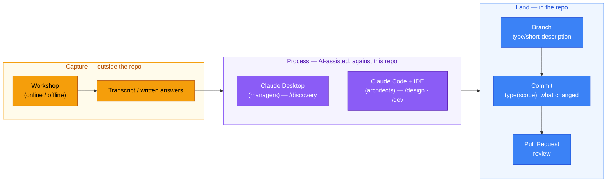

# Team Collaboration

_How the engagement team actually works in this repo — who touches what, with which tool, and how it lands. Not dev-environment setup (→ [Engineering Guide — Getting Started](/Engineering%20Guide/05%20Getting%20Started.md)) or commit-format mechanics (→ [Engineering Guide — Conventions](/Engineering%20Guide/01%20Conventions.md)) — those are covered once, there._

## Who uses what

| Role                                                             | Tool                 | Does                                                                                                                                                                                                        |
| ---------------------------------------------------------------- | -------------------- | ----------------------------------------------------------------------------------------------------------------------------------------------------------------------------------------------------------- |
| Architects doing repo work (docs, skills, agents, infra, design) | Claude Code + IDE    | Runs `/dev` and `/design` directly against this repo; owns the actual commits.                                                                                                                              |
| Managers running the engagement                                  | Claude Desktop       | Clones the repo and runs `/discovery` directly against it — see [09 Claude Desktop Setup](./09%20Claude%20Desktop%20Setup.md); owns their own branch/commit/PR, same guarded-command pattern as architects. |
| Whoever runs the workshop                                        | Any note-taking tool | Captures the transcript itself; the tool doesn't matter, only that it lands as `Transcript.md` for the workshop folder to process.                                                                          |

> [!WARNING] Populated During Bootstrap
> Confirm who is actually filling the architect and manager roles for the [[CLIENT_NAME]] engagement during `/bootstrap-client`, and replace this table with the real names/handles.

## Landing content in the repo

Whether it's a manager in Claude Desktop or an architect in Claude Code, both work directly against a cloned copy of this repo — the same rule applies before anything is published: it goes through [Workflows](./07%20Workflows/01%20Initiation.md)'s review → publish → wire-traceability pattern, not straight from draft to merged.

1. **Branch** — `<type>/short-description`, per [Engineering Guide — Conventions](/Engineering%20Guide/01%20Conventions.md).
2. **Commit** — `<type>(<scope>): <what changed>`, Conventional Commits. Scope is the AI SDLC section (`process`, `capture`, `problem-space`, `goals`, `solution-space`, `roadmap`) or the workshop ID (`ws1`, `ws2`, …).
3. **Pull Request** — opened against `main`; reviewed by `@discovery` (read-only evidence-chain check, see `.claude/skills/discovery/pattern-satellite-review.md`) for everything under `docs/AI SDLC/`, including `02 Capture/04 Workshops/WS N (…)` folders — see the agent table in `CLAUDE.md`. A PR that adds a workshop's Notes/Outcomes should also show the Changelog rows it triggered downstream (Current State, SDLC Domain, Solution Goals) — see [04 Evidence Chain](./04%20Evidence%20Chain.md).

Guarded commands (`git push`, `cdk deploy`, `yarn nx run infra:provision`) are never run directly — they're presented as instructions for the developer to run themselves, same as everywhere else in this repo.
