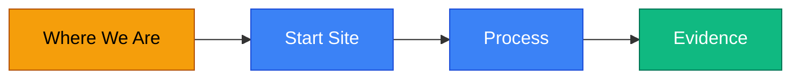
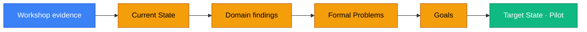

# Quick Walkthrough

_Four prompts for exploring the engagement with any harness-compatible AI assistant._



Use the prompts below in one conversation so the assistant can keep the site and browser context available.

## 1 — Where Are We?

> Where are we in the engagement?

The answer should come from [Where We Are — Engagement](../06%20Where%20We%20Are/01%20Engagement.md) and the active phase tracker, not from document count or assumptions.

## 2 — Start the Site

> Run the documentation site locally and open the preview.

The repository command is:

```bash
yarn nx run site:serve
```

Open the local URL it returns.

## 3 — Walk Through the Process

> Walk me through the engagement process on the site.

Follow:

1. [Process Overview](../01%20Overview.md)
2. [How the Engagement Runs](../03%20How%20the%20Engagement%20Runs.md)
3. [Evidence Chain](../04%20Evidence%20Chain.md)
4. [Where We Are — Engagement](../06%20Where%20We%20Are/01%20Engagement.md)

## 4 — Walk Through the Evidence

> Walk me through our evidence chain on the site. Show what we have and what is missing.

Follow:

| Evidence layer  | Page                                                                                                                                    |
| --------------- | --------------------------------------------------------------------------------------------------------------------------------------- |
| Workshops       | [Capture Overview](/AI%20SDLC/02%20Capture/00%20Overview.md)                                                                            |
| Current State   | [Process](/AI%20SDLC/02%20Capture/01%20Current%20State/Process.md)                                                                      |
| Domain findings | [Problem Space](/AI%20SDLC/03%20Problem%20Space/01%20Overview.md)                                                                       |
| Formal Problems | [Problems Registry](/AI%20SDLC/03%20Problem%20Space/02%20Diagnose/02%20Problems.md)                                                     |
| Goals           | [Strategic Intent](/AI%20SDLC/04%20Goals/02%20Strategic%20Intent.md) · [Solution Goals](/AI%20SDLC/04%20Goals/03%20Solution%20Goals.md) |
| Solution        | [Target State](/AI%20SDLC/05%20Solution%20Space/02%20Target%20State.md) · [Pilot](/AI%20SDLC/05%20Solution%20Space/03%20Pilot.md)       |

Read every warning, evidence tier, status, and open item. A populated-looking template is not necessarily confirmed engagement content.

Ask the assistant to derive the current chain from those pages each time. The shape should remain:



The assistant should report the evidence tier, status, and gaps it actually finds rather than treating this structural diagram as the engagement's current status.
