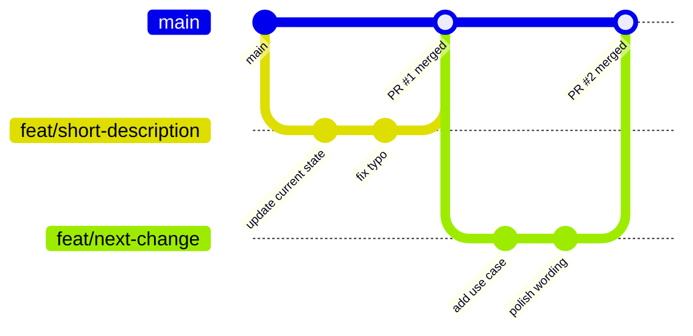

# Branching Policy

_Trunk-based development: `main` is always mergeable, all work happens on short-lived feature branches._

## Model

`main` is the trunk — always in a mergeable state, never worked on directly. Every change, big or small, gets its own short-lived feature branch that merges back via PR and is deleted afterward.

## Before starting new work

Always start from a fresh `main`, not wherever your last branch left off:

1. `git checkout main`
2. `git pull`
3. `git checkout -b <type>/short-description`

In Claude Desktop, just ask — "switch to main and pull" — Claude has `checkout-main` and `pull` as named launch configs (`.claude/launch.json`) it can run directly, no need to type git yourself.

## Rules

- One feature branch per PR — don't stack unrelated changes.
- Branch naming: `<type>/short-description`, same `type` as Conventional Commits (`feat`, `fix`, `docs`, `refactor`, `test`, `chore`) — see [Engineering Guide — Conventions](/Engineering%20Guide/01%20Conventions.md).
- Feature branches are short-lived — open the PR as soon as there's something reviewable, don't let it drift from `main`.
- Delete the branch after merge.

→ See [05 Team Collaboration](./05%20Team%20Collaboration.md) for how commit/push/PR actually lands in this repo, and [09 Claude Desktop Setup](./09%20Claude%20Desktop%20Setup.md) for the manager-facing flow.
