# [DRAFT] Gate 1 Steering Meeting Agenda — 25 August 2026

_Collinson × DataArt ADLC discovery — Gate 1's [Gate Review](/AI%20SDLC/01%20Process/07%20Workflows/02%20Gate%20Review.md) session, convened as the Steering Meeting. Not a working workshop like WS4/WS5 — a formal leadership-level recap plus alignment on what comes next._

**Audience:** Richard Reid (VP of Software Development), Marco Pera (CTO), and other Collinson C-level/management.

**Format:** A formal leadership-level kickoff of the ADLC initiative — recap vision → recap goals → recap problem understanding → where we go deeper.

**Source:** DataArt internal sync, 13 Aug 2026 (Olga, Anton Merkulov, Mariam Chaduneli) — where the overall shape was agreed. Below is the fleshed-out version.

**Duration:** Roughly 60 minutes (same time-boxing discipline as other ADLC sessions; compress block 3 first if needed).

**Pre-read:** A short, reworked version of the deck goes out in advance — Marco prefers to receive materials ahead of a meeting so he has time to review them. Built on James's previous (enriched) deck, shortened and simplified, keeping the same recognizable structure and format — not changing the presentation approach in this round.

---

## Session Flow

```mermaid
flowchart LR
    B0["0: Opening\n(5 min)"] --> B1["1: Recap Vision\n(10 min)"] --> B2["2: Recap Goals\n(10 min)"] --> B3["3: Recap Problem\nUnderstanding (15-20 min)"] --> B4["4: Where We Go\nFrom Here (10-15 min)"] --> B5["5: Ask of Collinson\n(5-10 min)"] --> B6["6: Questions &\nNext Steps (5-10 min)"]

    classDef opening fill:#1F2937,stroke:#111827,color:#fff
    classDef recap fill:#8B5CF6,stroke:#5B21B6,color:#fff
    classDef problem fill:#EF4444,stroke:#B91C1C,color:#fff
    classDef forward fill:#3B82F6,stroke:#1D4ED8,color:#fff
    classDef ask fill:#F59E0B,stroke:#B45309,color:#000
    classDef closing fill:#10B981,stroke:#047857,color:#fff

    class B0 opening
    class B1,B2 recap
    class B3 problem
    class B4 forward
    class B5 ask
    class B6 closing
```

---

## 0. Opening and Purpose of the Session (5 min)

- Why we're here: a formal, leadership-level launch of the initiative, now that both the engineering and product sides have been through a first round of diagnosis.
- What we need from this meeting: confirmation of the vision and goals, a shared understanding of where we are, and agreement on what we need from Collinson next (see block 5).
- Format: short, to the point, leaving room for questions.

## 1. Recap: Vision (10 min)

- Briefly restate the [ADLC vision](/AI%20SDLC/04%20Goals/02%20Strategic%20Intent.md) — the "perfect world" agentic SDLC: the [context layer and the process layer wired directly together](/The%20Story/05%20Target%20Agentic%20SDLC%20Setup.md), so the handover between stages (analysis → design → development) happens through automated context transfer rather than a manual person-to-person handover.
- Show the contrast: today's typical problem — [requirements drift, decisions lost in Slack/email, documentation going stale](/The%20Story/03%20Challenges.md#the-drift) — versus the target picture with an automated feedback loop between context and process.
- Name it explicitly: the vision is fresh and still needs to be validated in this room, not just presented.
- Check with the audience: does this match how Collinson itself sees the "perfect world" of delivery?

## 2. Recap: Engagement Goals (10 min)

Restate the 4 goals agreed at the start ([Solution Goals registry](/AI%20SDLC/04%20Goals/03%20Solution%20Goals.md)), plus the governance goal reserved pending WS4, and explicitly ask for confirmation on each:

1. AI-first SDLC culture — AI as a primary tool, not an add-on. ([SG-01](/AI%20SDLC/04%20Goals/03%20Solution%20Goals.md#sg-01-—-ai-first-sdlc-culture))
2. Eliminating delivery waste before a line of code is written. ([SG-02](/AI%20SDLC/04%20Goals/03%20Solution%20Goals.md#sg-02-—-eliminate-delivery-waste))
3. Changing outcomes, not just speed. ([SG-03](/AI%20SDLC/04%20Goals/03%20Solution%20Goals.md#sg-03-—-change-outcomes-not-just-speed))
4. AI-aware governance — reserved, not yet drafted: blocked on [P-06](/AI%20SDLC/03%20Problem%20Space/02%20Diagnose/02%20Problems.md#p-06-—-no-formal-data-governance-beyond-pci) moving further along, which needs [WS4's governance re-run](</AI%20SDLC/02%20Vision/WS%204%20(Design%20%26%20UX%20and%20Governance)%20-%20Date%20TBD/Agenda.md>) with Compliance/Security/Procurement present (see block 4). ([SG-04](/AI%20SDLC/04%20Goals/03%20Solution%20Goals.md#sg-04-—-ai-aware-governance-not-yet-drafted))
5. A grounded, evidence-backed pilot decision — not a registry row on the [Solution Goals](/AI%20SDLC/04%20Goals/03%20Solution%20Goals.md) page; this is Gate Review's "Align + prioritise" step and Solution's [Pilot](/AI%20SDLC/05%20Solution%20Space/03%20Pilot.md) flow, not a capability to build.

**Check question for the audience:** do these goals still match what matters to the business right now (given the new squads launching in September)?

## 3. Recap: How We Understand the Problem Today (15–20 min)

Don't dive into workshop-level detail — just the headline findings that already have evidence from both sides (engineering + product):

- Commits are up +119% (36→79/day over 8 months), lead time is unchanged (~2 weeks). Bolting AI onto one step (PR review) doesn't move throughput. ([P-01](/AI%20SDLC/03%20Problem%20Space/02%20Diagnose/02%20Problems.md#p-01-—-ai-mapped-onto-old-processes-not-redesigned-around-it))
- ~60–70% of a story's time is spent before coding starts — analysis, requirements, design, sign-offs, not the code itself. ([P-02](/AI%20SDLC/03%20Problem%20Space/02%20Diagnose/02%20Problems.md#p-02-—-domain-complexity-consumes-70–80-of-developer-time-before-code-is-written))
- ~£500K/year in AI spend, with no established link to business outcomes — on both the engineering and product sides ([Ben Stainer names this himself, unprompted, as a key pain point](/AI%20SDLC/02%20Vision/WS%202%20-%2004%20August%202026%20-%20%5BCollinson%20x%20DataArt%5D%20ADLC%20follow-up%20with%20Ben%20Stainer/Notes.md#outcomes-measurement-category-d)). ([P-05](/AI%20SDLC/03%20Problem%20Space/02%20Diagnose/02%20Problems.md) — [08 Measurement](/AI%20SDLC/03%20Problem%20Space/03%20SDLC%20Domains/08%20Measurement.md))
- Documentation and roadmaps drift independently on the engineering side (Confluence/Lucid) and the product side (Aha!/Confluence/Excel) — code remains the only "source of truth." ([04 Knowledge Base](/AI%20SDLC/03%20Problem%20Space/03%20SDLC%20Domains/04%20Knowledge%20Base.md), [Context Topology](/AI%20SDLC/02%20Vision/01%20Current%20State/Context%20Topology.md))
- AI governance is reactive: [no control over personal AI-account use, no block on data leakage into third-party tools](/AI%20SDLC/02%20Vision/WS%203%20-%2004%20August%202026%20-%20%5BCollinson%20x%20DataArt%5D%20ADLC%20follow-up%20with%20James%20Knights/Notes.md#the-open-gap) — this will be addressed head-on at the next working session (see block 4). ([P-06](/AI%20SDLC/03%20Problem%20Space/02%20Diagnose/02%20Problems.md) — [09 Governance](/AI%20SDLC/03%20Problem%20Space/03%20SDLC%20Domains/09%20Governance.md))
- State explicitly: this isn't the full list, just the most representative findings, cross-checked from both sides.

**Check question for the audience:** does leadership recognise this picture, and is there anything to correct or add?

## 4. Where We Go From Here (10–15 min)

- **[WS4 — Design & UX + Governance (re-run)](</AI%20SDLC/02%20Vision/WS%204%20(Design%20%26%20UX%20and%20Governance)%20-%20Date%20TBD/Agenda.md>).** [Design & UX](/AI%20SDLC/03%20Problem%20Space/03%20SDLC%20Domains/02%20Design%20%26%20UX.md) is the least-evidenced domain (deferred three times). [Governance](/AI%20SDLC/03%20Problem%20Space/03%20SDLC%20Domains/09%20Governance.md) already ran once at WS3, but without Compliance/Security/Procurement — the outcome is invalid until re-run with them present. **Explicit leadership support is needed** to guarantee these three functions attend — otherwise the session will need to be rescheduled again.
- **[WS5 — Product & Projects](</AI%20SDLC/02%20Vision/WS%205%20(Product%20%26%20Projects)%20-%20Date%20TBD/Agenda.md>).** The final session of the discovery programme: synthesising pilot candidates and choosing one across 5 dimensions (Impact, Confidence, Ease, Governance fit, Team AI-readiness).
- **Solution model:** [Pilot → Scale → Evolve](/AI%20SDLC/05%20Solution%20Space/01%20Overview.md) — a closed loop; start with one self-contained pilot, then scale what worked.
- **Milestones and timing:** only the Workshop 1 milestone (22 Jul 2026) is confirmed so far; the rest (measurement baseline, pilot selection, pilot go-live, retrospective) need an owner and a date — see [Milestones](/AI%20SDLC/06%20Roadmap/02%20Milestones.md) and DataArt's own [Execution Plan](/AI%20SDLC/01%20Process/06%20Where%20We%20Are/06%20Execution%20Plan.md) — propose locking these in at this meeting or right after WS5.
- Restate the hard deadline: [new squads launch in September](/AI%20SDLC/02%20Vision/WS%201%20-%2022%20July%202026/Outcomes.md#september-deadline-new-squads-need-an-ai-first-baseline) — the baseline needs to exist before they start.

## 5. What We Need From Collinson (Explicit Ask) (5–10 min)

- Confirm that Compliance, Security and Procurement will attend the [governance re-run at WS4](</AI%20SDLC/02%20Vision/WS%204%20(Design%20%26%20UX%20and%20Governance)%20-%20Date%20TBD/Agenda.md>) — without them, the session will need to be rescheduled again.
- Help identify the right contact(s) for assessing pilot-candidate [team AI-readiness](</AI%20SDLC/02%20Vision/WS%205%20(Product%20%26%20Projects)%20-%20Date%20TBD/Agenda.md>) — based on prior sessions, a function head doesn't always have visibility at the individual level; we need someone closer to the team.
- Confirm or adjust the shortlist of pilot candidates ahead of [WS5](</AI%20SDLC/02%20Vision/WS%205%20(Product%20%26%20Projects)%20-%20Date%20TBD/Agenda.md>) — see [Early Direction](/AI%20SDLC/05%20Solution%20Space/index.md#early-direction) for the working hypotheses so far.
- Agree a cadence for showing progress to leadership — DataArt's proposal, every 2 weeks, matching the [Execution Plan](/AI%20SDLC/01%20Process/06%20Where%20We%20Are/06%20Execution%20Plan.md)'s existing leadership-review cadence.

## 6. Questions and Next Steps (5–10 min)

- Open questions from the audience.
- Lock in agreements and owners for each item in block 5.
- Confirm the [WS4](</AI%20SDLC/02%20Vision/WS%204%20(Design%20%26%20UX%20and%20Governance)%20-%20Date%20TBD/Agenda.md>) date.

---

## Preparation Notes

- Mariam is preparing the deck and will sync with James Lever (back the day after the internal sync) before it goes to the client — 14 Aug 2026.
- Delivery format is PowerPoint, consistent with James's previous version; the question of moving to a repo/context-namespace as the primary format is deferred to a future round, so as not to switch approach mid-stream.
- Send the draft deck out in advance, given Marco's preference to review materials before the meeting.
