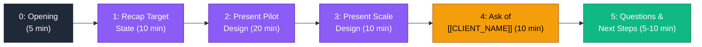

# [DRAFT] Gate 2 (Solution Approval) Agenda — Date TBD

_[[CLIENT_NAME]] × DataArt ADLC discovery — Gate 2's Solution Approval session (see [How the Engagement Runs](/AI%20SDLC/01%20Engagement/03%20Process/03%20How%20the%20Engagement%20Runs.md#the-four-gates)). Presents the designed Solution — Target State, Pilot, and Scale where the engagement runs one — for approval before Roadmap._

**Audience:** Whoever approves funding/staffing for the pilot — usually the same sponsor from Gate 0 and Gate 1.

**Format:** Recap Target State → present Pilot design → present Scale design (if run) → ask for approval.

**Duration:** Roughly 60 minutes.

**Pre-read:** Share the Pilot design's `/design` artifacts (Architecture, Design, Stack, Efforts) ahead of the session — this is an approval session, not where the design gets explained for the first time.

---

## Session Flow

_Drop block 3 (Scale) if this engagement isn't running a Scale design — see [How the Engagement Runs](/AI%20SDLC/01%20Engagement/03%20Process/03%20How%20the%20Engagement%20Runs.md), Scale only applies "where the engagement runs one"._

---

## 0. Opening and Purpose of the Session (5 min)

- Why we're here: the Solution is designed and reviewed — this session gets it approved before Roadmap sequencing starts.
- What we need from this meeting: sign-off on Target State direction, and a funded/staffed decision on the Pilot.

## 1. Recap: Target State (10 min)

- Restate the target-state design direction from [Target State](/AI%20SDLC/05%20Solution%20Space/02%20Target%20State/00%20Overview.md) — how it answers the Solution Goals confirmed at Gate 1.
- **Check question for the audience:** does this direction still match what was approved at Gate 1?

## 2. Present: Pilot Design (20 min)

- Recommended option and key trade-offs from the Pilot's `/design` artifacts — see [Pilot](/AI%20SDLC/05%20Solution%20Space/03%20Pilot/01%20Overview.md).
- Key Well-Architected Framework findings from the design's Review phase.
- **Check question for the audience:** any concerns before this becomes what gets built?

## 3. Present: Scale Design (10 min)

- High-level shape of how the Pilot's approach scales beyond the first pilot team — see [Scale](/AI%20SDLC/05%20Solution%20Space/04%20Scale.md).
- **Check question for the audience:** does the scale path look credible given what's known about the wider organisation?

## 4. What We Need From [[CLIENT_NAME]] (Explicit Ask) (10 min)

- Formal approval of the Pilot design to proceed.
- Confirmed funding/staffing for the pilot team.
- [Any other concrete asks]

## 5. Questions and Next Steps (5–10 min)

- Open questions from the audience.
- Lock in agreements and owners for each item in block 4.
- Confirm the Roadmap kickoff date.

---

## Preparation Notes

- [Who's preparing materials, and by when]
- [Delivery format — deck / PDF / live walkthrough]
- **Deck:** [Path under `decks/<deck-name>/` once generated via `deck-design-corporate`, or "not requested for this session"]
