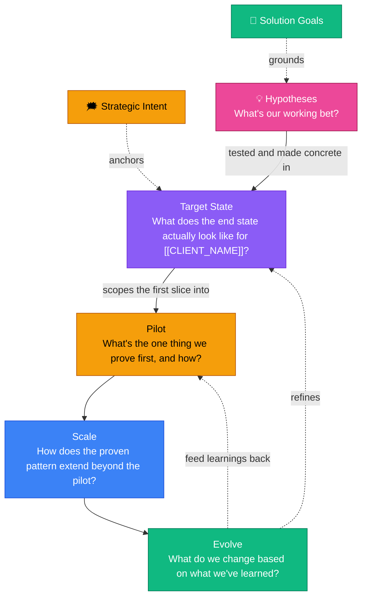

# Overview

> [!NOTE] Static Page
> This page describes the solution's four-stage shape and does not change during the engagement. Each stage page below holds draft ideas — provisional, not commitments — updated as [Problem Space](/AI%20SDLC/03%20Problem%20Space/) findings mature.

This is about the solution itself — what gets built and rolled out for [[CLIENT_NAME]], not the process for reaching it or the engagement's own logistics.

> Think Big, Start Small, Scale Fast.

- **Think Big** — identify long-term, transformative future trends, disruptions, and ambitious visions. Do not restrict the imagination. Made concrete in [Target State](./02%20Target%20State/00%20Overview.md) once there's evidence to ground it in — not restricted at the ideas stage.
- **Start Small** — break the massive vision down into bite-sized, low-risk, experimental projects to gather real data and test assumptions. This is [Pilot](./03%20Pilot/01%20Overview.md).
- **Scale Fast** — once a small prototype proves its value, aggressively pour resources into it to expand into full-fledged, widespread operations. This is [Scale](./04%20Scale.md).

This engagement pivots the mantra into a closed loop, not a one-shot sequence: Think Big becomes Target State — grounded in Strategic Intent and Solution Goals, not just imagination — Start Small becomes Pilot, the one slice of Target State proven first, Scale Fast becomes Scale — and [Evolve](./05%20Evolve.md) closes the loop, feeding what's learned back into Pilot and refining Target State itself. [Hypotheses](./01%20Hypotheses.md) sits between Solution Goals and Target State — a short, falsifiable guess at the shape of the answer, one per Goal, before Target State works out the detail.

| Stage        | Purpose                                                                                                                                                                                                                                                                                                               | Deliverables                                                                                        | Page                                                   |
| ------------ | --------------------------------------------------------------------------------------------------------------------------------------------------------------------------------------------------------------------------------------------------------------------------------------------------------------------- | --------------------------------------------------------------------------------------------------- | ------------------------------------------------------ |
| Hypotheses   | A short, falsifiable bet on how to solve each Solution Goal — pilot vs. target scope, wired to [[CLIENT_NAME]]'s existing ecosystem — before Target State commits to detail                                                                                                                                           | One hypothesis per Solution Goal, pilot (1 squad) and target (department/org) scope stated          | [Hypotheses](./01%20Hypotheses.md)                     |
| Target State | Ground the "Think Big" ambition in [[CLIENT_NAME]]'s actual Current State, Problems, [Strategic Intent](/AI%20SDLC/04%20Goals/02%20Strategic%20Intent.md), and [Solution Goals](/AI%20SDLC/04%20Goals/03%20Solution%20Goals.md) — what full adoption looks like here, concretely, and which slice of it becomes Pilot | Target Phase × Context Matrix for [[CLIENT_NAME]]; gap to Current State stated                      | [Target State](./02%20Target%20State/00%20Overview.md) |
| Pilot        | Prove the one slice of Target State chosen first: define the pilot workload, stand up an AI-assisted process and toolset, scope a knowledge base to it (phased), and educate the team on how to work with it                                                                                                          | Workload defined; AI-assisted process & toolset live; scoped knowledge base; team educated          | [Pilot](./03%20Pilot/01%20Overview.md)                 |
| Scale        | Extend the workload to the wider product context, wire governance control from product down to project, widen the knowledge base, and educate and control access as the group grows                                                                                                                                   | Workload at product scope; governance wired; wider knowledge base; team educated; access controlled | [Scale](./04%20Scale.md)                               |
| Evolve       | Gather metrics, analyse them, build dashboards and reporting, identify problems, and reiterate the solution                                                                                                                                                                                                           | Metrics gathered; dashboards & reporting live; problems identified; solution reiterated             | [Evolve](./05%20Evolve.md)                             |

Each stage page is grounded in current [Problem Space](/AI%20SDLC/03%20Problem%20Space/) findings and linked back to the specific evidence behind each idea. Pilot, Scale, and Evolve should each be checkable against [Target State](./02%20Target%20State/00%20Overview.md) — does this move [[CLIENT_NAME]] toward that picture, not just away from Current State without a clear destination.

Once a stage's scope and timing are agreed, they feed the [Roadmap](/AI%20SDLC/06%20Roadmap/) — the settled shape this solution converges on.
