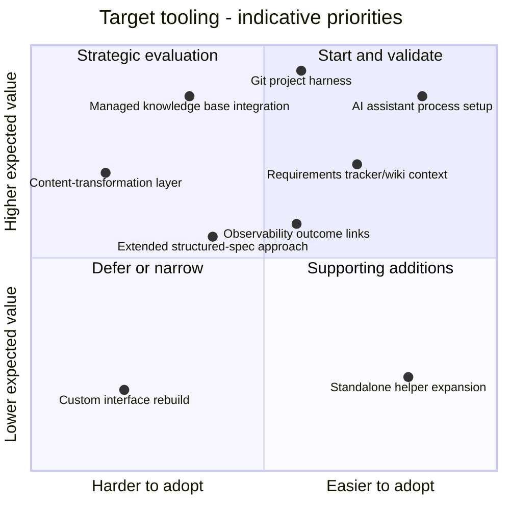

🚧 **DRAFT** — not final, subject to change

# Hypotheses

> What's our working bet on how to actually solve this, before [Target State](./02%20Target%20State/00%20Overview.md) makes it concrete and [Pilot](./03%20Pilot/01%20Overview.md) commits to one slice?

This page is the bridge between [Solution Goals](/AI%20SDLC/04%20Goals/03%20Solution%20Goals.md) and Target State — a short, falsifiable guess at the shape of the answer, grounded in what [Problem Space](/AI%20SDLC/03%20Problem%20Space/) found, before the five Target State stages (Ideation, Explore, Discovery, Design, Delivery) describe the wider operating model. Each hypothesis is provisional: Target State can contradict it once evidence says so.

> [!IMPORTANT] One Ecosystem, Not a Parallel One
> Every hypothesis below wires into tools [[CLIENT_NAME]] already runs — [its requirements, planning, and comms stack, e.g. Confluence, Jira, Teams/Outlook, GitHub] — rather than standing up a second stack alongside them. This is the same discipline [Solution Goals](/AI%20SDLC/04%20Goals/03%20Solution%20Goals.md) already applies to the Inhouse Initiative: extend, don't duplicate.

Five sections, mapped onto whichever [Central Symptom](/AI%20SDLC/03%20Problem%20Space/02%20Diagnose/01%20Where%20Gaps%20Sit.md#central-symptom) clusters Problem Space has diagnosed: sections 1 and 2 (Analysis & Design, Development) typically address a process / hand-offs cluster; section 3 a knowledge-base cluster; section 4 a metrics / visibility cluster; section 5 picks out whichever intent-to-outcome check needs its own pilot slice. Each has one table, Pilot and Target side by side, built on the same rows: **Size**, **Tools**, **Context** (what the tools are wired to), **Process** where one is part of the bet, then **Hypothesis** and **How it works**. The pilot keeps WHAT and WHY in [[CLIENT_NAME]]'s existing requirements/planning records, and project-level HOW in the Git repo. Connectors bring upstream knowledge into the engineering harness, whose instructions require it to respect that context. The Target column's shared access and transformation approach remains open — [a content-transformation layer, a managed knowledge-base/RAG service, or a structured-spec approach in the Git repo] — while preserving the authority of the underlying records. Tool names are the working hypothesis, not a procurement decision — Target State's [technology direction](./02%20Target%20State/00%20Overview.md#technology-direction) frames the choices to evaluate against Current State.

---

## 1 — Analysis & Design

_Requirements, refinement, technical planning — where a hand-off first picks up or drops context._

| Field            | Pilot                                                                                                                                                                                                                                    | Target                                                                                                                                                                                                                                                                                      |
| ---------------- | ---------------------------------------------------------------------------------------------------------------------------------------------------------------------------------------------------------------------------------------- | ------------------------------------------------------------------------------------------------------------------------------------------------------------------------------------------------------------------------------------------------------------------------------------------- |
| **Size**         | 1 squad                                                                                                                                                                                                                                  | Department / organisation                                                                                                                                                                                                                                                                   |
| **Tools**        | [An AI chat/desktop assistant] with shared process instructions                                                                                                                                                                          | Knowledge layer: [a content-transformation layer, a managed knowledge base, or a structured-spec repo approach] — open · the same assistant interface as the proposed analysis interface                                                                                                    |
| **Context**      | [Requirements-tracker/wiki] WHAT and WHY; linked roadmap-tool and approved request/meeting context. Direct comms-tool access is conditional on policy and permissions                                                                    | Context topology — structured and governed (RBAC)                                                                                                                                                                                                                                           |
| **Process**      | Shared instructions per process, configured around the squad's existing practices and available interfaces                                                                                                                               | Adopted and shared processes, org-wide                                                                                                                                                                                                                                                      |
| **Hypothesis**   | Focused process assistance, grounded in the squad's existing tools and reviewed source records, reduces repeated context gathering and hand-off gaps.                                                                                    | A shared, governed knowledge layer plus org-adopted processes let any squad's analysis and design work draw from one source, instead of each squad inventing its own.                                                                                                                       |
| **How it works** | Assistants read source context through connectors and prepare reviewed requirements, acceptance criteria and decisions in the requirements tracker and wiki. These upstream records remain authoritative when engineering consumes them. | Authoritative records are reached through a shared knowledge interface — with transformation, indexing, or structured specifications as candidate approaches; context topology is structured and scoped by RBAC rather than one open pool; process templates apply org-wide, not per squad. |

**Grounds on:** [the Solution Goal ID(s) this hand-off work traces to] — [the Problem ID(s) it addresses, e.g. hand-off information loss, missing process standards]

---

## 2 — Development (Engineering)

_Where code actually gets written — often the one stage already evidenced as faster, not slower._

| Field            | Pilot                                                                                                                                                                                                                                           | Target                                                                                                                                                                               |
| ---------------- | ----------------------------------------------------------------------------------------------------------------------------------------------------------------------------------------------------------------------------------------------- | ------------------------------------------------------------------------------------------------------------------------------------------------------------------------------------ |
| **Size**         | 1 squad                                                                                                                                                                                                                                         | Department / organisation                                                                                                                                                            |
| **Tools**        | [An AI coding CLI] · [a harness that wires and manages project context]                                                                                                                                                                         | Same AI coding CLI · same harness                                                                                                                                                    |
| **Context**      | Upstream WHAT and WHY from the requirements tracker/wiki through connectors · project-level HOW in the Git repo                                                                                                                                 | Architecture-review context · product context · estate context                                                                                                                       |
| **Hypothesis**   | A harness that reads and respects upstream requirements and decisions alongside project documentation keeps AI-assisted engineering aligned with the agreed WHAT and WHY.                                                                       | Connecting the same harness to architecture-review, product, and estate context lets any squad's engineering work self-check against organisation-level decisions, not just its own. |
| **How it works** | Connectors inject the relevant upstream context into Design and Dev. The harness records source references, checks the proposed HOW against upstream intent, and maintains project knowledge in Git. Conflicts return to the responsible owner. | The harness and CLI tooling don't change — only what the harness is wired to widens, from squad-local context to org-wide context.                                                   |

**Grounds on:** [the Solution Goal ID this redesign-around-AI bet traces to] — [the Problem ID it addresses, e.g. AI mapped onto old processes rather than redesigned around it]; Target's "architecture-review context" is [Technical Context](/AI%20SDLC/05%20Solution%20Space/02%20Target%20State/00%20Overview.md#context-and-knowledge-authority), also [the Problem ID for intent drift, if diagnosed]

**Made concrete in:** [Pilot — Development (Engineering)](./03%20Pilot/03%20Development%20%28Engineering%29/00%20Overview.md) names the harness this row's "harness that wires and manages project context" bet resolves to — the same Plan → Implement → Test → Document harness already running in this engagement's own repo, not a new build.

---

## 3 — Knowledge Base

_The source-of-truth problem — a wiki stale by design, code as the only thing anyone trusts._

| Field            | Pilot                                                                                                                                                                                                                                                       | Target                                                                                                                                                                                      |
| ---------------- | ----------------------------------------------------------------------------------------------------------------------------------------------------------------------------------------------------------------------------------------------------------- | ------------------------------------------------------------------------------------------------------------------------------------------------------------------------------------------- |
| **Size**         | 1 squad                                                                                                                                                                                                                                                     | Department / organisation                                                                                                                                                                   |
| **Tools**        | Existing requirements tracker and wiki for WHAT/WHY · project Git repo for HOW · connectors and harness                                                                                                                                                     | Knowledge layer: [a content-transformation layer, a managed knowledge base, or a structured-spec repo approach] — open · + interface                                                        |
| **Context**      | Linked upstream intent and project-level engineering knowledge, each with an authoritative home                                                                                                                                                             | Wiring with integration context                                                                                                                                                             |
| **Process**      | Analysis maintains WHAT/WHY in the requirements tracker and wiki; engineering consumes it and maintains HOW in Git as work progresses                                                                                                                       | —                                                                                                                                                                                           |
| **Hypothesis**   | Keeping WHAT/WHY in existing analysis tools and HOW beside the code, linked through connectors and harness instructions, makes knowledge usable and maintainable across the hand-off.                                                                       | The same structure, extended organisation-wide, keeps knowledge joined to the live architecture and contracts, not just to text.                                                            |
| **How it works** | Analysis records reviewed intent in the requirements tracker and wiki. The harness loads that upstream context, links it to project design and implementation records in Git, and requires owner review when engineering findings imply a change to intent. | Existing content is transformed, indexed, or the Git/structured-spec model is extended org-wide; whichever carries it is wired into the integration context (contracts, consumer registry). |

**Grounds on:** [the Solution Goal ID for shared current context] — [the Problem ID it addresses, e.g. no shared context, knowledge inconsistent and outdated]

---

## 4 — Metrics

_The engagement sponsor's own acceptance test at Gate 1: prove outcomes changed, not just that one step got faster._

| Field            | Pilot                                                                                                                                                                                                                                                                                                                                                                                              | Target                                                                                                                                                           |
| ---------------- | -------------------------------------------------------------------------------------------------------------------------------------------------------------------------------------------------------------------------------------------------------------------------------------------------------------------------------------------------------------------------------------------------- | ---------------------------------------------------------------------------------------------------------------------------------------------------------------- |
| **Size**         | 1 squad                                                                                                                                                                                                                                                                                                                                                                                            | Department / organisation                                                                                                                                        |
| **Scope**        | Engineering phase only                                                                                                                                                                                                                                                                                                                                                                             | End-to-end: idea → delivery                                                                                                                                      |
| **Tools**        | [An observability/dashboard platform]                                                                                                                                                                                                                                                                                                                                                              | Department / organisation-level dashboards, same approach as Pilot                                                                                               |
| **Source**       | Requirements tracker · Git host (PRs, builds, etc.) · harness productivity metrics · AI cost/usage records                                                                                                                                                                                                                                                                                         | Same source types as Pilot, extended to cover every stage from idea intake through delivery, not engineering alone                                               |
| **Derived**      | Delivery: lead time (one agreed definition, against whatever bar leadership has set) · time to fix bug · team productivity · velocity Leadership-named self-monitoring KPIs (if set at a gate), e.g. requirements-to-code traceability % · automation-test coverage % · security-requirement compliance % Cost: cost per feature (token spend per feature against stated AI spend, if known) | Same set as Pilot, computed end-to-end instead of engineering-phase-only                                                                                         |
| **Hypothesis**   | Instrumenting the engineering phase alone is enough to show whether the pilot changed outcomes, not just made one step faster.                                                                                                                                                                                                                                                                     | Extending scope end-to-end — idea through delivery, not engineering alone — is needed to prove outcomes changed across the whole lifecycle, not one stage of it. |
| **How it works** | The observability platform ingests the Source data and derives it into the values above; scoped to one squad's engineering phase, not the full lifecycle yet.                                                                                                                                                                                                                                      | Same dashboard approach as Pilot, widened to department/org-level and to data sources covering idea intake through delivery, not only engineering.               |

**Grounds on:** [the Solution Goal ID for measuring delivery below the epic] — [the Problem ID for no metrics baseline below epic completion]. The Derived row should carry every leader-named measure on record — a lead-time bar from Strategic Intent, any self-monitoring KPIs named at a gate (proposed, not built — see [Metrics (Current State)](/AI%20SDLC/02%20Capture/01%20Current%20State/Metrics.md#key-numbers-captured)), and a cost-per-feature proxy if Solution Goals adopted one. Traceability and compliance need the harness's requirement-to-PR links, not the tracker/Git host alone — a wiring question for [Target State](./02%20Target%20State/00%20Overview.md)

---

## 5 — Governance

_Intent-to-outcome governance — does what shipped still match what was decided — not AI data governance (see Not Yet Covered Here)._

| Field            | Pilot                                                                                                                                                                                                                                                                                                   | Target                                                                                                                                                                                 |
| ---------------- | ------------------------------------------------------------------------------------------------------------------------------------------------------------------------------------------------------------------------------------------------------------------------------------------------------- | -------------------------------------------------------------------------------------------------------------------------------------------------------------------------------------- |
| **Size**         | 1 squad                                                                                                                                                                                                                                                                                                 | Department / organisation                                                                                                                                                              |
| **Tools**        | Requirements tracker · wiki · project Git repo · connectors · harness                                                                                                                                                                                                                                   | Same knowledge layer as sections 1 and 3: [a content-transformation layer, a managed knowledge base, or a structured-spec repo approach] — open                                        |
| **Context**      | Authoritative upstream WHAT/WHY injected into the harness alongside project HOW                                                                                                                                                                                                                         | Project · integration · operational · architecture-review / compliance · product · estate context                                                                                      |
| **Govern level** | Analysis → development hand-off, with alignment checks during engineering                                                                                                                                                                                                                               | Idea → delivery (the full lifecycle)                                                                                                                                                   |
| **Hypothesis**   | A harness instructed to respect connected upstream knowledge can expose intent drift at the hand-off and during engineering, before the change reaches UAT or production.                                                                                                                               | Extending governed context across every layer, idea through delivery, lets intent be traced through every hand-off in the lifecycle, not just the one hand-off the pilot instrumented. |
| **How it works** | Connectors supply the relevant upstream records; harness skills use them as constraints for design, implementation and verification. Source links and review evidence make deviations visible; owners approve changes to WHAT/WHY in the requirements tracker/wiki before the dependent HOW is revised. | Whichever option carries the knowledge layer, it spans all six layers above, so governance applies at every hand-off along idea → delivery, not only analysis → development.           |

**Grounds on:** [the Solution Goal ID for decision traceability] — [the Problem ID for intent drift]. Target's context layers echo [Target State — Context](/AI%20SDLC/05%20Solution%20Space/02%20Target%20State/00%20Overview.md#context-and-knowledge-authority)'s five context layers (Project, Integration, Operational, Technical/architecture-review, Business) plus estate as the cross-squad extension of it.

---

## Target tooling options — value versus ease

This is a **provisional prioritisation hypothesis**, using expected contribution to shared context, preserved intent and measurable outcomes against expected ease of adoption. Positions are illustrative judgements, not measured scores, estimates or procurement decisions. The AI chat/desktop assistant is the proposed analysis interface; the knowledge-layer options below still require comparison.

| Option                                            | Why it sits here                                                                                                                                | What could change the priority                                                                                       |
| ------------------------------------------------- | ----------------------------------------------------------------------------------------------------------------------------------------------- | -------------------------------------------------------------------------------------------------------------------- |
| **AI assistant process setup**                    | Directly supports reviewed requirements, readiness and refinement with shared instructions. Narrow scope makes it a candidate early step.       | Licence or approved-context access gaps could make adoption harder.                                                  |
| **Requirements tracker/wiki context connections** | Supplies authoritative WHAT/WHY to analysis and engineering, addressing hand-off loss. Existing connector experience provides a starting point. | Selected-interface permissions, content quality and connector behaviour need verification.                           |
| **Git project harness**                           | Provides engineering HOW and applies upstream context through Design and Dev. Existing harness patterns offer a starting point.                 | Repository onboarding effort and documentation maturity may change the scope.                                        |
| **Observability outcome links**                   | Connects existing source evidence to decisions about engineering outcomes and AI cost.                                                          | Missing requirement links, inconsistent event definitions or unattributed usage may require substantial preparation. |
| **Managed knowledge base integration**            | Candidate for wider retrieval across governed source records, building on the existing platform direction.                                      | Ingestion readiness, access controls and retrieval quality must be demonstrated for the relevant content.            |
| **Content-transformation layer**                  | Candidate for structuring fragmented content at scale. Potential value depends on improving the knowledge used in real work.                    | Scope, integration effort and output quality remain unvalidated.                                                     |
| **Extended structured-spec approach**             | Candidate for wider structured engineering specifications and links to upstream sources.                                                        | Must preserve requirements tracker/wiki authority for WHAT/WHY and justify additional maintenance effort.            |
| **Standalone helper expansion**                   | Easy-to-scope conveniences may support individual tasks but have a weaker direct case for fixing the hand-off.                                  | A selected squad may demonstrate a material bottleneck that raises their value.                                      |
| **Custom interface rebuild**                      | Additional interface work has limited initial justification given the proposed assistant route.                                                 | A demonstrated workflow or access requirement that existing interfaces cannot meet could change this assessment.     |

The three knowledge-layer candidates are alternatives to evaluate against the same workload, access and quality criteria. Their inclusion does not propose deploying all three. Validate the early candidates through the [pilot](./03%20Pilot/01%20Overview.md), then refine this matrix using observed integration effort, context quality and engineering outcomes.

---

## Not Yet Covered Here

[The Solution Goal ID for AI data governance, if one exists] deliberately has no hypothesis above — it's a different "governance" from section 5's intent-to-outcome check, and it's reserved, gated on [the Problem ID for reactive/unowned AI data governance, if diagnosed] still being verified. RBAC and governed context topology are named as a Target-row property in section 1 because they're a precondition for scaling past one squad, not because the governance Problem itself is confirmed yet.

---

## Changelog

| Date   | Change                                                                                                                                                                                                                                                                                                                                                                                                                          | Evidence                                                                                                                                                                                                                                                                                                                                                                                                       |
| ------ | ------------------------------------------------------------------------------------------------------------------------------------------------------------------------------------------------------------------------------------------------------------------------------------------------------------------------------------------------------------------------------------------------------------------------------- | -------------------------------------------------------------------------------------------------------------------------------------------------------------------------------------------------------------------------------------------------------------------------------------------------------------------------------------------------------------------------------------------------------------- |
| [DATE] | Page drafted from the engagement lead's working hypotheses — five sections mapped onto the Central Symptom clusters (governance split out separately where needed), each with one table — Pilot (1 squad) and Target (department / organisation) side by side — on the same rows (Size, Tools, Context, Process / Scope, Hypothesis, How it works), wired to [[CLIENT_NAME]]'s existing ecosystem rather than a parallel stack. | [Solution Goals](/AI%20SDLC/04%20Goals/03%20Solution%20Goals.md) · [Where Gaps Sit — Central Symptom](/AI%20SDLC/03%20Problem%20Space/02%20Diagnose/01%20Where%20Gaps%20Sit.md#central-symptom) · [Problems](/AI%20SDLC/03%20Problem%20Space/02%20Diagnose/02%20Problems.md) · [Target State — Context](/AI%20SDLC/05%20Solution%20Space/02%20Target%20State/00%20Overview.md#context-and-knowledge-authority) |
| [DATE] | Added a "Made concrete in" pointer from section 2 to the new [Pilot — Development (Engineering)](./03%20Pilot/03%20Development%20%28Engineering%29/00%20Overview.md) page, which describes the harness section 2's "harness that wires and manages project context" bet resolves to — this engagement's own repo harness, already running, not a new build. No change to the hypothesis itself.                                 | [Pilot — Development (Engineering)](./03%20Pilot/03%20Development%20%28Engineering%29/00%20Overview.md)                                                                                                                                                                                                                                                                                                        |
| [DATE] | Revised the pilot knowledge model following engagement-lead clarification: the requirements tracker/wiki retain WHAT and WHY; the project Git repo holds HOW. Aligned Analysis, Development and Governance around connector-supplied upstream context and harness-enforced review of deviations. Target tooling remains provisional.                                                                                            | Engagement-lead direction; [Knowledge Base](./03%20Pilot/04%20Knowledge%20Base/Overview.md) · [Governance](./03%20Pilot/06%20Governance/Overview.md)                                                                                                                                                                                                                                                           |
