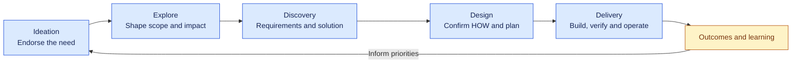

🚧 **DRAFT** — proposed target, subject to validation

# Target State

The target is an **AI-assisted product lifecycle in which every stage consumes the right context and leaves a reviewed record the next stage can use**. People own priorities, decisions and approvals; assistants carry context, prepare artifacts and check alignment throughout the work.

This applies the harness's own target agentic SDLC setup to [[CLIENT_NAME]]'s product funnel: **Ideation → Explore → Discovery → Design → Delivery**. It describes the organisation-wide ambition; the [Pilot](../03%20Pilot/01%20Overview.md) tests a bounded part of it with one squad.

## Overall process vision

**Across every stage:** governed source context → instructed AI assistance → human-reviewed outputs → evidence for the next decision. Quarterly prioritisation reviews work across the funnel. Individual changes take the stages appropriate to their scope and architectural significance.

[An AI chat/desktop assistant] supports analysis and collaborative preparation. The engineering harness applies Design and Dev skills to project work. The requirements tracker and wiki carry WHAT/WHY, Git carries project HOW, and derived metrics inform improvements.

## Context across the lifecycle

The image shows the context layers across engineering activities. The five product stages below organise the wider journey around those activities, from the first request through a running solution and measured outcomes. The stage names and gate intent follow the product-funnel reference supplied for this target; AI assistance and knowledge responsibilities are the proposed extension.

## The five stages

| Stage                                   | Intent                                                                                    | Reviewed output for the next stage                                                                              |
| --------------------------------------- | ----------------------------------------------------------------------------------------- | --------------------------------------------------------------------------------------------------------------- |
| [**01 Ideation**](./01%20Ideation.md)   | Capture a one-line idea, establish WHY it matters and identify owners.                    | Endorsed, prioritised idea with its source and Product, Tech and Delivery ownership.                            |
| [**02 Explore**](./02%20Explore.md)     | Shape the idea, gather initial requirements, explore UI where relevant and assess impact. | Draft Concept Card, initial scope and roadmap disposition.                                                      |
| [**03 Discovery**](./03%20Discovery.md) | Elicit requirements and identify the solution, dependencies and risks.                    | Product Requirements Document (PRD), high-level end-to-end plan and solution design, updated Concept Card.      |
| [**04 Design**](./04%20Design.md)       | Confirm the solution and sequence implementation against capacity and capability.         | Updated PRD, detailed plan, low-level solution design, testing outline and required approvals.                  |
| [**05 Delivery**](./05%20Delivery.md)   | Build, verify and operate the solution while monitoring outcomes.                         | Working changes, maintained project knowledge, test evidence and measured results informing the next decisions. |

Explore and Discovery use **unconfirmed target dates**. Design and Delivery work with **committed dates**, established through the planning and approval decisions. Each transition has explicit readiness evidence and ownership; a stage may return to an earlier one when evidence changes the proposed direction.

## Context and knowledge authority

| Context layer                  | Authority and use across the lifecycle                                                                                                                                                                  |
| ------------------------------ | ------------------------------------------------------------------------------------------------------------------------------------------------------------------------------------------------------- |
| **Business**                   | Organisation-owned strategy, priorities and product outcomes guide idea selection and requirements. [[[CLIENT_NAME]]'s roadmap tool] provides roadmap context where applicable.                         |
| **Technical / ARB**            | Organisation-owned principles, standards and approved architecture decisions constrain solution choices and implementation. Project findings go through the relevant review process to propose changes. |
| **Operational — WHAT and WHY** | Existing requirements-tracker and wiki records retain requirements, purpose, acceptance criteria and approved scope changes. Analysis creates them; later stages refine them through owner review.      |
| **Integration**                | Contracts, shared schemas and consumer relationships inform impact analysis, design and verification. The target includes a discoverable consumer view alongside existing contract sources.             |
| **Project — HOW**              | The project Git repo retains architecture, technical design, implementation documentation and engineering instructions alongside code. Engineering maintains this knowledge as the system changes.      |

Connectors make the relevant sources available; harness instructions require assistants to respect their authority. Record source links and currency, surface conflicts, and route proposed changes to WHAT/WHY back to their owners. Reviewed HOW must remain traceable to the intent and constraints it implements.

## Governance and measurement across stages

Human gates review the required outputs before they become trusted inputs. AI prepares requirements and options, detects missing context and contradictions, checks implementation against approved design, and proposes documentation updates. Its recommendations remain subject to the relevant owner and approver.

Capture stage transitions, decisions, requirement links, verification results and attributable AI usage as part of the work. Derived measures should span idea → delivery at target scale: elapsed and waiting time, accepted work, quality, traceability and cost. Use them to decide where to remove friction, improve instructions, revisit scope or extend adoption. The pilot initially measures engineering scope only.

## Technology direction

Reuse the existing ecosystem and connect it to structured context. The requirements tracker/wiki and project Git retain their knowledge responsibilities. [An AI chat/desktop assistant] is the proposed analysis interface. Engineering uses the harness with its coding tools. Model access and knowledge-layer integration remain design choices; candidates in [Hypotheses](../01%20Hypotheses.md) require evaluation against the [Tool Inventory](/AI%20SDLC/02%20Capture/01%20Current%20State/Tool%20Inventory.md).

Organisation-wide model routing, budget attribution, access controls and data classification need named owners and validated designs. Knowledge transformation or indexing must preserve source authority. Mobile environment limitations, environment reliability and the timing of process changes alongside squad reorganisation remain constraints to resolve when specifying the relevant work.

## Grounding and path to adoption

The target responds to [Solution Goals](/AI%20SDLC/04%20Goals/03%20Solution%20Goals.md) — [the relevant Solution Goal IDs once drafted]: redesign work around AI, preserve hand-offs, maintain shared context, and measure outcomes. Broader AI data governance remains a separate topic requiring validation with its owners.

[Pilot](../03%20Pilot/01%20Overview.md) proves one connected workflow; [Scale](../04%20Scale.md) extends what works across teams and context layers; [Evolve](../05%20Evolve.md) feeds learning back into the model. These pages express direction and stage responsibilities. Detailed tools, connectors, approval mechanics and deployment designs require their own specifications.
