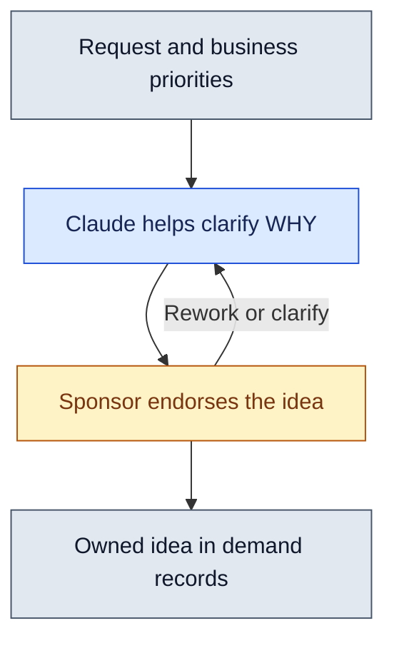

🚧 **DRAFT** — proposed target, subject to validation

# Ideation

**Endorse the idea.** A one-line message in Slack can start the journey: capture the request, establish its purpose, then carry it through requirements gathering and design. Preserve the original message as evidence while the idea becomes a managed record. Slack is an example intake channel; the same pattern applies to Teams, email or the existing demand portal.

## Entry and exit

| Gate                | Expected evidence                                                                                                                                                                                     |
| ------------------- | ----------------------------------------------------------------------------------------------------------------------------------------------------------------------------------------------------- |
| **Entry**           | An idea is captured in the demand process and prioritised within the requesting function.                                                                                                             |
| **Exit / hand-off** | An endorsed, prioritised idea with its source, business purpose and agreed Product, Tech and Delivery owners. The sponsor decides whether it proceeds to Explore, needs clarification or is deferred. |

## Context consumed

| Context                | What this stage needs                                                                      |
| ---------------------- | ------------------------------------------------------------------------------------------ |
| **Business context**   | Strategy, desired outcomes, sponsor priorities and related roadmap items.                  |
| **Source request**     | The original message, requester and any supporting evidence.                               |
| **Existing knowledge** | Related initiatives and earlier decisions that may explain duplication or prior rejection. |

## Work and AI assistance

| Activity                  | Proposed assistance                                                                                        |
| ------------------------- | ---------------------------------------------------------------------------------------------------------- |
| **Capture**               | Turn the brief request into a draft problem, intended outcome and questions, keeping assumptions explicit. |
| **Review alignment**      | Help the sponsor assess strategic relevance and find related demand.                                       |
| **Assign responsibility** | Identify the proposed Product, Tech and Delivery owners and capture their confirmation.                    |

People review the outputs and own the stage decision. AI drafts and checks using the relevant sources, with assumptions and unresolved questions visible.

## Knowledge contributed

Keep the idea in the existing demand/roadmap process and link it to subsequent Jira/Confluence records. Initial WHAT/WHY may be incomplete; questions remain visible until the responsible owner resolves them.

## Decisions supported

Priority, sponsorship and whether to proceed. Record the reason for endorsement, deferral or rejection so future proposals can reuse that knowledge.

**Grounding:** [Solution Goals](/AI%20SDLC/04%20Goals/03%20Solution%20Goals.md) — [the relevant Solution Goal IDs]: retain intent and decision history from the first hand-off.

[Target State overview](./00%20Overview.md) · Next: [Explore](./02%20Explore.md)
