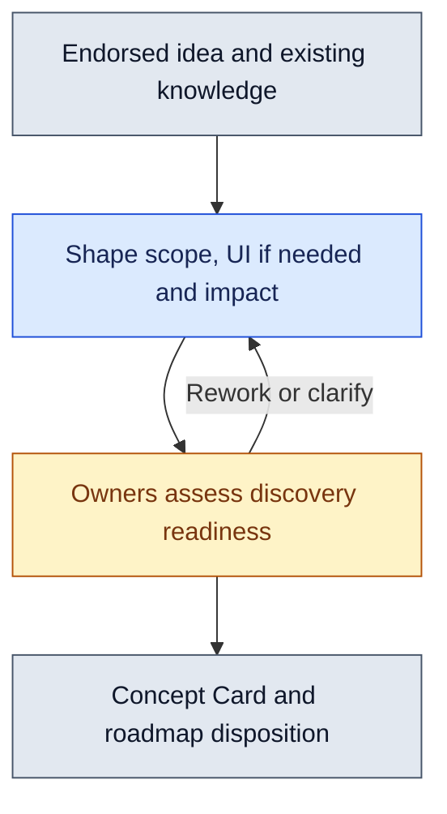

🚧 **DRAFT** — proposed target, subject to validation

# Explore

**Shape the opportunity.** Turn a prioritised idea into an initial scope and a credible direction for discovery. Gather high-level requirements, explore user journeys and UI concepts where needed, and assess the likely impact on products, teams and systems. The solution is still being shaped.

## Entry and exit

| Gate                | Expected evidence                                                                                                                                                                 |
| ------------------- | --------------------------------------------------------------------------------------------------------------------------------------------------------------------------------- |
| **Entry**           | The idea is prioritised and has accountable owners.                                                                                                                               |
| **Exit / hand-off** | A first-draft Concept Card, high-level scope and an agreed roadmap disposition in the roadmap tool and Jira. Entry to Discovery requires readiness, capacity and assigned owners. |

## Context consumed

| Context                              | What this stage needs                                                           |
| ------------------------------------ | ------------------------------------------------------------------------------- |
| **Business and operational context** | Endorsed idea, desired outcomes, existing requirements and roadmap priorities.  |
| **Project and integration context**  | Current capabilities, affected systems, contracts and known consumers.          |
| **Technical context**                | Organisation standards and constraints that may limit the available directions. |

## Work and AI assistance

| Activity               | Proposed assistance                                                                                          |
| ---------------------- | ------------------------------------------------------------------------------------------------------------ |
| **Shape scope**        | Draft requirements, boundaries and open questions with the requester and owners.                             |
| **Explore experience** | Prepare user journeys or UI concepts where user interaction matters; validate them with the relevant people. |
| **Assess impact**      | Identify potentially affected teams, dependencies and architecture questions.                                |
| **Compare directions** | Summarise plausible approaches and uncertainties for the initial priority assessment.                        |

People review the outputs and own the stage decision. AI drafts and checks using the relevant sources, with assumptions and unresolved questions visible.

## Knowledge contributed

Maintain the emerging WHAT/WHY in Jira/Confluence and link to the roadmap record. UI concepts and impact notes retain their draft status and source links. Use unconfirmed target dates.

## Decisions supported

Whether the opportunity warrants discovery, which scope to investigate and which teams must participate.

**Grounding:** [Solution Goals](/AI%20SDLC/04%20Goals/03%20Solution%20Goals.md) — [the relevant Solution Goal IDs]: make scope and cross-team impact visible before the next hand-off.

[Target State overview](./00%20Overview.md) · Next: [Discovery](./03%20Discovery.md)
