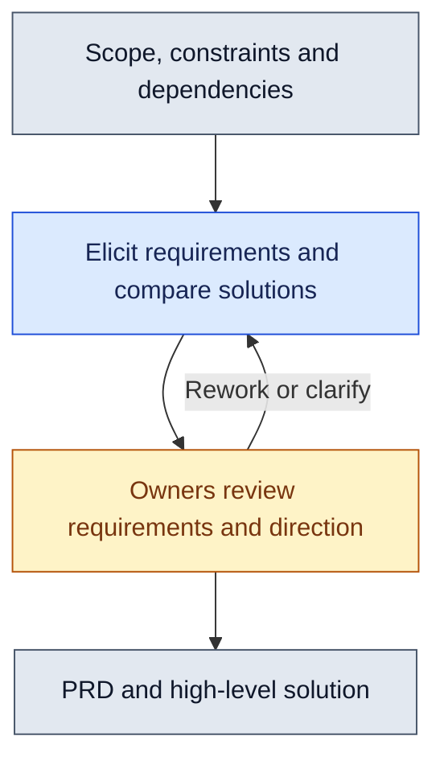

🚧 **DRAFT** — proposed target, subject to validation

# Discovery

**Identify requirements and the solution.** Develop an evidence-backed understanding of the requirements and a high-level solution. Elicit needs, capture known dependencies, identify early risks and agree how those risks will be managed.

## Entry and exit

| Gate                | Expected evidence                                                                                                                                                          |
| ------------------- | -------------------------------------------------------------------------------------------------------------------------------------------------------------------------- |
| **Entry**           | The opportunity is ready for Discovery, with capacity and owners assigned.                                                                                                 |
| **Exit / hand-off** | A PRD, high-level end-to-end plan and solution design, and an updated Concept Card. The responsible owners confirm readiness for Design, including capacity and ownership. |

## Context consumed

| Context                              | What this stage needs                                                  |
| ------------------------------------ | ---------------------------------------------------------------------- |
| **Operational and business context** | Concept Card, initial requirements, user needs and expected outcomes.  |
| **Technical context**                | Architecture principles, relevant decisions and approval expectations. |
| **Integration and project context**  | Existing implementation, interfaces, consumers and system constraints. |

## Work and AI assistance

| Activity                          | Proposed assistance                                                                                          |
| --------------------------------- | ------------------------------------------------------------------------------------------------------------ |
| **Elicit requirements**           | Help owners refine functional and non-functional requirements, acceptance criteria and unresolved questions. |
| **Develop the solution**          | Compare approaches and draft a high-level end-to-end solution grounded in the affected systems.              |
| **Expose dependencies and risks** | Connect requirements to affected teams and contracts; record risks and proposed management actions.          |
| **Prepare the hand-off**          | Assemble a coherent PRD, solution outline and plan for owner review.                                         |

People review the outputs and own the stage decision. AI drafts and checks using the relevant sources, with assumptions and unresolved questions visible.

## Knowledge contributed

WHAT/WHY and approved scope stay in Jira/Confluence. Project-specific technical solution records belong in Git and link back to the PRD; organisation-level decisions remain with their architecture owners. Dates remain unconfirmed targets.

## Decisions supported

Which solution direction to elaborate, which risks need resolution and whether the scope is ready for detailed design.

**Grounding:** [Solution Goals](/AI%20SDLC/04%20Goals/03%20Solution%20Goals.md) — [the relevant Solution Goal IDs]: connect requirements, dependencies and solution knowledge before detailed planning.

[Target State overview](./00%20Overview.md) · Next: [Design](./04%20Design.md)
