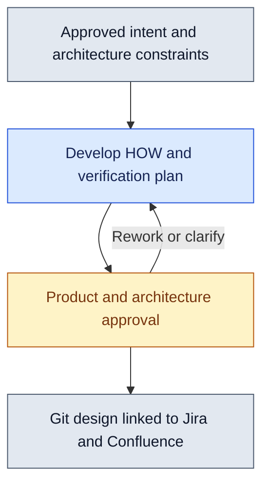

🚧 **DRAFT** — proposed target, subject to validation

# Design

**Confirm the solution.** Validate the chosen solution and make it implementable. Match the work to organisational resources, sequence implementation by capacity and capability, and obtain the required architecture and business approvals.

## Entry and exit

| Gate                | Expected evidence                                                                                                                                                                                                                      |
| ------------------- | -------------------------------------------------------------------------------------------------------------------------------------------------------------------------------------------------------------------------------------- |
| **Entry**           | The work is ready for Design, with capacity and owners assigned.                                                                                                                                                                       |
| **Exit / hand-off** | A detailed end-to-end plan, updated PRD, low-level solution design and testing outline, with ARB approvals and final sign-off as required. Delivery begins with signed-off requirements, Ready for Build status and assigned capacity. |

## Context consumed

| Context                               | What this stage needs                                                              |
| ------------------------------------- | ---------------------------------------------------------------------------------- |
| **Operational context**               | Reviewed PRD, requirements, acceptance criteria and scope decisions.               |
| **Technical and integration context** | Architecture constraints, relevant ARB decisions, contracts and dependency owners. |
| **Project context**                   | Existing project design and implementation, plus the proposed high-level solution. |

## Work and AI assistance

| Activity                | Proposed assistance                                                                                     |
| ----------------------- | ------------------------------------------------------------------------------------------------------- |
| **Elaborate HOW**       | Prepare the detailed technical design, relevant UI/UX specifications and requirement-to-design links.   |
| **Plan implementation** | Break down and sequence work against dependencies, capacity and capability.                             |
| **Plan verification**   | Define how acceptance criteria, integration behaviour and non-functional requirements will be verified. |
| **Prepare approval**    | Surface trade-offs, deviations and remaining readiness issues for the appropriate reviewers.            |

People review the outputs and own the stage decision. AI drafts and checks using the relevant sources, with assumptions and unresolved questions visible.

## Knowledge contributed

Approved WHAT/WHY remains in Jira/Confluence; detailed project HOW is reviewed and versioned in Git. Structured architecture approvals are linked as upstream constraints. Proposed requirement changes return to the upstream owner. Committed dates are established through the planning and approval process.

## Decisions supported

Whether the solution is ready to build, what sequence and capacity to commit, and whether any scope or architecture change needs further approval.

**Grounding:** [Solution Goals](/AI%20SDLC/04%20Goals/03%20Solution%20Goals.md) — [the relevant Solution Goal IDs]: turn reviewed intent into an explicit implementation and verification basis.

[Target State overview](./00%20Overview.md) · Next: [Delivery](./05%20Delivery.md)
