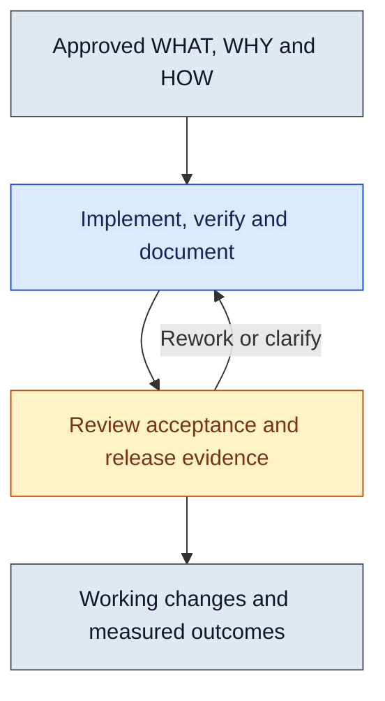

🚧 **DRAFT** — proposed target, subject to validation

# Delivery

**Build the solution right.** Implement, verify, release and maintain the solution through continuous development and monitoring of outcomes. The harness uses approved upstream intent and project knowledge, while each change leaves evidence and updated documentation for the next task.

## Entry and exit

| Gate                | Expected evidence                                                                                                                                                                                                              |
| ------------------- | ------------------------------------------------------------------------------------------------------------------------------------------------------------------------------------------------------------------------------ |
| **Entry**           | Requirements are signed off, the solution is Ready for Build, required ARB approval is recorded and capacity is assigned.                                                                                                      |
| **Exit / hand-off** | Working, verified changes; refined end-to-end and quarter plans; a change-controlled PRD; test plans, cases and results; maintained project documentation. Acceptance and release decisions remain with the designated owners. |

## Context consumed

| Context                           | What this stage needs                                                        |
| --------------------------------- | ---------------------------------------------------------------------------- |
| **Operational context**           | Approved scope, acceptance criteria, committed plan and authorised changes.  |
| **Project and technical context** | Reviewed HOW, engineering conventions and applicable architecture decisions. |
| **Integration context**           | Contracts, affected consumers and verification expectations.                 |

## Work and AI assistance

| Activity                 | Proposed assistance                                                                                                     |
| ------------------------ | ----------------------------------------------------------------------------------------------------------------------- |
| **Implement and review** | Use Dev skills and contextual PR review to check code against the ticket, project documentation and standards.          |
| **Verify and release**   | Validate acceptance criteria, architecture alignment and release readiness using tests and human review where required. |
| **Maintain knowledge**   | Update HOW in Git, report status and bugs in Jira, and route proposed intent changes to the upstream owner.             |
| **Measure and learn**    | Capture process, quality and cost evidence; investigate outcomes and propose improvements to skills and workflow.       |

People review the outputs and own the stage decision. AI drafts and checks using the relevant sources, with assumptions and unresolved questions visible.

## Knowledge contributed

Read WHAT/WHY through connectors and maintain HOW alongside code. Preserve requirement-to-change-to-verification links. Changes to upstream intent follow owner approval. Delivery operates against committed dates and records approved changes to the plan.

## Decisions supported

Whether to release, address a defect or drift, change a bottleneck, adjust AI usage or extend a proven practice. Evaluate time, quality and cost together across the lifecycle.

The target includes context-aware PR review, architecture conformance checks and evidence-based environment promotion. Any automation of release gates requires agreed reliability and test-quality thresholds. Emergency changes need explicit approval and recorded verification or follow-up; the detailed release policy remains to be designed.

**Grounding:** [Solution Goals](/AI%20SDLC/04%20Goals/03%20Solution%20Goals.md) — [the relevant Solution Goal IDs]: instructed engineering, preserved intent, maintained context and measurable outcomes.

[Target State overview](./00%20Overview.md)
