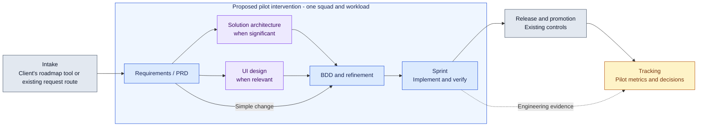
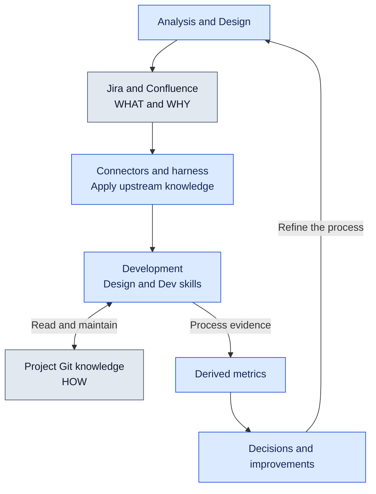

# Pilot

> [!NOTE] Draft
> Proposed model for one squad and one real workload — fixed scope and timebox, with outcomes to validate.

The pilot connects **Analysis & Design → governed knowledge → Development → derived metrics → decisions**. Analysis maintains WHAT and WHY in existing Jira and Confluence records. Engineering consumes that upstream intent through connectors and the harness, and maintains HOW in the project Git repo. Evidence captured as work progresses supports decisions about the process and its wider adoption.

## Where we propose to scope the pilot

The proposed slice runs from **requirements preparation to verified engineering work for one squad and one workload**. It tests the entry and hand-off gaps in the delivery-process view: is there enough reviewed intent to start, do affected owners confirm dependencies, and does engineering use that knowledge?

**Blue:** core intervention. **Purple:** included when the selected change needs it. **Grey:** existing surrounding process. **Amber:** measurement and decisions. This is a common path, not a mandatory sequence for every item. Architecture and UI work may overlap; defect fixes can enter the sprint with sufficient defect and acceptance context. Quarterly prioritisation continues to review and move work across stages.

| Boundary                                   | Proposed treatment                                                                                                                                                                                |
| ------------------------------------------ | ------------------------------------------------------------------------------------------------------------------------------------------------------------------------------------------------- |
| **Intake and portfolio prioritisation**    | Consume the selected request and priority through the existing route. Portfolio-wide intake redesign is outside this pilot.                                                                       |
| **Requirements through refinement**        | Claude Desktop/chat assists gathering, criteria, readiness and decision capture. Jira/Confluence retain reviewed WHAT/WHY. Confirm dependencies and ownership at the hand-off.                    |
| **Solution architecture and UI**           | Use the applicable review/design activities for the workload. Preserve required architecture approvals; UI work applies only to changes that need it.                                             |
| **Sprint implementation and verification** | The engineering harness consumes upstream intent, uses Design/Dev skills and maintains project HOW in Git. Capture traceability and verification evidence.                                        |
| **Release and promotion**                  | Use the existing controls and record relevant events. Rebuilding the deployment pipeline or automating release gates is outside the proposed scope.                                               |
| **Tracking and decisions**                 | Derive engineering time, quality, traceability and AI-cost measures. Production/release events can supply an agreed endpoint where available; whole-product return attribution is a wider target. |

The knowledge and governance model spans the highlighted slice. It is expressed through source records, connectors, harness instructions and human review. Measurement is captured during the process and reviewed afterwards. The squad, workload and precise start/end events remain to be agreed.

## The end-to-end model

The knowledge base governs through its approved content and the harness rules that apply it. People retain responsibility for approvals and resolving conflicts. Engineering findings that change WHAT/WHY return to the upstream owner for approval; project HOW is then aligned with the updated intent.

## Five connected pilot slices

| Slice                                                                                    | Role in the process                                                                                                                                                                                                                | Main outcome                                                                                |
| ---------------------------------------------------------------------------------------- | ---------------------------------------------------------------------------------------------------------------------------------------------------------------------------------------------------------------------------------- | ------------------------------------------------------------------------------------------- |
| [**Analysis & Design**](./02%20Analysis%20%26%20Design/00%20Overview.md)                 | Claude Desktop/chat helps gather requirements, draft tickets and acceptance criteria, assess impact/readiness and capture refinement decisions; estimation supports squad judgement. Reviewed WHAT/WHY remains in Jira/Confluence. | Structured engineering inputs with preserved intent and source links.                       |
| [**Knowledge Base**](./04%20Knowledge%20Base/Overview.md)                                | Connect Jira/Confluence WHAT/WHY with project-level HOW in Git, retaining an authoritative home and owner for each concern.                                                                                                        | Current, linked context that people and assistants can use and maintain through their work. |
| [**Governance**](./06%20Governance/Overview.md)                                          | Connectors supply upstream context; harness instructions require Design and Dev to respect it, verify alignment and surface deviations for owner review.                                                                           | Traceable decisions and visible drift at the hand-off and during engineering.               |
| [**Development (Engineering)**](./03%20Development%20%28Engineering%29/00%20Overview.md) | Design and Dev skills use upstream intent and project documentation to plan, implement, verify and document changes.                                                                                                               | Verified changes and maintained HOW in the project Git repo.                                |
| [**Metrics**](./05%20Metrics/Overview.md)                                                | Join Jira, GitHub, harness and AI cost/usage evidence captured during work; derive measures in the proposed observability dashboards.                                                                                              | Evidence for decisions about bottlenecks, quality, cost and whether to extend the pilot.    |

## Knowledge and evidence captured along the way

| Process point                       | Record maintained                                                                     | How the next step uses it                                                                |
| ----------------------------------- | ------------------------------------------------------------------------------------- | ---------------------------------------------------------------------------------------- |
| **Analysis and refinement**         | Requirements, purpose, acceptance criteria and approved decisions in Jira/Confluence. | The harness loads the agreed WHAT/WHY before engineering plans the change.               |
| **Technical design and planning**   | Project design, plan and links to upstream requirements in Git.                       | Implementation follows the agreed HOW within the upstream constraints.                   |
| **Implementation and verification** | PRs, tests, review findings, requirement links and deviations.                        | Reviewers check alignment; owners resolve proposed intent changes.                       |
| **Completion**                      | Updated project documentation, verification results and work status.                  | The next task starts from maintained project knowledge.                                  |
| **Throughout engineering**          | Timestamps, progress, rework, verification and attributable AI usage/cost.            | Metrics derive time, productivity, traceability, coverage, compliance and cost measures. |

## Use the data to decide

| Observed pattern                                                               | Potential decision                                                          |
| ------------------------------------------------------------------------------ | --------------------------------------------------------------------------- |
| Coding speeds up but lead time stays flat.                                     | Use phase and waiting-time evidence to focus on the actual bottleneck.      |
| Requirements are missing, ambiguous or repeatedly reinterpreted.               | Improve analysis outputs, knowledge ownership and upstream context loading. |
| Faster work brings more defects, rework or unverified requirements.            | Strengthen readiness, verification or review before extending the workflow. |
| AI spend rises without a corresponding outcome improvement.                    | Review task scope, instructions, repeated attempts and model usage.         |
| Comparable work improves across time, quality and cost with reliable evidence. | Consider extending the model to another workload or squad.                  |

The process view spans analysis through engineering. The initial metrics hypothesis measures **the engineering phase of one squad**. Agree event boundaries, denominators and a baseline before comparing outcomes; wider idea-to-delivery claims require broader measurement.

## Define and run the pilot

| Setup decision                   | What needs to be agreed                                                                                                          |
| -------------------------------- | -------------------------------------------------------------------------------------------------------------------------------- |
| **Workload and scope**           | Select a real change or bounded set of work that exercises the analysis → engineering hand-off, with a squad, owner and timebox. |
| **Knowledge ownership**          | Identify the authoritative Jira/Confluence records, project Git documentation and responsible reviewers.                         |
| **Connections and instructions** | Configure source access, upstream context loading, refresh points, approval rules and deviation handling in the harness.         |
| **Measurement**                  | Define success measures and thresholds, establish a comparable baseline, and implement requirement links and cost attribution.   |
| **Team adoption**                | Pair with the squad as it uses the assistants and skills; capture friction and improve instructions during the pilot.            |

Candidate entry points remain requirements drafting, context-aware PR review and project documentation upkeep, grounded in [Requirements & Stories](/AI%20SDLC/03%20Problem%20Space/03%20SDLC%20Domains/01%20Requirements%20%26%20Stories), [Implementation](/AI%20SDLC/03%20Problem%20Space/03%20SDLC%20Domains/10%20Implementation) and [Knowledge Base](/AI%20SDLC/03%20Problem%20Space/03%20SDLC%20Domains/04%20Knowledge%20Base). Choose the workload that can exercise the connected model within the agreed scope.

Reuse [[CLIENT_NAME]]'s existing tools and applicable access/data-handling controls. Detailed connector wiring and repository configuration remain design work; the pilot does not require an organisation-wide knowledge-platform decision. Feed the results into [Scale](../04%20Scale.md) and the lessons into [Evolve](../05%20Evolve.md).
