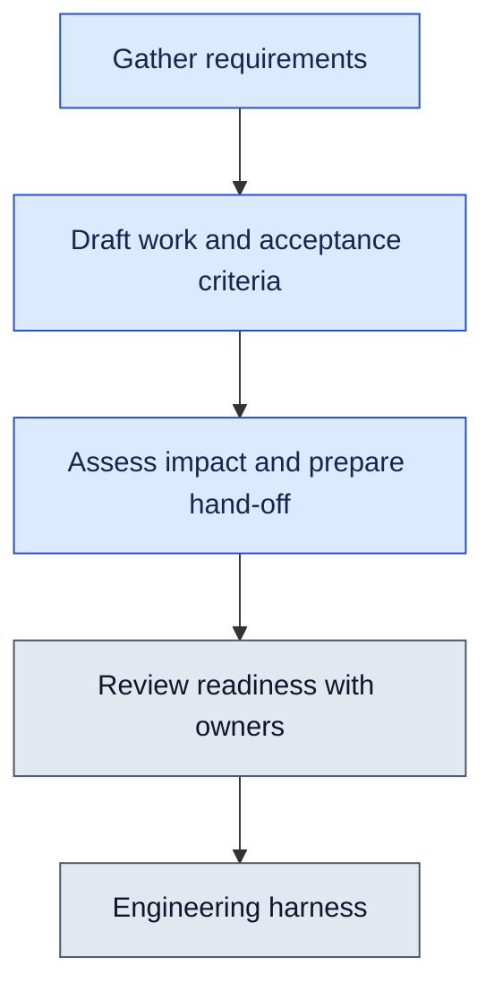

# Analysis & Design

🚧 **DRAFT** — recommendations based on [[CLIENT_NAME]] capture; pilot scope and access require validation.

The proposed pilot strengthens **requirements gathering and the analysis → engineering hand-off**, using explicit instructions and the squad’s existing tools. Approved **WHAT and WHY stay in Jira and Confluence**. The engineering harness consumes those records and maintains project **HOW in Git**, as defined in the [Knowledge Base](../04%20Knowledge%20Base/Overview.md) and [Governance model](../06%20Governance/Overview.md).

The flow shows a typical path, with iteration as requirements change. Refinement updates feed back into the affected records; estimation supports planning once scope is clear. Small changes can use a proportionate subset. The proposed interface is **Claude Desktop/chat**, using shared instructions for each process and approved access to source systems. This is a solution direction from team feedback; licences, connector access and write capabilities require pilot validation.

## Recommended process set

| Process                                                                                      | Recommendation                                  | Why, based on capture                                                                                                                                      |
| -------------------------------------------------------------------------------------------- | ----------------------------------------------- | ---------------------------------------------------------------------------------------------------------------------------------------------------------- |
| [Gather Requirements](./07%20Gather%20Requirements.md)                                       | **Add — core**                                  | One-line/page/interview intake and requirements-gathering effort are captured. Drafting a ticket alone misses the work needed to establish WHAT/WHY.       |
| [Draft Ticket From Request](./01%20Draft%20Ticket%20From%20Request.md)                       | **Reshape — core**                              | Keep source-linked drafting and duplicate checks; route unclear requests to gathering. Remove automatic estimation at intake.                              |
| [Draft Acceptance Criteria](./03%20Draft%20Acceptance%20Criteria.md)                         | **Keep — shared capability**                    | Build on existing BDD/AC assistance, with common grounding and review rules used by intake and remediation.                                                |
| [Assess Impact and Prepare Handoff](./08%20Assess%20Impact%20and%20Prepare%20Handoff.md)     | **Add — core where applicable**                 | Address cross-team dependencies, affected contracts and missing design behaviour. Use Three Amigos or the squad’s equivalent; include UI only when needed. |
| [Score Ticket Readiness](./02%20Score%20Ticket%20Readiness.md)                               | **Keep — extend existing practice**             | An AI-assisted completeness check is already captured. Agree the selected squad’s criteria and add evidence-based checks and owner actions.                |
| [Update Tickets From Refinement Call](./05%20Update%20Tickets%20From%20Refinement%20Call.md) | **Keep — connect to existing meeting analysis** | Preserve reviewed decisions in current Jira/Confluence records. Reuse existing transcript analysis where suitable and retain a decision trail.             |
| [Estimate Effort](./04%20Estimate%20Effort.md)                                               | **Reshape — supporting**                        | Use comparable work and capacity to support squad decisions. Defer numerical calibration until the data and method are validated.                          |
| [Draft Bug Report](./06%20Draft%20Bug%20Report.md)                                           | **Optional — outside the core slice**           | Useful QA support, but the reviewed capture does not establish generic bug formatting as a priority analysis bottleneck.                                   |

This is a recommendation for the documented pilot, not a record of stakeholder approval or deployed automation.

## Proposed tooling and captured constraints

| Tool or capability                                 | Captured position                                                                                                   | Pilot implication                                                                                                                                                         |
| -------------------------------------------------- | ------------------------------------------------------------------------------------------------------------------- | ------------------------------------------------------------------------------------------------------------------------------------------------------------------------- |
| **[Client's requirements tracker and wiki]**       | Existing operational/requirements sources; [note any existing MCP/connector proxies if captured].                   | Use these as authoritative WHAT/WHY. Confirm the selected assistant's project access and write permissions. Existing proxies do not establish every workflow's readiness. |
| **[An AI chat/desktop assistant]**                 | Proposed interface selected through solution feedback. Capture shows varied assistant use and account availability. | Configure shared process instructions and validate licences, source access and permitted writes for the squad.                                                            |
| **[Client's roadmap tool]**                        | Existing idea and roadmap context.                                                                                  | Link relevant roadmap records; direct assistant access is not established by the reviewed evidence.                                                                       |
| **[Client's comms stack, e.g. Teams/Outlook]**     | [If a captured workshop reports a connector disabled by policy, cite it here.]                                      | Do not assume direct retrieval. Confirm the current permitted route with its owner; user-supplied material also requires approval for the chosen assistant.               |
| **Meeting analysis**                               | [If a captured team already uses transcript analysis for actions/questions and notifications, cite it here.]        | Extend decision-to-ticket follow-through if supported; no new scheduled meeting router is assumed.                                                                        |
| **[Client's design tool] and project Git**         | [Note existing connector/MCP use and reliability if captured.] Git holds project context.                           | Include design context for UI work and project context for feasibility/impact, with explicit source links and owner review.                                               |
| **[Client's AI platform] and knowledge ingestion** | Platform capabilities exist; [note whether organisation-level ingestion work has started, if captured].             | Assess existing orchestration with the platform owner. Distinguish live squad connectors from planned central ingestion.                                                  |

Sources: [Tool Inventory](/AI%20SDLC/02%20Capture/01%20Current%20State/Tool%20Inventory.md), [AI Adoption](/AI%20SDLC/02%20Capture/01%20Current%20State/AI%20Adoption.md), and the relevant [Workshop](/AI%20SDLC/02%20Capture/04%20Workshops/) notes covering connector policy, once captured. These describe captured observations, not a fresh technical access check.

## Shared rules for the pilot

Use maintained process instructions, the selected squad’s readiness criteria and approved source records. Distinguish grounded statements, proposed changes and unresolved questions. Product retains ownership of WHAT/WHY; engineering contributes feasibility and impact evidence. The assistant presents proposed external changes for review and applies only approved content where configured access permits it.

Keep the current specification accurate and preserve its decision history. A dated note alone is insufficient when it contradicts the active requirement. Link the reviewed PRD, Jira work, relevant design and dependency decisions for the [engineering harness](../03%20Development%20%28Engineering%29/00%20Overview.md).

## Scope and validation

Select the squad before finalising the workflow: captured practices differ, and a bottleneck on one squad is not automatically the priority on another. Confirm owners, accessible source records, supported writes and the local readiness rules. Run representative requests through gathering, preparation and the engineering hand-off, and inspect rework, missing context and owner corrections alongside the [pilot metrics](../05%20Metrics/Overview.md).

Automated readiness posting, direct meeting retrieval and numerical estimation are conditional extensions. The core process should first work with reviewed evidence and verified access.
