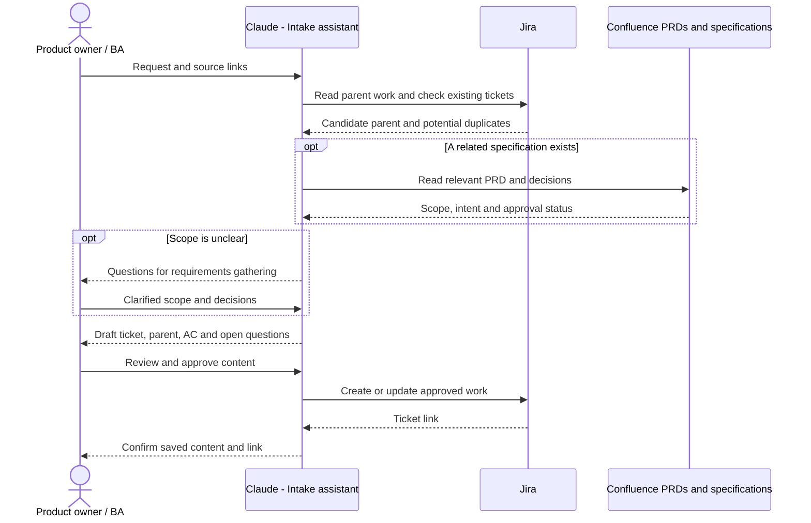

# Draft Ticket From Request

> **Pilot recommendation:** Reshape — keep as intake after sufficient requirements gathering. Proposed workflow; configuration and access remain to be validated.

Turn a request into a reviewed Jira draft linked to its source, PRD and parent work. A one-line request can initiate clarification; ticket creation should follow sufficient understanding of the requested behaviour.

## Who uses it and when

PM/PO or BA when a request needs a ticket. If purpose, scope or behaviour is unclear, use [Gather Requirements](./07%20Gather%20Requirements.md) first.

## Inputs and tooling

| Source                          | What the assistant reads                                                                                     |
| ------------------------------- | ------------------------------------------------------------------------------------------------------------ |
| **Request**                     | Stakeholder message, brief or interview notes, with its source.                                              |
| **Confluence**                  | Relevant PRD, functional specification and approved product decisions, where available.                      |
| **Jira**                        | Related epics, stories, tasks and existing acceptance criteria, used to identify parent work and duplicates. |
| **Roadmap tool where relevant** | Linked initiative or roadmap item. Direct assistant access must be confirmed.                                |

**Tool fit:** Use Claude Desktop/chat with shared intake instructions and approved Jira/Confluence access, or approved source extracts. Validate project permissions and field mappings before enabling writes. No script runtime or automatic estimate is required.

## Process and controls

Propose scope, source links, parent association, draft acceptance criteria and unanswered questions. Reuse [Draft Acceptance Criteria](./03%20Draft%20Acceptance%20Criteria.md). A separate PRD is not required for every small change, but approved scope must be recorded in the relevant Jira or Confluence source. Product confirms the draft before issue creation or update; check duplicates first. Do not infer a parent epic or requirement as settled when it is uncertain.

## Example request

> Draft a Jira ticket from this request and linked PRD. Show missing requirements, likely duplicates and the proposed parent before creating anything.

## Why this fits the pattern

[If a captured workshop or current-state finding shows a team already drafting requirements from one-line requests, existing pages, or interviews, cite it here.] This makes intake relevant, but a message-to-ticket shortcut cannot replace requirements gathering. [Process capture](/AI%20SDLC/02%20Capture/01%20Current%20State/Process.md) · [AI Adoption capture](/AI%20SDLC/02%20Capture/01%20Current%20State/AI%20Adoption.md)

[Analysis & Design overview](./00%20Overview.md) · [Knowledge Base](../04%20Knowledge%20Base/Overview.md) · [Governance](../06%20Governance/Overview.md)
