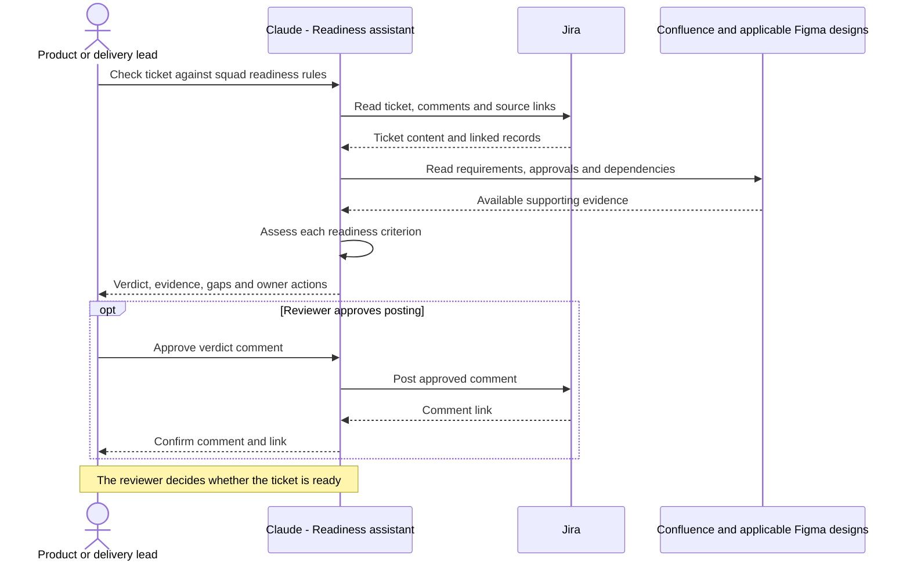

# Score Ticket Readiness

> **Pilot recommendation:** Keep — extend the existing squad readiness practice. Proposed workflow; configuration and access remain to be validated.

Check whether a ticket has the evidence the selected squad needs before refinement or build. Produce actionable gaps with sources, then let the responsible people decide readiness.

## Who uses it and when

PM/PO, delivery lead and engineers before refinement or sprint planning.

## Inputs and tooling

| Source                   | What the assistant reads                                                                       |
| ------------------------ | ---------------------------------------------------------------------------------------------- |
| **Jira**                 | Ticket description, acceptance criteria/BDD, comments, dependency links and refinement status. |
| **Confluence**           | Linked PRD or specification, approval evidence and the squad’s agreed Definition of Ready.     |
| **Figma where relevant** | Linked UI designs and agreed design behaviour. Record unavailable design evidence as a gap.    |

**Tool fit:** Use [an AI chat/desktop assistant] with the squad's readiness rules and approved Jira/Confluence access. [If a captured workshop already found an existing completeness check, name it and use it to inform the criteria to carry forward.] Confirm commenting permissions before enabling writes. An unattended sweep remains a later option requiring separate configuration and authorization.

## Process and controls

Return Pass / Partial / Missing / Not applicable per agreed criterion with evidence and an owner action. A link being present does not prove its content is complete or approved. Distinguish evidence that is missing from evidence the assistant cannot access. Route requirement gaps to [Gather Requirements](./07%20Gather%20Requirements.md), criteria gaps to [Draft Acceptance Criteria](./03%20Draft%20Acceptance%20Criteria.md), and dependency gaps to [Assess Impact](./08%20Assess%20Impact%20and%20Prepare%20Handoff.md). Report the result for human review; post only when approved. This process does not rewrite the ticket or approve entry to engineering.

## Example request

> Check this ticket against our agreed readiness criteria. Show evidence, missing information and who needs to resolve each gap.

## Why this fits the pattern

[If captured current-state evidence shows a Definition of Ready already in use — signed-off PRD, designs, BDD stories, refinement — and any existing AI-assisted check, cite it here.] Reuse that practice and add semantic checks and dependency evidence where useful. [Process capture](/AI%20SDLC/02%20Capture/01%20Current%20State/Process.md) · [AI Adoption capture](/AI%20SDLC/02%20Capture/01%20Current%20State/AI%20Adoption.md)

[Analysis & Design overview](./00%20Overview.md) · [Knowledge Base](../04%20Knowledge%20Base/Overview.md) · [Governance](../06%20Governance/Overview.md)
