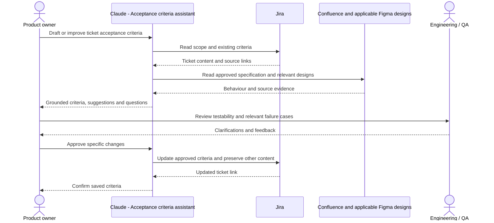

# Draft Acceptance Criteria

> **Pilot recommendation:** Keep — reuse as a capability within requirements drafting and readiness remediation. Proposed workflow; configuration and access remain to be validated.

Draft testable acceptance criteria grounded in approved WHAT/WHY. Use the same rules when creating a ticket and when addressing a readiness gap.

## Who uses it and when

PM/PO or BA with engineers and QA when requirements need testable detail.

## Inputs and tooling

| Source                   | What the assistant reads                                                                                           |
| ------------------------ | ------------------------------------------------------------------------------------------------------------------ |
| **Jira**                 | Ticket scope, existing acceptance criteria and linked refinement decisions.                                        |
| **Confluence**           | Approved PRD or functional specification defining the intended behaviour and purpose.                              |
| **Figma where relevant** | UI states and interactions to check with product and design. A visual alone does not establish approved behaviour. |

**Tool fit:** Use Claude Desktop/chat with shared acceptance-criteria instructions and approved Jira/Confluence context. Existing BDD-writing experience informs the process. Figma access is conditional and does not replace a reviewed behavioural specification.

## Process and controls

Distinguish source-backed criteria from proposed additions and questions. Product approves changes to WHAT/WHY with engineering/QA input. Write only approved content to the configured Jira field; preserve unrelated content and record source links. If proposed criteria change the approved PRD, obtain the product owner’s decision and update that upstream record before treating the new criteria as settled. Keep shared drafting rules in one maintained location.

## Example request

> Draft acceptance criteria for this ticket from the approved PRD. Separate grounded behaviour, suggestions and questions; include relevant failure cases.

## Why this fits the pattern

[If captured current-state evidence shows BDD/requirements generation already in use somewhere, cite it here.] The improvement is consistent grounding and review across the hand-off, not a second independent AC-writing tool. [AI Adoption capture](/AI%20SDLC/02%20Capture/01%20Current%20State/AI%20Adoption.md) · [Process capture](/AI%20SDLC/02%20Capture/01%20Current%20State/Process.md)

[Analysis & Design overview](./00%20Overview.md) · [Knowledge Base](../04%20Knowledge%20Base/Overview.md) · [Governance](../06%20Governance/Overview.md)
