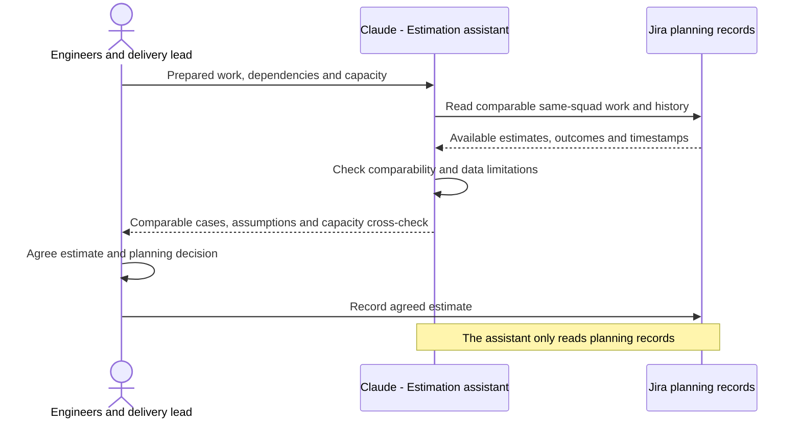

# Estimate Effort

> **Pilot recommendation:** Reshape — estimation support and capacity cross-check; defer automated calibration. Proposed workflow; configuration and access remain to be validated.

Help the squad compare proposed work with relevant completed work and available capacity. Engineers retain responsibility for estimates; historical data is evidence with limits.

## Who uses it and when

Engineers and delivery lead after scope and dependencies are sufficiently understood, during refinement or planning.

## Inputs and tooling

| Source                     | What the assistant reads                                                                                                               |
| -------------------------- | -------------------------------------------------------------------------------------------------------------------------------------- |
| **Jira**                   | Prepared work, same-squad completed tickets, estimates, outcomes and dependency records.                                               |
| **Confluence**             | Linked scope/specification and decisions explaining complexity or constraints.                                                         |
| **Squad planning records** | Capacity and commitments supplied by the delivery lead, including Jira Advanced Roadmaps where used. Check currency and comparability. |

**Tool fit:** Use Claude Desktop/chat to compare approved Jira exports or connected Jira records with squad capacity and scope. Include Advanced Roadmaps records where applicable. Keep the assistant read-only. A calibrated model needs a separately validated dataset and method.

## Process and controls

Present comparable cases, complexity factors, uncertainty and a capacity cross-check. Flag insufficient evidence rather than invent hours or a P85 band. Story cycle time includes waiting and is not actual effort. Do not compare raw story points across squads or write estimates automatically; the squad records its agreed estimate.

## Example request

> Help us size this work using comparable tickets from our squad. Show dependency assumptions, data limitations and the fit with available capacity.

## Why this fits the pattern

[If captured current-state evidence shows no story/sub-task time tracking, story points not reconciled to actual effort, reported overcommitment, or an existing individual estimate-cross-check tool, cite it here.] This supports comparison and capacity decisions. A numerical forecast requires data and calibration beyond what the capture establishes. [Metrics capture](/AI%20SDLC/02%20Capture/01%20Current%20State/Metrics.md) · [Process capture](/AI%20SDLC/02%20Capture/01%20Current%20State/Process.md) · [AI Adoption capture](/AI%20SDLC/02%20Capture/01%20Current%20State/AI%20Adoption.md)

[Analysis & Design overview](./00%20Overview.md) · [Knowledge Base](../04%20Knowledge%20Base/Overview.md) · [Governance](../06%20Governance/Overview.md)
