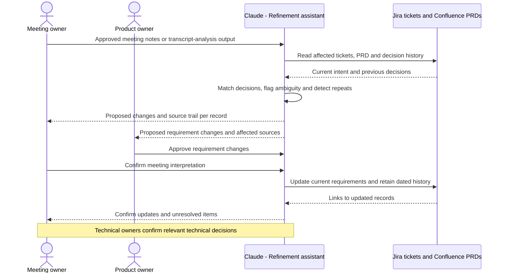

# Update Tickets From Refinement Call

> **Pilot recommendation:** Keep — integrate with existing meeting analysis and maintain current intent. Proposed workflow; configuration and access remain to be validated.

Turn refinement decisions into reviewed updates to the affected Jira tickets and Confluence requirements, preserving both the current agreed intent and the decision trail.

## Who uses it and when

PM/PO, BA or meeting owner after refinement or a Three Amigos session.

## Inputs and tooling

| Source               | What the assistant reads                                                                                                                                              |
| -------------------- | --------------------------------------------------------------------------------------------------------------------------------------------------------------------- |
| **Meeting evidence** | Permitted transcript, attendee notes or output from the existing transcript-analysis tool, with meeting date and source. Extracted decisions need owner confirmation. |
| **Jira**             | Affected tickets, current acceptance criteria, comments and linked work.                                                                                              |
| **Confluence**       | Linked PRD/specification and existing decision history, used to identify which current requirements need revision.                                                    |

**Tool fit:** Use [an AI chat/desktop assistant] to review permitted meeting notes or output from an existing transcript-analysis capability, if one is already in use. Confirm Jira/Confluence update permissions separately. Direct comms-tool retrieval is conditional on policy and access. Validate access for the chosen assistant specifically rather than assuming another tool's observed restriction applies identically.

## Process and controls

Show each proposed change, affected record and source. Product approves requirement changes; relevant technical owners confirm technical decisions. Apply reviewed edits to current requirements and retain a dated decision history. Append-only notes alone can leave obsolete requirements in force. Re-read records before applying approved edits so intervening changes are surfaced for review. Detect repeated decisions before updating and return links to the changed records. If one update fails, report what was saved and what remains pending.

## Example request

> Compare these refinement decisions with the linked tickets and PRD. Propose the exact updates and identify the owners who need to approve them.

## Why this fits the pattern

[If captured current-state evidence shows meeting-action extraction already in use, a Three-Amigos-style refinement forum, or where product retains requirements ownership, cite it here.] The valuable addition is verified decision-to-record follow-through. [Process capture](/AI%20SDLC/02%20Capture/01%20Current%20State/Process.md) · [Tool Inventory](/AI%20SDLC/02%20Capture/01%20Current%20State/Tool%20Inventory.md)

[Analysis & Design overview](./00%20Overview.md) · [Knowledge Base](../04%20Knowledge%20Base/Overview.md) · [Governance](../06%20Governance/Overview.md)
