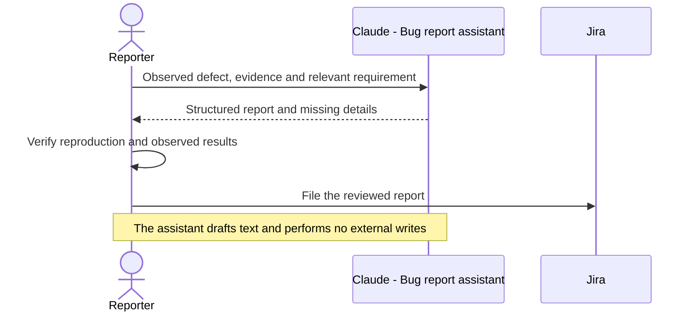

# Draft Bug Report

> **Pilot recommendation:** Optional — QA helper outside the core Analysis & Design pilot scope. Proposed workflow; configuration and access remain to be validated.

Structure an observed defect into a report with reproducible steps, expected and actual behaviour, environment and supporting evidence.

## Who uses it and when

QA, support or an engineer when a defect report needs clarification. Include in the pilot only if the selected squad identifies report quality as a material bottleneck.

## Inputs and tooling

| Source                           | What the assistant reads                                                                                                     |
| -------------------------------- | ---------------------------------------------------------------------------------------------------------------------------- |
| **Reporter evidence**            | Observed results, reproduction steps, screenshots or logs permitted for the assistant, and affected version/environment.     |
| **Jira or Confluence reference** | Relevant acceptance criterion or specification describing expected behaviour, supplied by the reporter with its source link. |
| **Squad bug template**           | The required Jira defect fields supplied to the assistant. Drafting does not require direct Jira access.                     |

**Tool fit:** Use Claude Desktop/chat with the squad’s Jira defect template and reporter-supplied evidence. A direct connector is unnecessary for drafting. The captured process confirms QA bugs, but does not establish multilingual report formatting as a priority problem.

## Process and controls

Do not invent reproduction steps or observed results. Mark missing details, link the relevant requirement and ask the reporter to verify the draft before filing. Defect triage and acceptance remain with the owning team.

## Example request

> Structure this observed defect using our bug template. Keep unknown details explicit and identify what is needed to reproduce it.

## Why this fits the pattern

[If captured current-state evidence shows QA and bug triage already present in the engineering flow, cite it here.] The reviewed capture provides stronger support for requirements and dependency hand-offs than for a standalone bug-writing pilot. This is a prioritisation judgement, not evidence that bug reports are uniformly good. [Process capture](/AI%20SDLC/02%20Capture/01%20Current%20State/Process.md)

[Analysis & Design overview](./00%20Overview.md) · [Knowledge Base](../04%20Knowledge%20Base/Overview.md) · [Governance](../06%20Governance/Overview.md)
