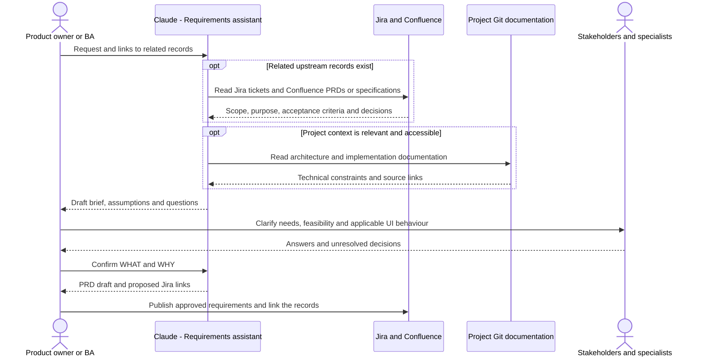

# Gather Requirements

> **Pilot recommendation:** Add — core missing step before ticket drafting. Proposed workflow; configuration and access remain to be validated.

Turn an initial request, existing page or stakeholder discussion into reviewed WHAT/WHY. Expose unknowns early and assemble a linked requirement brief or PRD for the selected scope.

## Who uses it and when

PM/PO or BA with the requester, designer where relevant, and engineering representatives before ticket drafting or when intake is unclear.

## Inputs and tooling

| Source               | What the assistant reads                                                                                                                         |
| -------------------- | ------------------------------------------------------------------------------------------------------------------------------------------------ |
| **Original request** | The stakeholder message, brief or interview notes, including the business purpose.                                                               |
| **Confluence**       | Existing Product Requirements Documents (PRDs), functional specifications, user journeys and approved product decisions relevant to the request. |
| **Jira**             | Related epics, stories and tasks, their scope, acceptance criteria, linked specifications and refinement decisions.                              |
| **Project Git repo** | Architecture and implementation documentation describing current capabilities and technical constraints — the project’s HOW.                     |

Read the relevant records where they exist, preserving their source links and approval status. If a request has no PRD or related ticket yet, record that gap and draft the requirements from the request and stakeholder clarification. Project HOW informs feasibility; it does not override approved WHAT/WHY.

**Tool fit:** Use Claude Desktop/chat with shared requirements instructions and approved Jira/Confluence context. Confirm Git access separately where project constraints are needed. Approved source extracts can support a task when direct access is unavailable. Unavailable context remains an explicit gap for the relevant owner.

## Process and controls

Capture purpose, scope, behaviour, non-functional needs, acceptance direction, assumptions and unanswered questions. Product confirms WHAT/WHY in Confluence/Jira. Link source evidence and approved decisions; route technical feasibility questions to the appropriate engineer. Proceed to ticket drafting when the scope is sufficiently clear.

## Example request

> Help gather requirements for this request. Read the linked context, identify missing decisions, and draft WHAT/WHY for product review.

## Why this fits the pattern

[If a captured workshop identifies requirements gathering as a major time sink for a squad, or describes an existing one-line/page/interview intake pattern, cite it here.] These support a dedicated gathering step, while not proving the same bottleneck for every squad. [Process capture](/AI%20SDLC/02%20Capture/01%20Current%20State/Process.md) · [AI Adoption capture](/AI%20SDLC/02%20Capture/01%20Current%20State/AI%20Adoption.md)

[Analysis & Design overview](./00%20Overview.md) · [Knowledge Base](../04%20Knowledge%20Base/Overview.md) · [Governance](../06%20Governance/Overview.md)
