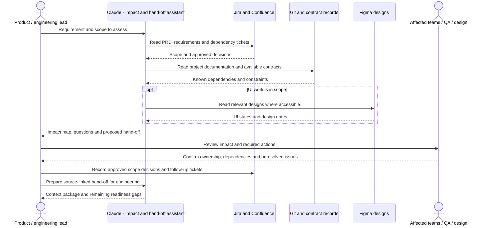

# Assess Impact and Prepare Handoff

> **Pilot recommendation:** Add — core for changes crossing systems; UI hand-off when applicable. Proposed workflow; configuration and access remain to be validated.

Connect the reviewed requirement to affected systems, contracts, teams and design behaviour before engineering commits. Prepare a reviewed hand-off with explicit ownership and unresolved dependencies.

## Who uses it and when

Product and engineering leads with affected teams, QA and a designer where the change has a user interface. Use Three Amigos or the squad’s equivalent forum.

## Inputs and tooling

| Source                                          | What the assistant reads                                                                                                   |
| ----------------------------------------------- | -------------------------------------------------------------------------------------------------------------------------- |
| **Jira and Confluence**                         | Work scope, reviewed PRD, requirements, approved decisions and dependency tickets.                                         |
| **Project Git repo**                            | Architecture and implementation documentation describing affected components and constraints.                              |
| **[Client's schema/contract registry]**         | Available API and event schemas, versions and compatibility constraints. Confirm access and affected owners.               |
| **[Client's design tool] where relevant**       | UI states, interactions and design notes for the affected experience.                                                      |
| **[An observability platform] where available** | Observed service traffic as supporting impact evidence. Lack of observed traffic does not establish absence of a consumer. |

**Tool fit:** Use Claude Desktop/chat with approved Jira/Confluence and project Git context. Add Figma and contract-source access where the workload requires it. Existing individual MCP use provides experience to assess, but does not establish access in this proposed interface. A complete consumer registry is not captured as existing.

## Process and controls

List affected systems, owners, contract changes, UI states where applicable, risks and unanswered questions. Ask affected owners to confirm the impact and required work. Record confirmation and link follow-up tickets; a Teams announcement alone is not acknowledgement. Product approves scope changes in Jira/Confluence; technical owners maintain approved technical decisions in the project Git repo. The hand-off lists source links, confirmed owners, acceptance criteria and unresolved blockers. Detailed engineering HOW proceeds through the [Design skill](../03%20Development%20%28Engineering%29/02%20Design%20Lifecycle.md).

## Example request

> Assess the impact of this requirement. Identify affected teams, contracts and UI behaviour where relevant, and prepare the questions and evidence for the hand-off review.

## Why this fits the pattern

[If captured workshops report dependency-management gaps, a working Three-Amigos-style pattern, missing design acceptance criteria, or a missing consumer registry, cite them here.] UI is conditional, dependent on whichever backend/frontend distinction a gate has drawn. [Process capture](/AI%20SDLC/02%20Capture/01%20Current%20State/Process.md) · [Architecture capture](/AI%20SDLC/02%20Capture/01%20Current%20State/Architecture.md) · [AI Adoption capture](/AI%20SDLC/02%20Capture/01%20Current%20State/AI%20Adoption.md)

[Analysis & Design overview](./00%20Overview.md) · [Knowledge Base](../04%20Knowledge%20Base/Overview.md) · [Governance](../06%20Governance/Overview.md)
