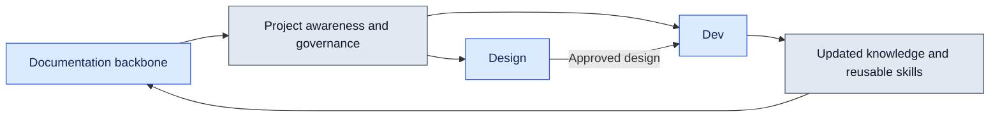

🚧 **DRAFT** — not final, subject to change

# Development (Engineering)

The proposed **engineering harness** makes AI assistance instructed and aware of the project it is working in. **Documentation is its backbone**: it gives the AI the architectural context, engineering conventions, constraints and approval rules needed to act within the team's expectations. **Dev and Design are the core skills** that turn this context into repeatable engineering work. Jira and Confluence retain upstream WHAT and WHY; connectors load that intent into the harness, while project documentation in Git records HOW. See the [Knowledge Base](../04%20Knowledge%20Base/Overview.md) and [Governance](../06%20Governance/Overview.md) model.

## Documentation is the backbone

The harness depends on maintained documentation to answer two questions for AI assistance: **what do I need to know about this system, and what rules must I follow when changing it?** This provides both project awareness and governance: documented instructions guide actions, reviews and approvals, reducing the need for the AI to guess intent or reconstruct decisions.

| Documentation                                | What it gives AI assistance                                                                                                     |
| -------------------------------------------- | ------------------------------------------------------------------------------------------------------------------------------- |
| **Target architecture**                      | The intended system structure, boundaries and non-functional requirements against which changes should be planned and reviewed. |
| **Implementation documentation**             | Knowledge of what is built and how it works, so proposed changes start from the current system.                                 |
| **Engineering conventions and instructions** | Explicit rules for working in the project, including verification, review and approval expectations.                            |
| **Approved design specifications**           | The agreed approach and requirements that guide implementation of a particular change.                                          |
| **Plans and work records**                   | Task context, progress, findings and deviations that make work traceable and resumable across sessions.                         |

The [documentation principles](./02%20Documentation%20Principles.md) make this context usable: one concern per document, one source of truth per concept, concise instructions and links to deeper detail. People and agents can progressively load the context relevant to their task. Settled architectural decisions belong in permanent documentation; options, open questions and review history stay in the task records.

## Dev and Design are the core skills

The core skills specify how AI assistance uses the documentation, performs work and involves people at decision points. Each has an orchestrator for the complete workflow and individual phase skills for focused or resumed work.

| Core skill                                 | When it applies                                                                                             | How it works                                                                                                                                                                        | Main outputs                                                                                                                     |
| ------------------------------------------ | ----------------------------------------------------------------------------------------------------------- | ----------------------------------------------------------------------------------------------------------------------------------------------------------------------------------- | -------------------------------------------------------------------------------------------------------------------------------- |
| [**Design**](./02%20Design%20Lifecycle.md) | Large, uncertain or architecturally significant changes that need an agreed approach before implementation. | Frame the problem and requirements, research options, assess trade-offs, specify the solution, review it and obtain human approval before publishing. Address feedback when needed. | Approved solution specification covering architecture, design, stack and effort; published decisions and implementation tickets. |
| [**Dev**](./01%20Dev%20Lifecycle.md)       | Every engineering ticket; well-understood changes can start here directly.                                  | Plan against the architecture and approved design where available, implement in verified steps, test against acceptance criteria, then update documentation.                        | Implementation plan, code changes, progress and verification report, updated documentation and an archived story.                |

## Governance in everyday work

Documentation states the rules; the core skills apply them at the relevant step. Specialist agents contribute focused implementation or review, while people retain the approval decisions defined by the workflow.

| Mechanism                              | How the harness applies it                                                                                                                                                                                                     |
| -------------------------------------- | ------------------------------------------------------------------------------------------------------------------------------------------------------------------------------------------------------------------------------ |
| **Context before action**              | Read the relevant architecture, implementation documentation and conventions before planning. Use an approved solution as the implementation specification within upstream WHAT/WHY; route conflicts to the responsible owner. |
| **Reviewable decisions**               | Write plans, design artifacts and findings before asking for review. Obtain human design approval before publication and implementation.                                                                                       |
| **Controlled implementation**          | Work through explicit steps with developer verification and confirmation. Record progress and findings before committing completed work.                                                                                       |
| **Verification and specialist review** | Check the build, tests and acceptance criteria. Use architect and layer specialists to review significant changes and surface inconsistencies.                                                                                 |
| **Maintained project knowledge**       | Update documentation as part of completing the work. Resolve architecture deviations through documented decisions or tracked technical debt.                                                                                   |

## Keep the harness learning and accurate

Two supporting lifecycles keep the instructions and project awareness useful over time.

| Supporting lifecycle                                             | Contribution to the harness                                                                                                                                                                       |
| ---------------------------------------------------------------- | ------------------------------------------------------------------------------------------------------------------------------------------------------------------------------------------------- |
| [**Skill lifecycle**](./03%20Skill%20Lifecycle.md)               | Capture repeatable lessons from engineering work, turn them into draft skills and promote them after practical use. New learning becomes reusable guidance for future AI assistance.              |
| [**Architecture lifecycle**](./04%20Architecture%20Lifecycle.md) | Audit design quality, implementation alignment and documentation coverage. Record gaps and feed corrective tickets into Dev so the team's documented understanding stays aligned with the system. |

The intended result is AI assistance guided by explicit project knowledge and working rules, with human oversight and a feedback loop that improves those instructions as the team works. The workload, tool integrations and rollout scope remain to be selected and validated through the [pilot definition](../01%20Overview.md).
