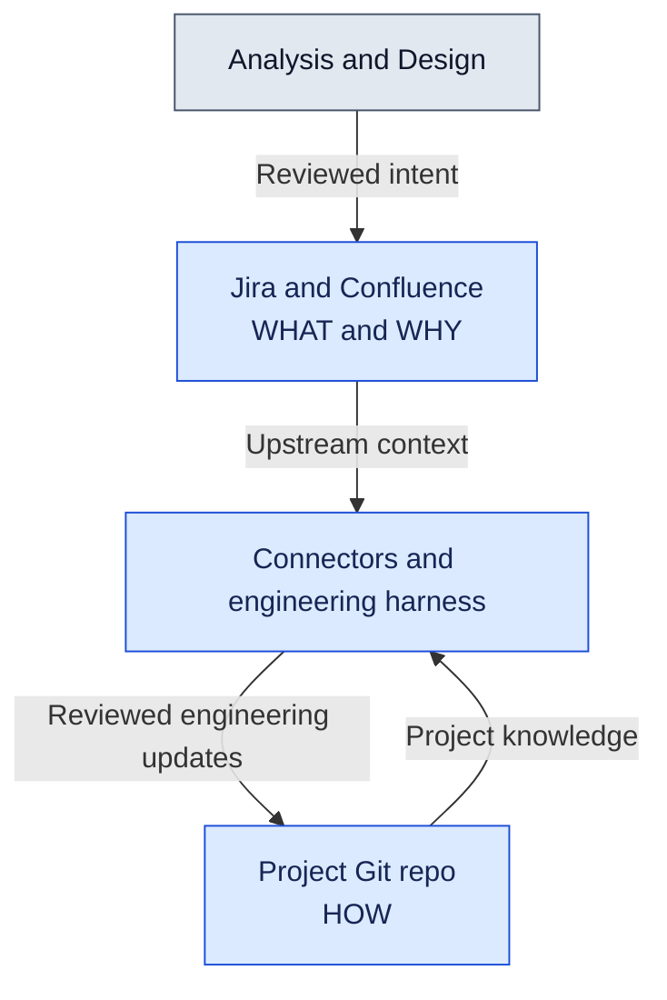

🚧 **DRAFT** — not final, subject to change

# Knowledge Base

The pilot knowledge base connects **two complementary homes for knowledge**: analysis keeps **WHAT and WHY in existing Jira and Confluence records**; engineering keeps **HOW in the project Git repo**. Connectors bring the relevant upstream knowledge into the harness, where Design and Dev use it alongside project documentation.

This is the revised [Knowledge Base hypothesis](../../01%20Hypotheses.md#3-—-knowledge-base): knowledge remains where its owners work, with explicit links and rules preserving its meaning across the analysis → development hand-off.

## Two knowledge homes, one connected process

| Knowledge home                | What belongs there                                                                                                                         | Maintenance responsibility                                      |
| ----------------------------- | ------------------------------------------------------------------------------------------------------------------------------------------ | --------------------------------------------------------------- |
| **Jira — WHAT to do**         | Work scope, acceptance criteria, ticket relationships and approved refinement updates, linked to the relevant specification.               | The requirement owner and squad, through intake and refinement. |
| **Confluence — WHAT and WHY** | Product behaviour, business purpose, supporting specifications and decision rationale, linked to the work in Jira.                         | The responsible analysis/product owners and approvers.          |
| **Project Git repo — HOW**    | Project architecture, technical design, implementation documentation, engineering conventions and verification records alongside the code. | Engineers and technical reviewers through Design and Dev.       |

WHAT and WHY may span linked Jira and Confluence records; the squad identifies the authoritative record for each concern. Technical decisions and their engineering rationale belong with HOW in Git, linked back to the upstream intent they serve.

## How knowledge is captured and consumed

| Process point                       | Knowledge action                                                                                                                                         |
| ----------------------------------- | -------------------------------------------------------------------------------------------------------------------------------------------------------- |
| **Analysis and refinement**         | Review and maintain requirements, acceptance criteria and reasons in Jira/Confluence. Link them so engineering can identify the agreed scope and source. |
| **Engineering planning**            | Use connectors to load the relevant upstream records. Record the source links and revision or retrieval time used, alongside the project context.        |
| **Technical design**                | Develop HOW within the upstream constraints. Store the reviewed project solution in Git and link its decisions to the requirements they address.         |
| **Implementation and verification** | Read the project knowledge, implement against the approved intent and record verification evidence. Surface conflicts or gaps for owner review.          |
| **Completion**                      | Update project documentation in Git as part of completing the change. Keep requirement, ticket and PR links discoverable.                                |
| **Change to intent**                | Return the proposed change to the upstream owner. Update and approve WHAT/WHY in Jira/Confluence, then reassess the affected design and implementation.  |

A local extract can support a task, but its source and currency must remain visible. It does not become a separately maintained authority for product intent. Connector access supplies context; the [Governance model](../06%20Governance/Overview.md) defines how the harness must respect it.

## Documentation as the engineering backbone

The [engineering harness](../03%20Development%20%28Engineering%29/00%20Overview.md) uses repo documentation to understand the project and follow its working rules. Its Design and Dev skills consume upstream WHAT/WHY, translate it into HOW and maintain that project knowledge as work progresses.

The [documentation principles](../03%20Development%20%28Engineering%29/02%20Documentation%20Principles.md) apply to that knowledge: focused documents, one authoritative location per concept, clear navigation and links to deeper detail. Approved design and observed implementation remain distinguishable so deviations can be reviewed. Named owners and review as part of the work address the maintenance problems recorded in [Problem Space](/AI%20SDLC/03%20Problem%20Space/03%20SDLC%20Domains/04%20Knowledge%20Base.md).

## What the pilot needs to establish

| Pilot decision                                            | Intended result                                                                                               |
| --------------------------------------------------------- | ------------------------------------------------------------------------------------------------------------- |
| Select the workload's Jira/Confluence records and owners. | A clear source of WHAT/WHY for the squad.                                                                     |
| Agree the project documentation structure in Git.         | Discoverable HOW that engineers and assistants maintain with code changes.                                    |
| Configure connector access and context selection.         | Relevant upstream records loaded at the point of use, with provenance and current access permissions.         |
| Define context refresh and conflict handling.             | Changed, missing or contradictory intent is surfaced before dependent work proceeds.                          |
| Exercise the full loop on real changes.                   | Evidence that upstream intent is used, engineering knowledge is updated and deviations reach the right owner. |

The pilot does not depend on selecting a new knowledge platform. The hypothesis retains broader transformation, indexing and interface options for the target state; these remain provisional and must preserve the authority of the source records. The [Metrics slice](../05%20Metrics/Overview.md) uses the resulting links and verification evidence to help assess whether this connected knowledge model improves the work.
