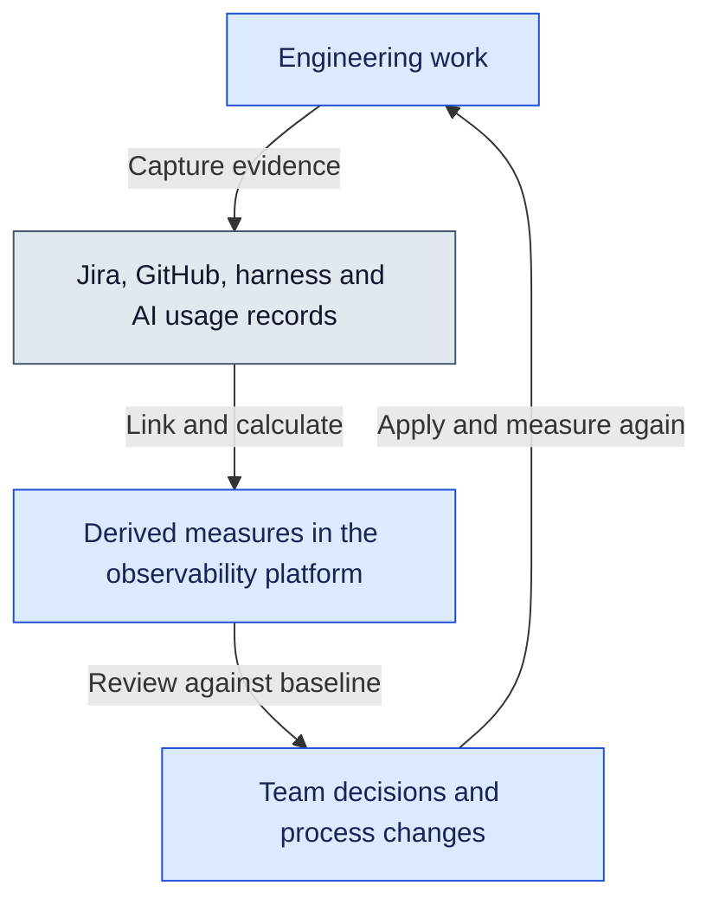

🚧 **DRAFT** — not final, subject to change

# Metrics

The proposed metrics approach makes **measurement part of the engineering process**. As the squad plans, implements, reviews and verifies work, its tools and harness capture the evidence needed to understand time, quality and AI cost. Derived measures turn that evidence into decisions about where to improve the process and whether to extend the pilot.

The [Metrics hypothesis](../../01%20Hypotheses.md#4-—-metrics) starts with **one squad's engineering phase**, using [an observability platform] dashboards to bring together Jira, GitHub, harness records and AI cost/usage. The target extends the same approach across the organisation and the full idea → delivery lifecycle. The definitions below are proposed for the pilot; they require agreement before a baseline is taken.

## From process evidence to decisions

## Sources: capture evidence as work happens

| Source                                | Evidence to capture                                                                                                                          | Where capture belongs in the process                                                                    |
| ------------------------------------- | -------------------------------------------------------------------------------------------------------------------------------------------- | ------------------------------------------------------------------------------------------------------- |
| **Jira**                              | Ticket identity and type, feature/parent links, status transitions, estimates, completion and reopening events.                              | Planning establishes scope and estimates; status changes record progress, waiting and completion.       |
| **GitHub**                            | Ticket-linked PRs, review and merge timestamps, build results, automated test and security-check results; deployment events where connected. | Implementation, review and verification produce these records as the change progresses.                 |
| **Harness**                           | Requirement-to-ticket-to-PR links, phase/step progress, verification evidence, review findings, rework and approved deviations.              | Dev and Design skills record context and outcomes at the step where the work or decision occurs.        |
| **[Client's AI platform] cost/usage** | Model usage, tokens, invocations and spend, attributed to the pilot squad and work item where possible.                                      | AI execution records consumption; attribution connects that consumption to the feature being worked on. |

The [current-state record](/AI%20SDLC/02%20Capture/01%20Current%20State/Metrics.md) describes existing Jira, observability and AI-platform measurement, but AI spend is still typically aggregated without team/workload attribution. Requirement links, harness instrumentation and cost attribution are proposed additions, not assumed existing capabilities. AI usage outside the primary platform would need equivalent records to be included in the cost measure.

**Capture once, reuse for measurement.** Ticket, requirement, PR and feature identifiers join the records across tools. The [engineering harness](../03%20Development%20%28Engineering%29/00%20Overview.md) should record this evidence as part of its normal workflow, so dashboards can derive measures from the same records used to plan and verify the work.

## Derived values: what the data tells us

| Derived value                           | Proposed calculation or interpretation                                                                                                                                                                                                                                           | Required sources                                                                                                      |
| --------------------------------------- | -------------------------------------------------------------------------------------------------------------------------------------------------------------------------------------------------------------------------------------------------------------------------------- | --------------------------------------------------------------------------------------------------------------------- |
| **Engineering lead time**               | Elapsed time from one agreed engineering entry event to one agreed completion event; show the median and a tail percentile. Use phase timestamps to identify where time accumulates.                                                                                             | Jira transitions, GitHub events and harness phase records. Deployment data is required if production is the endpoint. |
| **Time to fix a bug**                   | Elapsed time from the agreed bug start event to a verified fix, with reopened bugs visible. Apply the same boundaries throughout the pilot.                                                                                                                                      | Jira bug history, linked PRs and verification records.                                                                |
| **Team productivity**                   | Proposed proxy: accepted work items completed per period, grouped by work type and size, interpreted alongside available team capacity, rework and quality.                                                                                                                      | Jira completion data, team capacity context, GitHub and harness verification/rework records.                          |
| **Velocity**                            | Story Points completed per sprint within the same squad, using stable estimation and completion rules.                                                                                                                                                                           | Jira sprint, estimate and completion records.                                                                         |
| **Requirements-to-code traceability %** | In-scope requirements with a recorded link to an implemented change ÷ all in-scope requirements × 100. A link establishes traceability; acceptance still needs verification evidence.                                                                                            | Requirement register, harness links and GitHub PRs.                                                                   |
| **Automation-test coverage %**          | Proposed interpretation: in-scope acceptance criteria covered by automated tests ÷ all in-scope acceptance criteria × 100. Track test results alongside coverage; agree this definition before use.                                                                              | Acceptance criteria, criterion-to-test links and automated test reports.                                              |
| **Security-requirement compliance %**   | Applicable security requirements with passing verification evidence ÷ all applicable security requirements × 100. Keep unverified requirements and approved exceptions visible.                                                                                                  | Security requirements, harness evidence and security-check/review results.                                            |
| **AI cost per feature**                 | Attributed AI spend for a feature; for a completed-feature cohort, total attributed spend ÷ completed features. Include retries and failed attempts linked to that work; show unattributed spend separately. This is the hypothesis's AI-cost proxy, not total engineering cost. | [Client's AI platform] or equivalent usage/cost records, feature identifiers and Jira completion data.                |

The three percentage measures are proposed self-monitoring KPIs in the hypothesis. Jira and GitHub alone do not provide their denominators or evidence links; the harness must retain the requirement, test and verification relationships that make them calculable. Missing evidence should remain visible as unknown or unverified, rather than appearing as a passing result.

## Decisions supported by the data

These are potential responses to observed patterns, to be investigated with the squad before changing the process.

| Observed pattern                                                                                          | Potential decision                                                                                                                             |
| --------------------------------------------------------------------------------------------------------- | ---------------------------------------------------------------------------------------------------------------------------------------------- |
| Implementation becomes faster, but engineering lead time stays flat and review/waiting time grows.        | Focus the next improvement on review capacity, approval queues or environment access.                                                          |
| Lead time improves while reopened bugs, rework or failed checks increase.                                 | Strengthen acceptance criteria, verification or review before expanding the workflow.                                                          |
| Traceability is low or refinement decisions are missing from implementation records.                      | Improve the analysis → development hand-off and make requirement links part of planning and PR preparation.                                    |
| Automated coverage is low or applicable security requirements lack verification evidence.                 | Prioritise test automation and security verification for the uncovered requirements; review unresolved exceptions.                             |
| Velocity rises without a corresponding improvement in accepted work, lead time or quality.                | Check estimation and work mix before concluding that team productivity increased.                                                              |
| AI cost per feature rises without an improvement in time or quality.                                      | Inspect repeated attempts, context quality and model usage; adjust the assistant's instructions, task scope or model choice and measure again. |
| Comparable work improves against baseline across time, quality and cost, with adequate evidence coverage. | Consider extending the pilot to another workload or squad, retaining the same measurement definitions.                                         |
| Results are dominated by missing links, inconsistent timestamps or unattributed spend.                    | Fix capture and attribution before drawing conclusions about pilot effectiveness.                                                              |

## Establish a comparable baseline

The [current-state metrics](/AI%20SDLC/02%20Capture/01%20Current%20State/Metrics.md) include conflicting lead-time definitions and story points that are not comparable across squads. Before measuring pilot change, agree the event boundaries, denominators, reporting period and owner for each measure, then collect a baseline using those definitions.

Compare similar work within the pilot squad and record changes in workload, capacity and process. Review time, quality and cost together: a before/after difference is a signal to investigate, not by itself proof that AI caused the change. Agree success thresholds with the pilot owner before interpreting the results.

The pilot can support conclusions about its measured engineering scope. Demonstrating an improvement across the full idea → delivery lifecycle requires the wider sources and process coverage proposed for the target state.
