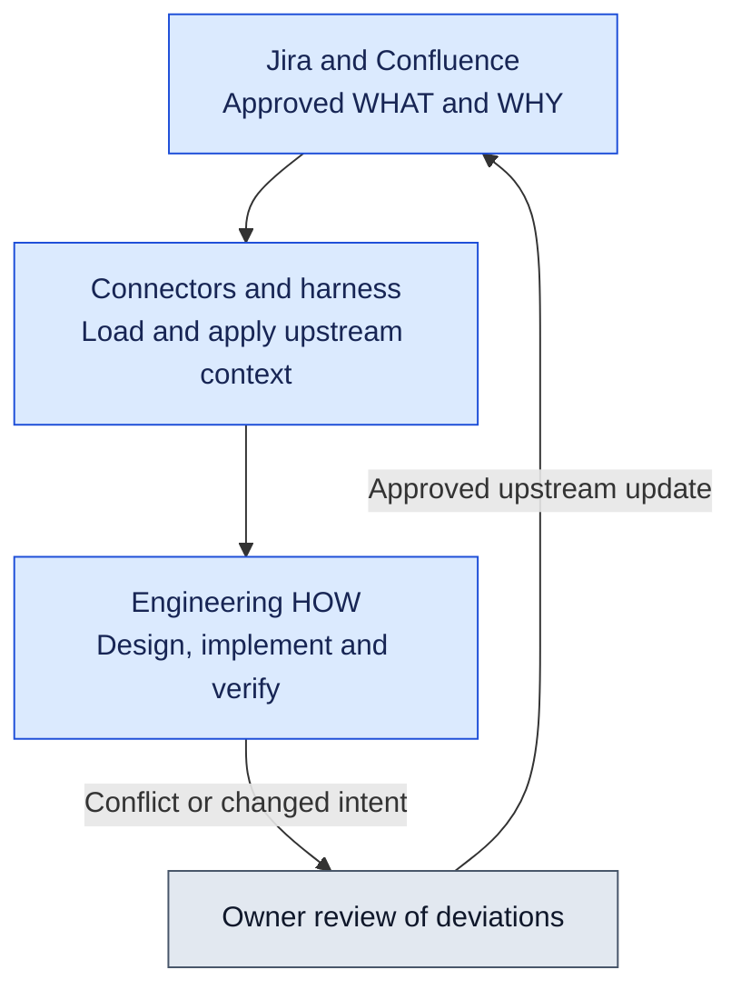

🚧 **DRAFT** — not final, subject to change

# Governance

The proposed governance model makes **upstream intent an explicit constraint on engineering work**. Jira and Confluence hold the agreed WHAT and WHY. Connectors inject the relevant knowledge into the engineering harness; its Design and Dev skills must respect that context when developing and verifying HOW in the project Git repo.

The [Governance hypothesis](../../01%20Hypotheses.md#5-—-governance) is that this connection makes intent drift visible at the analysis → development hand-off and during engineering. Governance comes from the combination of authoritative records, connector access, harness instructions, verification evidence and human decisions.

## Connect context to action

## Authority and responsibility

| Concern                   | Proposed authority and rule                                                                                                                                            |
| ------------------------- | ---------------------------------------------------------------------------------------------------------------------------------------------------------------------- |
| **WHAT and WHY**          | The responsible analysis/product owner approves requirements and intent in Jira/Confluence. Engineering findings can propose changes to these records.                 |
| **HOW**                   | Engineers and technical approvers decide the project solution in Git within upstream requirements and applicable constraints.                                          |
| **Context injection**     | Connectors retrieve the relevant records within source-system permissions. The harness records what was used and checks whether it is suitable for the task.           |
| **Conflicts and changes** | A local design, generated suggestion or code change cannot silently replace upstream intent. Route the discrepancy to the responsible owner and record its resolution. |
| **Evidence of alignment** | Link requirements to plans, PRs and verification results. Human review determines whether the evidence supports acceptance.                                            |

Connector availability alone does not establish approval or currency. The harness needs explicit instructions to distinguish approved context from drafts, identify missing information and refresh context when the relevant source changes.

## Controls within Design and Dev

| Point in the process      | Proposed harness behaviour                                                                                                                                                                                                 | Record produced                                                |
| ------------------------- | -------------------------------------------------------------------------------------------------------------------------------------------------------------------------------------------------------------------------- | -------------------------------------------------------------- |
| **Before planning**       | Load the ticket, linked specification and relevant project documentation. Identify approved scope, acceptance criteria and unresolved questions. If essential context is unavailable, ask the owner before dependent work. | Source links, revision or retrieval time, and identified gaps. |
| **During design**         | Check the proposed HOW against WHAT/WHY and applicable architectural constraints. Expose any requirement changes for upstream approval.                                                                                    | Requirement-to-design links and review decisions.              |
| **During implementation** | Work from the approved plan and context. When upstream changes are detected or notified, assess their impact before continuing affected steps.                                                                             | Progress, affected requirements and recorded deviations.       |
| **During verification**   | Validate acceptance criteria and applicable security requirements using tests and review evidence. A source link alone does not demonstrate compliance.                                                                    | Requirement-to-PR/test links and verification outcomes.        |
| **Before completion**     | Resolve discrepancies, maintain HOW in Git and ensure approved upstream changes are reflected in Jira/Confluence.                                                                                                          | Updated project docs and a traceable completion record.        |

## Handling a deviation

When engineering uncovers a conflict, the assistant records the affected requirement, its source, the proposed technical response and the impact on scope or behaviour. The responsible owner decides whether to clarify or change upstream intent, or require the implementation to conform to the existing intent.

If intent changes, the approved Jira/Confluence record is updated first, then the harness reloads that context and revises the affected HOW. If intent remains unchanged, engineering corrects its design or implementation. The decision and verification evidence stay linked so later reviews can follow what happened.

## Evidence for decisions

| Signal                                                                         | Decision it can support                                                      |
| ------------------------------------------------------------------------------ | ---------------------------------------------------------------------------- |
| Required context is repeatedly missing or inaccessible.                        | Improve source ownership, connector access or the analysis hand-off.         |
| The same requirement repeatedly triggers ambiguity or rework.                  | Clarify the upstream specification and improve readiness rules.              |
| Implementation diverges from loaded, approved requirements.                    | Correct the change and examine the harness instructions and review controls. |
| Upstream changes are discovered late.                                          | Adjust refresh triggers and impact-review practices.                         |
| Traceability and verification evidence improve alongside engineering outcomes. | Consider extending the governance model to another workload.                 |

These records feed the [derived metrics](../05%20Metrics/Overview.md), including requirements-to-code traceability and security-requirement verification. The scope here is intent-to-outcome governance. The hypothesis treats the wider AI data-governance topic separately.

## Pilot setup

For one squad and workload, agree the upstream owners, authoritative records, source permissions, context-loading and refresh points, and the route for resolving deviations. Configure these rules in the harness and exercise them on real changes. This is a proposed operating model; the connector wiring and checks require implementation and validation during the pilot.
