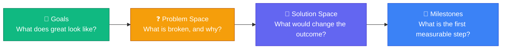

# Connect Framework

> [!TIP] Four Lists, One Living System
>
> Connect organizes complex engagements into four interconnected lists — Goals, Problem Space, Solution Space, and Milestones. These lists are not static documents — they are living artifacts that evolve as the team learns. The framework's value is keeping them in harmony: goals anchor problems, problems produce solutions, solutions feed milestones, and milestones prove goal achievement.

## How the Lists Connect

Goals anchor Problems. Problems produce Solutions. Solutions feed Milestones. Milestones prove Goals.

The framework applies at every scale: to the [[ENGAGEMENT_LENGTH]] engagement as a whole, to each workshop day, and to each individual session. The arc is the same; only the grain changes.

## Key Principles

| Principle              | What it means                                                                                                                                                   |
| ---------------------- | --------------------------------------------------------------------------------------------------------------------------------------------------------------- |
| **Living, not static** | These lists evolve as the team learns; priorities change and items get added, split, merged, resolved, or deferred.                                             |
| **Traceability**       | Every solution traces back to a problem; every milestone traces forward to an outcome; every decision is logged. You can always answer "why did we build this?" |
| **AI-augmented**       | Agents process meeting notes and recommend list changes as change sets for human review; the AI proposes, the team decides — judgment stays with people.        |

---

## The Four Lists

> [!NOTE] Living Pages
> This page describes the framework itself and does not change during the engagement. Each list below has its own page holding today's best understanding — a placeholder at the start, filled in and revised as workshops progress.

### 🎯 Goals

> **What does great look like for [[CLIENT_NAME]]?**

Strategic intents, ordered by importance. Goals define what success looks like and anchor every other list. They answer: why does this engagement exist?

**Examples**

- Achieve 60% digital adoption rate
- Reduce transaction processing costs by 30%
- Establish zero-trust security architecture

→ [02 Goals](./02%20Goals.md) for [[CLIENT_NAME]]'s current goals.

### ❓ Problem Space

> **Where is time lost, and what is the root cause?**

Things to figure out, in priority order. Problems enter, get worked, produce solutions and decisions, then resolve. The priority ordering across types is what matters.

**Examples**

- Legacy system integration constraints
- Data quality and fitness gaps
- Security and compliance interpretation

→ [03 Problem Space](./03%20Problem%20Space.md) for the current hypothesis and domains under diagnosis.

### 🔧 Solution Space

> **What would change the outcome — not just the speed?**

Work to do, organized by team. Each solution traces back to the problem it addresses and points forward to the milestone it enables. Solutions are sized and assigned.

**Examples**

- API anti-corruption layer
- ML risk scoring engine
- HIPAA compliance infrastructure

→ [04 Solution Space](./04%20Solution%20Space.md) for the current evaluation dimensions and pilot options.

### 🚩 Milestones

> **What is the first measurable step, and who owns it?**

Outcome-based waypoints. Defined not by scope delivered but by what becomes possible. Each milestone has a target date, budget envelope, and measurable outcomes.

**Examples**

- Platform foundation complete
- MVP features live in production
- Full digital suite & cost targets met

→ [05 Milestones](./05%20Milestones.md) for the current milestone plan.
