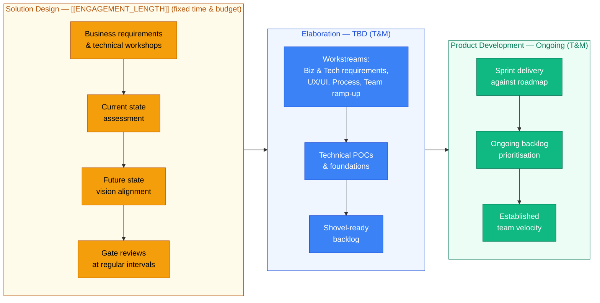

# Overview

> [!WARNING] Populated During Engagement
> Aiming toward a clear phased approach — scope, phases, timelines, and team composition all settled. What follows is a placeholder shape; content is filled in as it's agreed with [[CLIENT_NAME]] and as later phases are scoped.

---

## Scope

**Objectives:**

- Establish a shared view of how AI can meaningfully improve software delivery at [[CLIENT_NAME]]
- Identify the highest-impact SDLC bottlenecks where AI can drive measurable change
- Align key stakeholders on priorities, approach, and success criteria before widening the programme
- Align on the North Star vision and the iterative path to get there
- Ensure DataArt's engagement complements any AI investment [[CLIENT_NAME]] already has, rather than creating competing effort

**Constraints:**

| Constraint               | Detail                                                            |
| ------------------------ | ----------------------------------------------------------------- |
| Timeline                 | Fixed [[ENGAGEMENT_LENGTH]] Solution Design phase                 |
| [[CLIENT_NAME]] capacity | TBD — agreed with [[CLIENT_NAME]] at kickoff                      |
| DataArt role             | Expert guidance and spike leadership — not embedded delivery      |
| Data risk                | Availability and quality are known risks                          |
| Stakeholder availability | Gate reviews require consistent [[CLIENT_NAME]] senior attendance |

---

## Phases

| Phase               | Shape                                      | Status          |
| ------------------- | ------------------------------------------ | --------------- |
| Solution Design     | [[ENGAGEMENT_LENGTH]], fixed time & budget | Not yet started |
| Elaboration         | TBD, time & materials                      | Not yet started |
| Product Development | Ongoing, time & materials                  | Not yet started |

---

## Timelines

| Gate   | Timing                                     | Milestone                                |
| ------ | ------------------------------------------ | ---------------------------------------- |
| Gate 0 | Start of Solution Design                   | Solution Design Framework established    |
| Gate 1 | ~First quarter of Solution Design window   | First iteration of SDFD deliverables     |
| Gate 2 | ~Two-thirds through Solution Design window | Second iteration of SDFD deliverables    |
| Gate 3 | End of Solution Design                     | Final Solution Design Framework Document |

The live, tracked milestone list (what/who/by-when) is [Connect Framework — Milestones](/AI%20SDLC/Connect%20Framework/05%20Milestones).

---

## Team Composition

_Typical stakeholder shape for this kind of engagement — adjust to who's actually in the room._

| Role                        | Name   | Organisation    |
| --------------------------- | ------ | --------------- |
| CTO                         | [NAME] | [[CLIENT_NAME]] |
| VP of Software Engineering  | [NAME] | [[CLIENT_NAME]] |
| Product Director            | [NAME] | [[CLIENT_NAME]] |
| Head of Procurement         | [NAME] | [[CLIENT_NAME]] |
| Principal Engineer — DevOps | [NAME] | [[CLIENT_NAME]] |
| Enterprise Architect        | [NAME] | [[CLIENT_NAME]] |
| Principal Engineer          | [NAME] | [[CLIENT_NAME]] |
| Compliance / Security       | TBC    | [[CLIENT_NAME]] |
| Director, CxO Advisory      | [NAME] | DataArt         |
| Solutions Consultant        | [NAME] | DataArt         |
| Solutions Consultant        | [NAME] | DataArt         |
| Project Manager             | [NAME] | DataArt         |
| Delivery Manager            | [NAME] | DataArt         |

Gate reviews typically include senior stakeholders from both sides — confirm the specific attendee list per gate.
