# 1. What is this tool?

::: tip &#8203;
A shared, evidence-led workspace for understanding a client’s SDLC and designing its path to AI-first delivery.
:::

[DataArt’s Connect Framework](<../AI SDLC/01 Engagement/06 Reference/01 Connect Framework.md>) is a broader engagement methodology. **This tool is inspired by Connect and narrows its scope to ADLC discovery only**: understanding the current SDLC, diagnosing problems, aligning goals, and defining a proposed solution and roadmap.

Living documentation and AI-assisted workflows connect three phases:

| Phase           | Purpose                                                                                         |
| --------------- | ----------------------------------------------------------------------------------------------- |
| **Investigate** | Capture today’s workflow, diagnose root causes, and ground strategic intent in evidenced goals. |
| **Solution**    | Define the target state and pilot, then plan how learning informs scale and evolution.          |
| **Roadmap**     | Sequence milestones, work, ownership, and timelines into a delivery plan.                       |

The artifacts evolve as the team learns. Each recommendation stays connected to the evidence and intent behind it.

## The technical view

One Git repository brings together the engagement content, AI workflows, and everything needed to publish the workspace.

| Component                       | Role                                                                                                        |
| ------------------------------- | ----------------------------------------------------------------------------------------------------------- |
| **Repository**                  | Versions the work and supports collaboration through branches, commits, and pull requests.                  |
| **AI harness**                  | Skills, agents, project instructions, and conventions guide discovery, design, and engineering work.        |
| **Markdown documents**          | Store the methodology, workshop evidence, findings, decisions, and Mermaid diagrams as editable files.      |
| **VitePress web app**           | Turns the Markdown into a searchable, navigable documentation site with local preview.                      |
| **Infrastructure as code**      | AWS CDK defines S3 hosting, CloudFront delivery, and Lambda@Edge access protection.                         |
| **CI/CD**                       | GitHub Actions and Nx automate checks, builds, and deployment of affected components.                       |
| **Bootstrap and configuration** | Personalize the starter for a client’s identity, repository, and deployment setup.                          |
| **Review and governance**       | Git history, pull requests, evidence checks, and human approval gates keep changes and decisions traceable. |
| **Access and feedback**         | Protected site access and Giscus discussions support controlled sharing and feedback.                       |

## The flow

```mermaid
flowchart LR
    IN["🗯️ Strategic Intent\nWhy does this engagement exist, raw?"]

    subgraph InvestigateGroup["🔍 Investigate: What's driving this, what's broken, and what's worth solving?"]
        direction TB
        G["🎯 Goals\nWhat's evidenced and worth solving?"]
        C["👁️ Capture\nWhat's actually happening today?"]
        P["❓ Problem\nWhat is broken, and why?"]
        C --> P --> G
    end

    subgraph SolutionGroup["🔧 Solution: What would change the outcome — not just the speed?"]
        direction TB
        TSt["Target State\nWhat does the end state actually look like?"]
        Pi["Pilot\nWhat's the one thing we prove first, and how?"]
        Sc["Scale\nHow does the proven pattern extend beyond the pilot?"]
        Ev["Evolve\nWhat do we change based on what we've learned?"]
        TSt --> Pi --> Sc --> Ev
        Ev -.->|"feed learnings back"| Pi
        Ev -.->|"refines"| TSt
    end

    R["🗺️ Roadmap\nWhat's the phased plan?"]

    IN -.->|"informs"| C
    IN -.->|"grounds + re-scopes"| G
    IN -.->|"anchors"| TSt
    InvestigateGroup --> SolutionGroup --> R

    classDef intent fill:#F59E0B,stroke:#B45309,color:#000
    classDef capture fill:#8B5CF6,stroke:#5B21B6,color:#fff
    classDef problem fill:#EF4444,stroke:#B91C1C,color:#fff
    classDef goals fill:#10B981,stroke:#047857,color:#fff
    classDef target fill:#8B5CF6,stroke:#5B21B6,color:#fff
    classDef pilot fill:#F59E0B,stroke:#B45309,color:#000
    classDef scale fill:#3B82F6,stroke:#1D4ED8,color:#fff
    classDef evolve fill:#10B981,stroke:#047857,color:#fff
    classDef roadmap fill:#3B82F6,stroke:#1D4ED8,color:#fff

    class IN intent
    class C capture
    class P problem
    class G goals
    class TSt target
    class Pi pilot
    class Sc scale
    class Ev evolve
    class R roadmap

    style InvestigateGroup fill:#F5F3FF,stroke:#8B5CF6,color:#6D28D9
    style SolutionGroup fill:#EEF2FF,stroke:#6366F1,color:#4338CA
```

## Strategic Intent

**Why does this engagement exist?** Strategic Intent captures the sponsor’s original trigger, close to their own words, from sales conversations, an RFP, or kickoff. It can be an ambition, concern, or business pressure before the team knows its root cause or the right solution.

### What it looks like

_Illustrative examples, not statements from a client engagement._

| Trigger                           | Sponsor’s words                                                                                               |
| --------------------------------- | ------------------------------------------------------------------------------------------------------------- |
| **Unclear return on AI spend**    | “We keep investing in AI tools, but we cannot tell whether delivery is getting better.”                       |
| **Pressure on delivery capacity** | “We are expecting a smaller team to deliver more with AI. We need to understand what that requires.”          |
| **Ambition ahead of readiness**   | “We want agents to handle more of development, testing, and release. We need to know what must change first.” |

Each statement retains its source and context. Workshops test the assumptions behind it; diagnosed problems then ground and narrow it into **Solution Goals**. Intent explains why discovery starts—it does not establish a confirmed problem or an approved solution.

## When to use this tool

Use this tool when the team needs to investigate how software delivery works and agree on what to change. The table helps distinguish discovery work from work that is already ready for delivery.

| Case                             | Use                                                                                                    | Don’t use                                                                                    |
| -------------------------------- | ------------------------------------------------------------------------------------------------------ | -------------------------------------------------------------------------------------------- |
| **Starting a client engagement** | Understand the client’s workflow, priorities, and constraints when the starting picture is incomplete. | Repeat discovery that is already current, supported by evidence, and agreed with the client. |
| **Improving delivery**           | Investigate recurring delays, rework, or handoff problems whose causes are unclear.                    | Manage a routine fix when the cause and required change are already understood.              |
| **Exploring AI adoption**        | Assess where AI could help, what the team needs first, and which outcomes matter.                      | Set up an already selected tool or roll out an agreed change.                                |
| **Choosing a solution or pilot** | Check assumptions, compare options, and agree on what a pilot should prove.                            | Build a pilot whose scope, success criteria, and supporting evidence are already agreed.     |

Discovery produces the understanding needed for solution design and delivery planning. If delivery reveals a new uncertainty, the team can return to the relevant discovery work.

## Related references

- [Strategic Intent](<../AI SDLC/04 Goals/02 Strategic Intent.md>) — the sponsor’s starting point and illustrative patterns
- [Solution Goals](<../AI SDLC/04 Goals/03 Solution Goals.md>) — intent grounded in diagnosed problems

- [Process Overview](<../AI SDLC/01 Engagement/03 Process/01 Overview.md>) — the engagement model and original diagram
- [Connect Framework](<../AI SDLC/01 Engagement/06 Reference/01 Connect Framework.md>) — the broader method and its ADLC adaptation

- [System Overview](<../Target Architecture (HLD)/v1/System Overview.md>) — the platform architecture and its components

---

[Presentation](index.md) · [Next](<02 How the Engagement Runs.md>)
