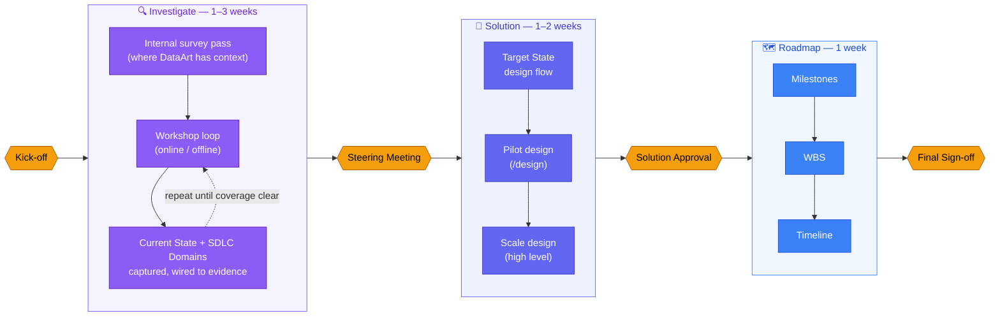

# 2. Progress through evidence and decisions

::: tip &#8203;
Three working phases. Four human checkpoints. A clear next decision.
:::

Investigate establishes supported problems and priorities. Solution defines the target state and pilot. Roadmap turns the approved approach into a plan the client can staff and fund.

**Four gates connect the phases:** Kick-off → Steering Meeting → Solution Approval → Final Sign-off. Each closes on evidenced criteria and recorded stakeholder decisions. The durations in the diagram are planning guidance; new evidence can reopen affected work.

::: info AI support today
`/discovery` guides investigation and gate preparation. Its Solution and Roadmap routes are manual handoffs; solution design uses `/design`.
:::

## The flow

## Related references

- [How the Engagement Runs](<../AI SDLC/01 Engagement/03 Process/03 How the Engagement Runs.md>) — gate criteria and original diagram
- [Where We Are](<../AI SDLC/01 Engagement/04 Where We Are/01 Engagement.md>) — recorded phase, decisions, and next actions

---

[Presentation](index.md) · [Previous](<01 What Is This Tool.md>) · [Next](<03 Evidence Chain.md>)
