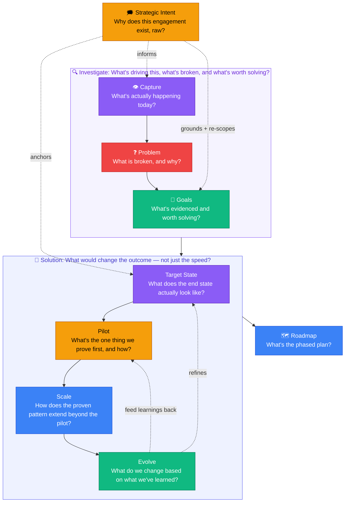

# Tool capabilities

[Presentation index](index.md) · [Previous](<01 The Discovery Challenge.md>) · [Next](<03 Engagement Flow.md>)

**Agenda section 2 · Suggested slides 3–4**

## Audience takeaway

The tool connects a repeatable discovery method, shared evidence, AI-assisted work, and reviewed artifacts.

## The workspace’s underlying model

Source: [Process Overview](<../AI SDLC/01 Engagement/03 Process/01 Overview.md>). Diagram reused unchanged.

**Talk through the diagram:** Start with strategic intent. Follow Capture → Problem → Goals. Point to the target-state and pilot loop, then the roadmap. Use this as an orientation map; review mechanics are on the next pages.

## Capability tour and speaker script

### Definition

> ADLC Discovery combines an engagement methodology, workshop materials, shared documentation, and AI-assisted workflows. It provides a structure for understanding a client’s development lifecycle and deciding where changes, including AI adoption, could help.
>
> The methodology organizes the work. Workshops capture evidence and stakeholder perspectives. Documentation keeps the team’s understanding and decisions available. AI workflows help process that material and prepare it for review.

### Guided workspace tour

Use the tool’s structure to explain where people go and what they do. Show representative pages or templates; there is no need to introduce a client narrative here. Identify templates as templates.

Frame each stop as a capability and show the corresponding artifact. Let the audience see what they can do, alongside where the material lives.

| Capability                               | Visible demonstration                                                                                |
| ---------------------------------------- | ---------------------------------------------------------------------------------------------------- |
| Organize discovery                       | Open the engagement process and workshop agenda structure                                            |
| Capture and structure evidence           | Show the relationship between a transcript, notes, and outcomes                                      |
| Develop and inspect findings             | Show current-state, domain, and problem structures and their source references                       |
| Connect findings to intended outcomes    | Show where solution goals link to problems and strategic intent                                      |
| Structure solution and delivery planning | Show target-state, pilot, and roadmap artifacts, explaining current automation limits                |
| Assist contributors with AI              | Show a rehearsed prompt and its source-linked response during section 4                              |
| Review work and track progress           | Show contribution guidance, a review example where available, and the phase tracker during section 4 |

| Area           | What to show                                               | Presenter wording                                                                                       |
| -------------- | ---------------------------------------------------------- | ------------------------------------------------------------------------------------------------------- |
| Engagement     | Process and “Where We Are” pages                           | “This is where we orient ourselves: how the engagement works, its current phase, and what is next.”     |
| Capture        | Workshop agenda, transcript, notes, and outcomes structure | “This is where we keep what we heard and learned, with the source material available for later review.” |
| Problem Space  | Domain pages and problems registry                         | “Here we organize observations and develop supported diagnoses of the problems.”                        |
| Goals          | Strategic intent and solution goals                        | “Here we connect what leadership wants to achieve with the improvements justified by the findings.”     |
| Solution Space | Target state, pilot, scale, and evolve structure           | “This organizes the proposed approach and how we intend to test and develop it.”                        |
| Roadmap        | Milestones, work breakdown, and timeline                   | “This turns the agreed solution into work that can be sequenced, staffed, and planned.”                 |

After the tour:

> The site gives people a way to read and navigate this shared material. The documents and workflows sit in the repository, where contributions can be changed and reviewed. We’ll look at that contribution experience shortly.

### What connects the areas

> These sections are connected. A problem should point back to evidence. A solution goal should address a diagnosed problem and be assessed against strategic intent. A proposed solution should explain which goals it covers.
>
> Those connections let a colleague check the reasoning, question an interpretation, or understand the effect of a change without relying entirely on the person who wrote the document.

### Transition

> That is the workspace. Now let’s look at how the team moves through it during an engagement.

## Live navigation stops

| Audience question                     | Open in the repository                                                        |
| ------------------------------------- | ----------------------------------------------------------------------------- |
| Where do I begin?                     | [Engagement](<../AI SDLC/01 Engagement/01 Overview.md>)                       |
| Where is workshop material organized? | [Capture](<../AI SDLC/02 Capture/00 Overview.md>)                             |
| How are problems recorded?            | [Problems registry](<../AI SDLC/03 Problem Space/02 Diagnose/02 Problems.md>) |
| What are we trying to improve?        | [Solution goals](<../AI SDLC/04 Goals/03 Solution Goals.md>)                  |
| Where is the proposed approach?       | [Solution Space](<../AI SDLC/05 Solution Space/00 Overview.md>)               |
| How is delivery planned?              | [Roadmap](<../AI SDLC/06 Roadmap/01 Overview.md>)                             |

**Show, then explain:** Open one representative page and identify its source fields, status, and review information. The template shows the expected structure; populated client evidence belongs in its own engagement workspace.

---

[Presentation index](index.md) · [Previous](<01 The Discovery Challenge.md>) · [Next](<03 Engagement Flow.md>)
