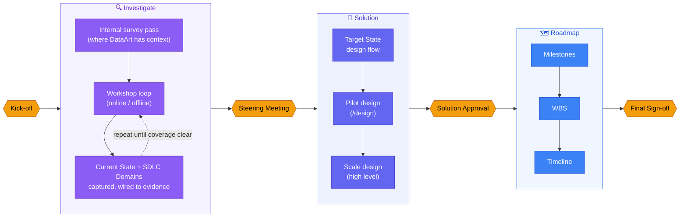
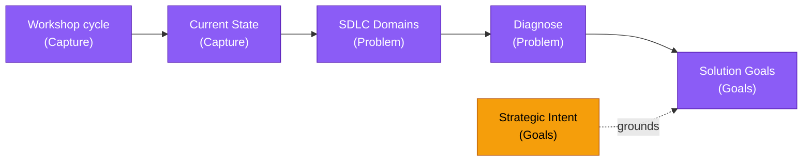

# Engagement flow

[Presentation index](index.md) · [Previous](<02 Tool Capabilities.md>) · [Next](<04 Evidence Chain.md>)

**Agenda section 3, first part · Suggested slide 5**

## Audience takeaway

An engagement moves through Investigate, Solution, and Roadmap, with evidence and review decisions controlling progression.

## Three phases, four gates

Source: [How the Engagement Runs](<../AI SDLC/01 Engagement/03 Process/03 How the Engagement Runs.md>). Diagram reused with duration labels omitted; indicative durations remain in the presentation index.

**Caption:** Each phase is opened by a gate and closed by the next one.

**Reveal order:** Kickoff and intent → Investigate and findings → Solution and designs → Roadmap and delivery commitments.

## Speaker script and review decisions

| Phase       | Main question                                                             | Closing decision                                                                 |
| ----------- | ------------------------------------------------------------------------- | -------------------------------------------------------------------------------- |
| Investigate | What is happening, which problems are evidenced, and what should improve? | Gate 1: agree on findings and prioritized solution goals                         |
| Solution    | What approach addresses those problems and goals?                         | Gate 2: approve target-state and pilot designs, plus scale design where included |
| Roadmap     | What will delivery require, and in what sequence?                         | Gate 3: sign off milestones, work breakdown, team composition, and timeline      |

### Presenter narrative

> We begin with Gate 0, the kickoff. We capture and review strategic intent and an early direction. That gives discovery a starting point, while keeping early ideas open to validation.
>
> Investigate establishes the current state, diagnoses problems, and develops solution goals. Workshops help us fill gaps and test interpretations. We may need several passes before the findings are ready for review.
>
> Solution develops the target approach and pilot design. Roadmap establishes the sequence of work, dependencies, and team needed to deliver it.
>
> The gates make the decisions explicit. We move forward when the required material has been reviewed and the closing criteria are met. The calendar helps us plan, but the evidence and agreement determine readiness.

## What a workshop feeds

Source: [Investigate Orchestration](<../AI SDLC/01 Engagement/05 Workflows/03 Investigate/00 Orchestration.md>). Diagram reused with duration labels omitted; indicative durations remain in the presentation index.

**Caption:** A workshop can update several connected artifacts. Each downstream step uses the evidence assembled upstream.

**Optional talking point:** “We repeat the investigation loop until coverage is clear. We may revisit an item when new evidence changes the diagnosis.”

## Transition to the evidence chain

> That tells us when we review. Now let’s look at what makes the work reviewable: the connections between a source, a finding, and a decision.

---

[Presentation index](index.md) · [Previous](<02 Tool Capabilities.md>) · [Next](<04 Evidence Chain.md>)
