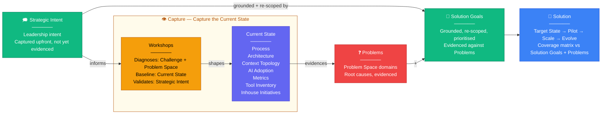

# 3. Every recommendation has a reason

::: tip &#8203;
Trace a proposed change back to the problem, the source, and the intent it serves.
:::

Workshop records preserve what was heard. Derived pages explain what the team concludes and why. Source links and changelogs connect each goal to its diagnosed problem and strategic intent.

| Evidence                      | What it establishes                |
| ----------------------------- | ---------------------------------- |
| **Source citation**           | Where a statement came from.       |
| **Independent corroboration** | Support for a Confirmed problem.   |
| **Measured impact**           | A number backing the impact claim. |

Corrections flow into affected downstream artifacts, keeping the reasoning reviewable as understanding changes.

## The flow

## Related references

- [Evidence Chain](<../AI SDLC/01 Engagement/03 Process/04 Evidence Chain.md>) — traceability principles and original diagram
- [Problems registry](<../AI SDLC/03 Problem Space/02 Diagnose/02 Problems.md>) — findings, citations, and confidence
- [Solution Goals](<../AI SDLC/04 Goals/03 Solution Goals.md>) — the connection between problems and intent

---

[Presentation](index.md) · [Previous](<02 How the Engagement Runs.md>) · [Next](<04 Collaboration.md>)
