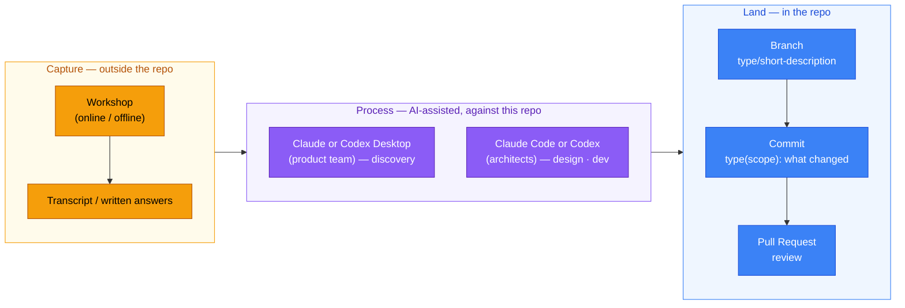

# 4. One workspace, shared contribution

::: tip &#8203;
People bring context. AI helps structure it. The team reviews what becomes shared knowledge.
:::

The product team and architects contribute to the same repository. The web app makes reviewed material easy to read and navigate. AI helps process evidence and identify gaps; people validate interpretations and own the decisions.

| Contribution                   | Shared outcome                                          |
| ------------------------------ | ------------------------------------------------------- |
| **Workshop input**             | Source material the team can revisit.                   |
| **AI-assisted synthesis**      | Proposed notes, findings, and linked updates.           |
| **Branch, commit, and review** | Traceable changes to the engagement’s shared knowledge. |

The two collaboration cases cover joining an engagement and updating a delivery plan.

## The flow

## Related references

- [Team Collaboration](<../AI SDLC/01 Engagement/07 Contribution/01 Team Collaboration.md>) — roles, contribution flow, and original diagram
- [Quick Walkthrough](<../AI SDLC/01 Engagement/07 Contribution/06 Quick Walkthrough.md>) — copyable prompts for exploring the workspace
- [Getting started case](<05 Getting Started Case.md>) — orientation for a new colleague
- [Day-to-day collaboration case](<06 Day-to-Day Collaboration Case.md>) — a plan update from repository check to a reviewed, deployed change

---

[Presentation](index.md) · [Previous](<03 Evidence Chain.md>) · [Next](<05 Getting Started Case.md>)
