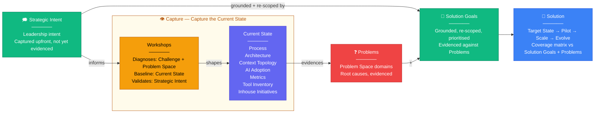

# Evidence chain

[Presentation index](index.md) · [Previous](<03 Engagement Flow.md>) · [Next](<05 Collaboration.md>)

**Agenda section 3, second part · Suggested slide 6**

## Audience takeaway

Every derived conclusion should be traceable to the evidence and intent that justify it. Status tells us what has actually been validated.

## Two source threads, one evidence chain



Source: [Evidence Chain](<../AI SDLC/01 Engagement/03 Process/04 Evidence Chain.md>). Diagram reused unchanged.

**Caption:** Workshop evidence explains the situation; strategic intent explains the purpose. They meet in solution goals.

**Talk through the picture:** Point first to Strategic Intent, then Workshops and Current State. Follow the path through Problems to Solution Goals. Explain that the roadmap is derived downstream of the solution even though this source diagram ends at Solution.

## Speaker script and demonstration

Show: strategic intent + workshop evidence → current state and domain findings → problems → solution goals → solution → roadmap.

Demonstrate how the links work in the workspace: open a problem’s evidence reference, show the source it points to, then show where a goal references the problem. Use prepared representative material with its status clearly labeled. Save the real client’s context and results for section 6. If a template has no populated links, explain the expected connection without presenting it as an existing trace.

> Strategic intent tells us what the organization wants. Workshop evidence helps us understand the situation. The goals bring those threads together, and the solution and roadmap build on them.
>
> If new evidence changes a diagnosis, we revisit the dependent goals and solution choices. We preserve the original workshop record and record the later correction, so the team can understand why the interpretation changed.
>
> This describes the engagement method. The degree of AI assistance depends on the workflow currently available and the review needed at that step.

**Presenter note:** The repository currently labels `/discovery-solution` and `/discovery-roadmap` as stubs. Explain the complete methodology without claiming that every phase is already automated end to end.

## Reading status correctly

| Artifact           | What the repository’s status means         | What it does not establish            |
| ------------------ | ------------------------------------------ | ------------------------------------- |
| Problem: Reported  | Raised by a source                         | Independent corroboration             |
| Problem: Confirmed | Corroborated by another independent source | Quantified impact                     |
| Problem: Measured  | Impact backed by a number                  | Stakeholder approval of a solution    |
| Goal: Shaped       | Drafted and grounded in evidence           | Stakeholder confirmation              |
| Goal: Confirmed    | Validated with stakeholders                | An executed pilot or measured benefit |

Sources: [Problems registry](<../AI SDLC/03 Problem Space/02 Diagnose/02 Problems.md>) and [Solution Goals](<../AI SDLC/04 Goals/03 Solution Goals.md>).

## Review and correction

```mermaid
sequenceDiagram
    participant Lead as Discovery Team
    actor Stake as Stakeholders
    participant PR as Problems
    participant SG as Solution Goals
    participant SI as Strategic Intent

    Note over Lead,Stake: Manual — online or offline
    Lead->>Stake: Present consolidated findings — Problems + Current State + draft Solution Goals
    Stake-->>Lead: Approve, or flag concerns

    rect rgb(239, 246, 255)
    Note over Lead,SG: Align and prioritise
    Lead->>PR: Align Problems against each other, rank by impact
    Lead->>SG: Align Solution Goals against Problems, prioritise
    end

    rect rgb(255, 251, 235)
    Note over Lead,SI: Score fit
    Lead->>SI: Map each Solution Goal's fit against Strategic Intent
    SI-->>Lead: e.g. "80% fit; 3 items flagged for re-evaluation"
    end

    alt Findings hold, fit is acceptable
        Lead->>PR: Mark Confirmed + Changelog
        Lead->>SG: Mark Confirmed + Changelog
        Note over Lead,SG: Gate 1 closed — unlocks the Solution workflow
    else Items flagged
        Lead-->>Lead: Re-open the flagged item at whichever stage or phase originated it
        Note over Lead: Reprocesses forward through every layer downstream of it — justified by the evidence that raised it, not opinion
    end
```

Source: [Gate Review](<../AI SDLC/01 Engagement/05 Workflows/02 Gate Review.md>). Diagram reused unchanged.

**Presenter note:** The source diagram’s “80% fit” is an illustrative example, not a metric from this tool instance or from Collinson. Show this supporting diagram only if the audience asks how review affects the chain.

**Point to the correction branch:** New evidence can reopen the relevant item and cause its downstream conclusions to be reviewed. Keep the original workshop history and record why the interpretation changed.

## Transition

> These links let someone else check our reasoning. Let’s look at how contributors and reviewers actually work with the shared material.

---

[Presentation index](index.md) · [Previous](<03 Engagement Flow.md>) · [Next](<05 Collaboration.md>)
