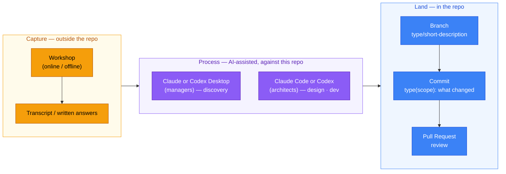
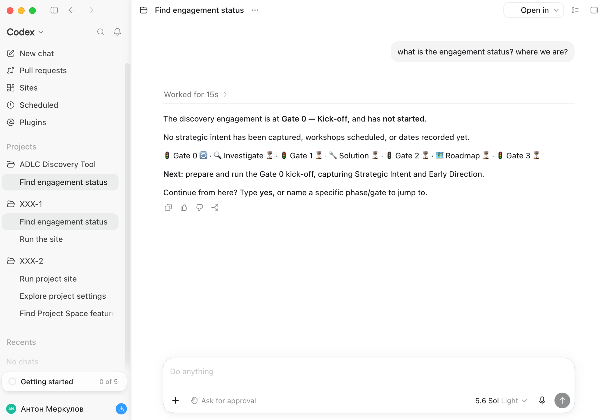
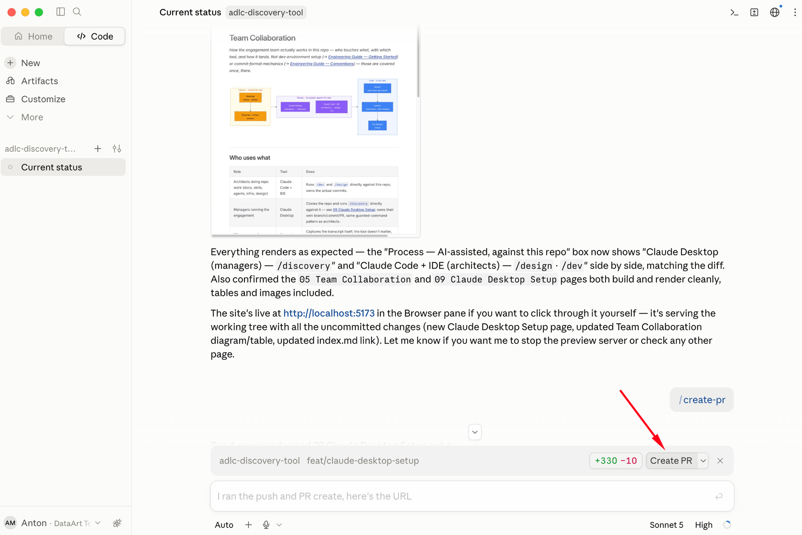
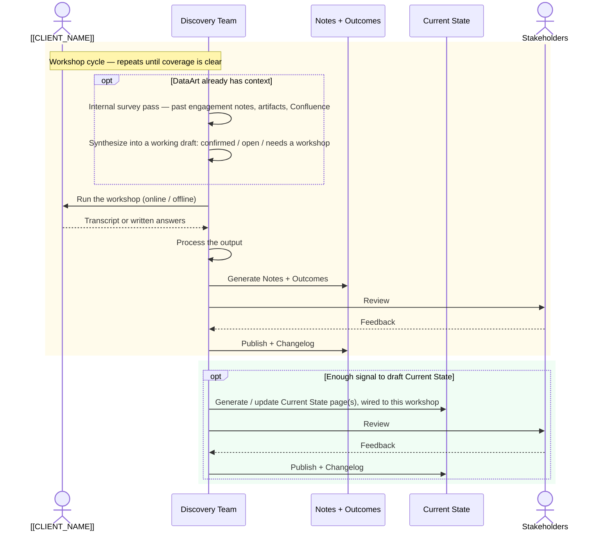

# Collaboration and contributor experience

[Presentation index](index.md) · [Previous](<04 Evidence Chain.md>) · [Next](<06 Starting an Engagement.md>)

**Agenda section 4 · Suggested slides 7–8**

## Audience takeaway

Contributors bring context, AI assists the work, and review makes the result dependable enough to share. People outside engineering are active participants in that process.

## Capture, process, review

Source: [Team Collaboration](<../AI SDLC/01 Engagement/07 Contribution/01 Team Collaboration.md>). Diagram reused unchanged.

**Caption:** Workshop capture happens outside the repository; contributors process the material against shared context and submit changes for review.

**Explain the terms simply:** A branch holds proposed changes. A commit records an update. A pull request presents changes for review. Human stakeholder review and repository review support different decisions; merging a change alone does not close an engagement gate.

## Real interface examples from the repository

**Caption:** A natural-language question provides an entry point into the engagement context.

**Caption:** Proposed changes are made available for review.

These are existing setup-guide screenshots, not new captures of this session. Use whichever interface matches the contributors’ actual experience.

Sources: [Codex Desktop Setup](<../AI SDLC/01 Engagement/07 Contribution/03 Codex Desktop Setup.md>) and [Claude Desktop Setup](<../AI SDLC/01 Engagement/07 Contribution/02 Claude Desktop Setup.md>).

## Host script and contributor handoffs

### Host: collaboration and AI assistance

Show the contribution flow: capture → AI-assisted processing → human review → publication → progress update.

> People contribute their knowledge through workshops, source material, corrections, and reviews. The person running a workshop captures the discussion. Contributors use the workspace and an AI assistant to help organize that material and prepare updates. The team reviews the changes before treating them as shared conclusions.
>
> AI can help us navigate the context, prepare drafts, and identify gaps or inconsistencies. We still need people to check whether an interpretation is accurate and whether a decision is justified.
>
> Changes are reviewed through the repository contribution process. For contributors, the practical questions are: what am I trying to update, what supports that update, who needs to review it, and how do I know it has been accepted?

Show where contribution guidance lives. Briefly explain branches and pull requests as a proposed set of changes and its review; adjust the level of technical detail to the audience.

An optional short AI interaction can use this read-only prompt:

> Explain the engagement structure and where a workshop contributor should begin. Cite the relevant guidance and identify which steps need review. Do not modify files.

Use a saved interaction if a live response would interrupt the pacing.

### Getting started case

**Case introduction:**

> This case explores the first contribution: the task, the starting material, the support needed, and what helped the contributor get started.

Questions to explore:

- What were you trying to do with the tool?
- What could you do yourself, and where did you need support?
- How did you interact with the AI assistant and review its output?
- What felt unfamiliar or confusing?
- What advice would you give someone in a similar role?

Case outline, completed from actual contributor feedback:

> Task: [TASK]. Starting point: [INPUT OR GUIDANCE]. Workflow and reviewed output: [WORKFLOW / OUTPUT]. Friction: [FRICTION]. Helpful support: [SUPPORT]. Advice for a new contributor: [ADVICE].

A brief view of the contribution can illustrate the case. Keep the focus on using the tool rather than the surrounding client history.

### Day-to-day collaboration case

**Case introduction:**

> This case explores day-to-day collaboration: finding context, sharing a contribution, reviewing it with others, and identifying what could work better.

Questions to explore:

- How did you find the context you needed?
- How did you share a contribution or ask for a correction?
- How did you know what was ready and what still needed review?
- Where did the AI assistant help, and where did you need a person’s judgment?
- What would make the tool easier for you to use?

Case outline, completed from actual contributor feedback:

> Task: [TASK]. Context source: [LOCATION]. Contribution and review: [CONTRIBUTION / REVIEW ROLE]. Useful aspects: [OBSERVATION]. Difficulties: [OBSERVATION]. Suggested improvement: [IMPROVEMENT].

Introduce both colleagues by their actual roles. Invite honest feedback about usefulness, onboarding, friction, and limitations. Their accounts should reflect their experience, without a scripted endorsement or invented benefit.

### Host: reflection and progress tracking

Ask one follow-up grounded in what the speakers said, such as: “What support would make the next person in your role comfortable contributing?”

Then show the “Where We Are” page and a phase tracker. If using the starter workspace, explicitly identify unfilled status fields.

> These pages are where we track the engagement’s current position, open items, and next actions. Progress depends on the work and reviews actually completed. The presence of a document alone does not mean that its contents are approved.

Connect the speakers’ observations to the relevant guidance or workflow. Avoid promising that a difficulty is resolved unless that has been verified.

### Transition

> With that view of how people use the tool, let’s look at what it takes to start a new engagement.

## A workshop update has review steps

Source: [Capture — Current State](<../AI SDLC/01 Engagement/05 Workflows/03 Investigate/01 Capture - Current State.md>). Diagram reused unchanged.

**Caption:** Notes and outcomes are reviewed; current-state updates are added when the workshop provides enough evidence. Use this detailed flow for questions rather than taking time from the two speakers.

## Progress page to open

[Where We Are — Engagement](<../AI SDLC/01 Engagement/04 Where We Are/01 Engagement.md>). Point to gate status, what is next, and blockers. In this starter repository, these are placeholders.

## Speaker preparation

Use the case prompts to gather actual contributor feedback. Include one observation about usefulness and one about difficulty. Attribute feedback to the contributor’s confirmed role when available; do not invent testimonials.

---

[Presentation index](index.md) · [Previous](<04 Evidence Chain.md>) · [Next](<06 Starting an Engagement.md>)
