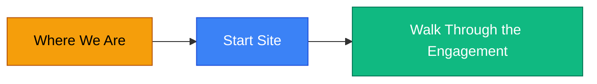

# 4a. Getting started: simple setup, shared context

::: tip &#8203;
A nontechnical contributor can get started with a short setup and plain-language requests. The lasting benefit is working from the team’s shared engagement context.
:::

Getting started does not require writing application code. The setup guide establishes a local workspace, and the assistant helps with repository tasks. Once connected, the contributor can use the engagement’s documents, workshop structure, and recorded progress to understand the work and contribute to it.

The supplied screenshots capture a small setup correction and a later contribution using `/discovery`.

## 1. A small setup issue, a simple correction

The repository clone succeeded. The next command failed because the `#` prompt symbol was copied along with the command. A short clarification identified the extra character and provided the command to use.

The example shows that a nontechnical contributor may need a little help with unfamiliar terminal conventions. The correction was small and specific.

[.png>)](<./getting started/image (1).png>)

_An extra copied character caused the setup issue; a brief clarification resolved what to enter._

## 2. Shared context makes contribution easier

In the later screenshot, a plain-language request brings in the latest changes from the main branch. The contributor then supplies workshop transcripts to `/discovery`, identifies the relevant workshops, corrects a meeting date, and asks for notes, outcomes, and transcript entries while preserving the agendas.

The request builds on the engagement’s existing structure. The contributor supplies the source material and context; the assistant can use the repository’s workflow and documents to carry out the requested work. The screenshot records the request, rather than its completed result.

_Plain-language instructions refer to shared workshops and artifacts without restating the engagement from scratch._

## What makes this useful

| Benefit                         | What it means for the contributor                                                                                |
| ------------------------------- | ---------------------------------------------------------------------------------------------------------------- |
| **A manageable start**          | A setup guide and a small amount of support establish the workspace.                                             |
| **Shared context**              | The contributor and assistant work with the same engagement documents and workshop structure.                    |
| **Engagement awareness**        | Recorded status, findings, and decisions provide a way to understand where the team is and what needs attention. |
| **Plain-language contribution** | Requests can describe the intended change, source material, and boundaries without writing application code.     |

Setup is the entry point. The ongoing value is being able to understand and contribute to the engagement with its context already available. Source material, corrections, and review still come from people.

## The flow

## Related references

- [Quick Walkthrough](<../AI SDLC/01 Engagement/07 Contribution/06 Quick Walkthrough.md>) — prompts for status, site preview, and engagement navigation
- [Claude Desktop Setup](<../AI SDLC/01 Engagement/07 Contribution/02 Claude Desktop Setup.md>) — contributor setup guide
- [Codex Desktop Setup](<../AI SDLC/01 Engagement/07 Contribution/03 Codex Desktop Setup.md>) — alternative contributor setup guide
- [Team Collaboration](<../AI SDLC/01 Engagement/07 Contribution/01 Team Collaboration.md>) — roles, contribution, and review
- [Where We Are](<../AI SDLC/01 Engagement/04 Where We Are/01 Engagement.md>) — recorded engagement status

---

[Presentation](index.md) · [Previous](<04 Collaboration.md>) · [Next](<06 Day-to-Day Collaboration Case.md>)

