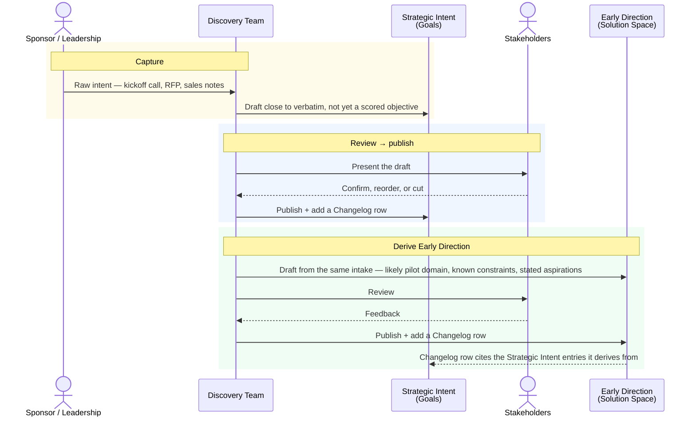
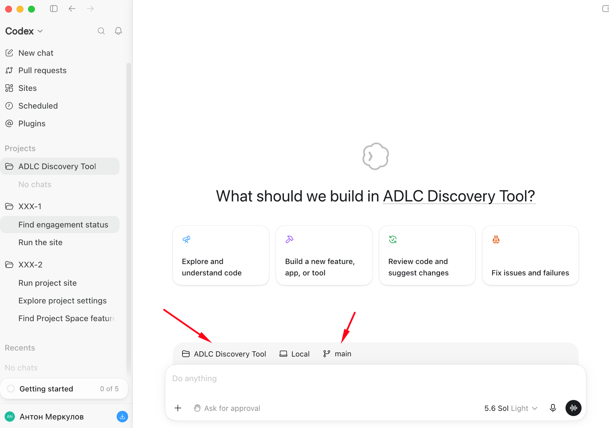

# Starting an engagement

[Presentation index](index.md) · [Previous](<05 Collaboration.md>) · [Next](<07 Collinson Example.md>)

**Agenda section 5 · Suggested slide 9**

## Audience takeaway

Starting an engagement combines technical workspace preparation with the human work of capturing and reviewing client intent.

## How initial intent becomes shared context

Source: [Initiation](<../AI SDLC/01 Engagement/05 Workflows/01 Initiation.md>). Diagram reused unchanged.

**Caption:** Capture sponsor intent, review it, publish it, and derive an explicitly tentative early direction.

## Bootstrap stages

The four stages below follow the repository’s `/bootstrap-client` workflow. This table is a presentation summary, not a replacement for the setup instructions.

| Stage                         | What gets prepared                                       | Who supplies the input              |
| ----------------------------- | -------------------------------------------------------- | ----------------------------------- |
| Environment and repository    | Working environment and client repository                | Technical setup owner               |
| Bootstrap                     | Client identity, configuration, and engagement narrative | Technical owner and engagement lead |
| Infrastructure and deployment | Hosted workspace and access configuration                | Technical owner                     |
| CI/CD                         | Publishing pipeline for reviewed changes                 | Technical owner                     |

Source: Bootstrap Client skill (`.claude/skills/bootstrap-client/SKILL.md`). The role split is suggested presentation guidance; confirm actual owners for the engagement.

## Existing interface illustration

**Caption:** Contributors work with a selected project and its context. This existing setup-guide image illustrates an entry point; it is not evidence that a new client workspace is already configured.

Source: [Codex Desktop Setup](<../AI SDLC/01 Engagement/07 Contribution/03 Codex Desktop Setup.md>).

## Presenter script and walkthrough

### Presenter narrative

> We start by preparing a client workspace and collecting the context that gives the engagement direction: who the client is, why the engagement exists, who is sponsoring it, the known constraints, and the people involved.
>
> The bootstrap flow covers repository and environment preparation, client personalization, infrastructure and deployment, and the publishing pipeline. The technical owner handles the technical setup. The engagement team supplies and reviews the client context and responsibilities.
>
> Once the workspace is ready, we review strategic intent and early direction at kickoff and plan the first evidence-gathering activities.

### Tool walkthrough

1. Show the required engagement inputs: identity, sponsor intent, team roles, constraints, and initial source material.
2. Introduce `/bootstrap-client` as the guided setup workflow.
3. Show a prepared result: client context, team responsibilities, and the workshop structure.
4. Explain what is ready to use and which engagement content still needs to be captured or reviewed.
5. Identify the technical setup contact and engagement lead: [NAMES OR ROLES].

Show the setup flow and its result within this segment; reserve full installation and deployment for separate onboarding.

### Transition

> We’ve covered the tool, its method, how people contribute, and how to get started. I’ll finish with a short real example so you can see those pieces together.

## Details to have ready

| Engagement input                             | Technical setup input                    |
| -------------------------------------------- | ---------------------------------------- |
| Client identity and sponsor                  | Client repository and access             |
| Strategic intent and known constraints       | Environment and deployment configuration |
| Engagement lead, contributors, and reviewers | Publishing setup and technical owner     |
| Initial source material and workshop plan    | Contributor setup guidance               |

The walkthrough describes the setup and shows prepared outputs. Do not run bootstrap against the working presentation repository during the session.

---

[Presentation index](index.md) · [Previous](<05 Collaboration.md>) · [Next](<07 Collinson Example.md>)
