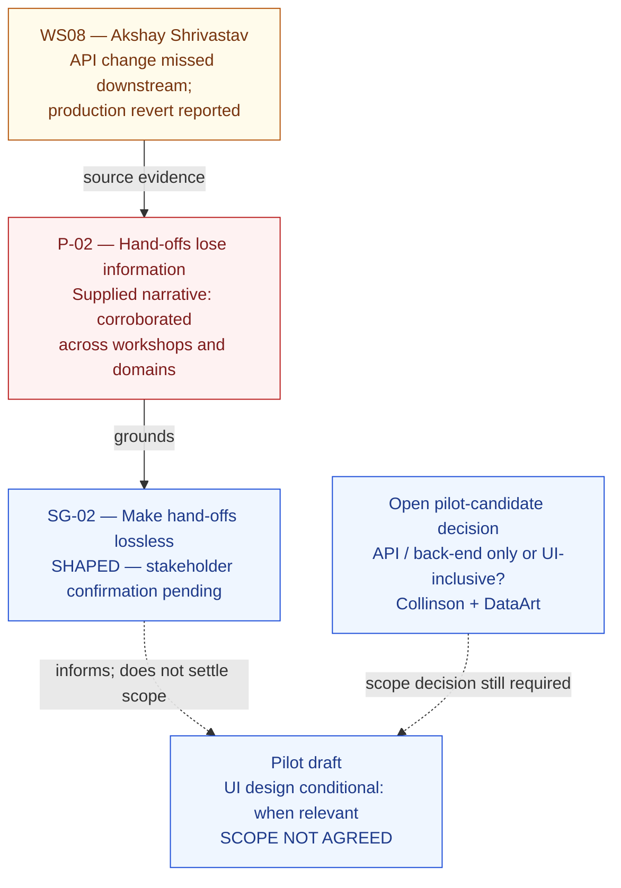

# Collinson: a real-world example

[Presentation index](index.md) · [Previous](<06 Starting an Engagement.md>) · [Next](<08 Discussion and Next Steps.md>)

**Agenda section 6 · Suggested slide 10**

## Audience takeaway

Collinson illustrates the tool’s three core ideas together: a finding grounded in evidence, visible review status, and shared ownership of the next decision.

## Case snapshot supplied in the workshop narrative

| Item          | Supplied case detail                                                     |
| ------------- | ------------------------------------------------------------------------ |
| Engagement    | Collinson Route-to-Live                                                  |
| Focus         | Hand-off and context losses slowing pre-code work; a Phase 1 pilot squad |
| Phase         | Solution; Gate 1 closed by engagement-lead direction on 1 October 2026   |
| Next gate     | Gate 2 not yet scheduled in the supplied snapshot                        |
| Finding       | P-02 — Hand-offs Lose Information Between Stages                         |
| Goal          | SG-02 — Make hand-offs lossless; Shaped, not yet confirmed goal-by-goal  |
| Pilot         | Draft; scope not yet agreed                                              |
| Open decision | API/back-end-only candidate versus a UI-inclusive candidate              |

**Presenter source note:** These details come from the user-populated [session narrative](index.md#_6-a-real-case-in-practice). This checkout contains starter templates, not the underlying Collinson workshop and gate records. Use the actual Collinson workspace for the live demonstration and recheck statuses before presenting. The local SG-02 placeholder has a different title and must not be shown as the Collinson goal.

## Apply the repository’s evidence chain to this case

**Diagram provenance:** Adapted from [Evidence Chain](<../AI SDLC/01 Engagement/03 Process/04 Evidence Chain.md>) using only the case details supplied in `docs/Demo/index.md`. Solid arrows show the stated evidence relationships; dashed arrows show a proposal or decision that remains open. This is a presentation illustration, not an independently verified client record.

**Reading cue:** A supported problem can ground a shaped goal while the pilot boundary remains unsettled. Gate progression and individual artifact status must both remain visible.

## Case narration

The purpose is to bring the three main ideas together in a real setting: a capability used, the evidence behind a finding, and the people who contributed or reviewed it. Choose one clear thread and rehearse direct navigation. Avoid a full client history or a second explanation of the methodology.

### Case overview and actual status

> This is the Collinson Route-to-Live engagement. It aims to find where AI can remove the hand-off and context losses that keep pre-code work slow, starting with a Phase 1 pilot squad, and is currently in Solution — Gate 1 closed by engagement-lead direction on 1 October 2026, Gate 2 not yet scheduled. I’ll show one finding: hand-offs lose information at stage boundaries, the engagement’s most corroborated problem.

### Source evidence and its linked interpretation

> This came from WS08, a workshop with Akshay Shrivastav. We recorded that a pre-announced API change wasn’t implemented by the downstream squad, causing a full production revert the week before the session, and connected it to P-02 — Hand-offs Lose Information Between Stages — confirmed across five SDLC domains and corroborated by over a dozen workshops. Here is the supporting link, and here is what remains uncertain: P-02 grounds Solution Goal SG-02, still 🔄 Shaped — evidenced, not yet confirmed goal-by-goal with Collinson.

### Furthest actual downstream artifact and next action

> That feeds the Pilot draft’s own open boundary: UI design is scoped as conditional, ‘when relevant,’ rather than settled — the live trace of Gate 1’s unresolved pilot-candidate disagreement between the CTO’s API/back-end-only proposal and the VP of Software Development’s UI-inclusive counter-proposal. Its review status is Draft — scope not yet agreed. The next action is resolving that disagreement ahead of WS05, jointly owned by Collinson and DataArt.

Within this walkthrough, identify who contributed and reviewed the material: “Akshay Shrivastav surfaced the hand-off failure at WS08; the DataArt discovery team synthesised it into P-02 and Solution Goal SG-02; Collinson and DataArt jointly own resolving the pilot-candidate decision it feeds into.” Use the actual division of work in the case.

Where the case has reached a pilot or roadmap, show the relevant connection briefly. If it has not, end at the current stage and state what is needed next. A proposed pilot is not an executed pilot; a target is not a measured result.

### Transition

> That is one concrete application of the structure we’ve discussed. Let’s turn to your questions and where you could see this fitting into your work.

## Open these in the Collinson workspace

| Order | Client artifact to locate                         | What to show                                                       |
| ----- | ------------------------------------------------- | ------------------------------------------------------------------ |
| 1     | WS08 record with Akshay Shrivastav                | The actual report of the missed API change and revert              |
| 2     | Problems → P-02                                   | Source links, corroboration, and actual status                     |
| 3     | Solution Goals → SG-02, “Make hand-offs lossless” | The problem relationship and Shaped status                         |
| 4     | Pilot Overview                                    | The conditional UI-design boundary and Draft status                |
| 5     | Gate 1, 03 September 2026 → Outcomes              | The pilot-candidate disagreement                                   |
| 6     | Engagement status / subsequent decision record    | The 1 October closure direction, outstanding work, and next action |

These are document locators from the supplied narrative, not working links to this starter repository. Keep the live route to two or three prepared tabs; use the rest for questions. Confirm the current meaning and timing of “ahead of WS05” in the client workspace rather than inferring dates from workshop numbers.

---

[Presentation index](index.md) · [Previous](<06 Starting an Engagement.md>) · [Next](<08 Discussion and Next Steps.md>)
