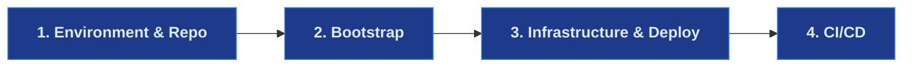

# 5. Launch a new client engagement

::: tip &#8203;
`/bootstrap-client` guides the setup from starter repository to a configured, deployed client workspace.
:::

The skill coordinates four stages, checks their outcomes, and records progress so setup can resume where it left off. Client details are collected through a short Q&A and applied deterministically by the bootstrap script.

| Stage                          | Result                                                                                                                 |
| ------------------------------ | ---------------------------------------------------------------------------------------------------------------------- |
| **1. Environment & Repo**      | Prerequisites and a separate client repository, detached from the starter’s history and origin.                        |
| **2. Bootstrap**               | Client identity, repository and deployment configuration, optional engagement narrative, and Discussions/Giscus setup. |
| **3. Infrastructure & Deploy** | Provisioned hosting, configured access protection, and the deployed documentation site.                                |
| **4. CI/CD**                   | GitHub environment and deployment configuration for ongoing automated delivery.                                        |

The developer prepares the environment and repository before invoking the skill. During setup, the skill guides the work and validates results; the developer runs provisioning and other external commands. Completion establishes the client workspace. Discovery findings and stakeholder decisions develop during the engagement.

## The flow

## Related references

- [README — Launching a new client engagement](https://github.com/DataArt/adlc-discovery-tool#launching-a-new-client-engagement) — repository setup and bootstrap entry point
- [Bootstrap skill](https://github.com/DataArt/adlc-discovery-tool/blob/main/.claude/skills/bootstrap-client/SKILL.md) — orchestration, validation, and progress tracking
- [Bootstrap plan](https://github.com/DataArt/adlc-discovery-tool/blob/main/.claude/skills/bootstrap-client/plan.md) — four-stage setup reference and original diagram

---

[Presentation](index.md) · [Previous](<06 Day-to-Day Collaboration Case.md>) · [Next](<08 Handoff Case.md>)
