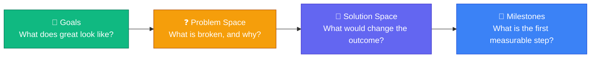

# 7. Questions worth asking

::: tip &#8203;
Understand the scope, the alternatives, and where human judgment stays essential.
:::

ADLC Discovery specializes an engagement method for understanding an SDLC and planning improvement. Its value is the connected evidence, decisions, and collaboration across that engagement.

::: details Why not OpenSpec?
OpenSpec organizes a software change through proposal, spec, design, and implementation. ADLC Discovery instead investigates a client’s SDLC, establishes supported problems and goals, and agrees an improvement roadmap. OpenSpec could pick up afterward; that’s a possible handoff, not something this kit integrates. [Source: OpenSpec’s default workflow](https://openspec.dev/docs/schemas/spec-driven).
:::

::: details Why not use the original Connect Framework?
Connect is the broader framework this tool is inspired by: Goals → Problem Space → Solution Space → Milestones, for a wide range of engagements. This tool narrows that to ADLC discovery only, adding Current State capture, SDLC domains, source traceability, and the Target State → Pilot → Scale → Evolve loop. [Source: local Connect adaptation](https://d2dn3olm9x55r4.cloudfront.net/AI%20SDLC/01%20Engagement/06%20Reference/01%20Connect%20Framework.html).
:::

::: details Is this a website, a methodology, or an AI tool?
All three work together: the repository stores evidence and decisions, the methodology structures discovery, the skills assist contributors, and the web app publishes navigable documentation.
:::

::: details Does AI make the decisions or approve gates?
AI helps prepare and check artifacts. People review interpretations and record stakeholder decisions. A generated document or completed checklist does not establish approval.
:::

::: details How do we trust a finding?
Follow its cited sources and confidence status. Independent corroboration supports confirmation; measured impact needs a number. Missing evidence remains an explicit gap. See [Evidence Chain](https://d2dn3olm9x55r4.cloudfront.net/AI%20SDLC/01%20Engagement/03%20Process/04%20Evidence%20Chain.html).
:::

::: details Is the whole lifecycle automated?
Investigation and gate preparation have guided workflows. The current discovery skill’s Solution and Roadmap routes remain manual handoffs; architecture design uses `/design`.
:::

::: details Can we contribute without writing application code?
Yes. Contribution includes workshop input, evidence review, clarification, and document changes. Repository changes still follow the shared branch, commit, and review flow.
:::

::: details What if new evidence contradicts an approved finding?
Preserve the source history, reopen the affected work, and revalidate downstream conclusions and gate readiness. The engagement is designed to evolve as the team learns.
:::

## Questions from the workshop — 8 October 2026

Raised live during the 8 October workshop. Kept here with attribution, the
same evidence discipline this tool asks of every other finding.

::: details What problem does the tool solve, and why do we need the evidence chain? — Pavel Khrulev, 15:27
Discovery produces scattered evidence: notes, assumptions, half-confirmed findings. The evidence chain keeps every recommendation traceable back through Solution Goals → Problems → Capture → Strategic Intent, each link citing its source and confidence, so new evidence can reopen the right step instead of the whole conclusion. See [Evidence Chain](https://d2dn3olm9x55r4.cloudfront.net/AI%20SDLC/01%20Engagement/03%20Process/04%20Evidence%20Chain.html).
:::

::: details Is the purpose to organise the discovery team's output? Is this basically a team workspace? — Viktoriya Zinovyeva, 15:36 & 15:43
Partly, but that's the mechanism, not the point. The repository is a shared workspace, discovery output lives there, reviewed through the same branch, commit, and pull-request flow as code. What it organises for is traceability under review: a stakeholder reads the same files to agree or challenge a finding. See [Collaboration](https://d2dn3olm9x55r4.cloudfront.net/Demo/04%20Collaboration.html).
:::

::: details What depth should architects show, and what here goes beyond tools any end user has? — Lyudmila Dezhkina, 15:41
This demo is about architects' involvement in the ADLC discovery phase, not about showing solution-architecture depth. Most of what's on screen is deliberately usable by a nontechnical contributor too (see [Getting Started Case](https://d2dn3olm9x55r4.cloudfront.net/Demo/05%20Getting%20Started%20Case.html)). Architectural judgment shows up later, in the Solution phase: target state, pilot scope, architecture alignment reviews, which this demo doesn't cover.
:::

::: details Could the same portal or knowledge base be built in Confluence, or a repo with the right structure? — Viktoriya Zinovyeva, 15:49; Alina Haloshyna
Yes, the publishing layer (structured pages, a searchable site) isn't the hard part; Confluence or a well-organised repo can do that too. Harder to replicate is the coupling: the same files hold the evidence and are what the AI skills read and write against, under the same review flow that publishes them. The storage medium was never the differentiator.
:::

::: details Which parts of the tool can be reused in another discovery engagement? — Viktoriya Zinovyeva, 15:54
The harness (skills, agents, conventions), the methodology skeleton (phases, gates, evidence chain), and the bootstrap tooling (`/bootstrap-client`). The team's practiced ways of working, running workshops against this structure, the citation-and-confidence discipline, transfer too. What doesn't transfer: the findings and recommendations themselves, since those belong to the engagement that produced them. See [Launching a New Client Engagement](https://d2dn3olm9x55r4.cloudfront.net/Demo/07%20Launching%20a%20New%20Client%20Engagement.html).
:::

::: details What am I missing? — Pavel Khrulev, 16:03, after 40 minutes of not seeing it
If evidence traceability and multi-person review aren't a constraint on how you work, a lighter personal setup (Obsidian, a repo, an assistant) may genuinely be enough. This tool is built for a team that must jointly justify its conclusions to a client, where "that was already covered" has to be checkable, not remembered. If that's not the working mode, the gap may be real.
:::

::: details Who is the intended audience for ADLC, given the session was billed for architects? — Lyudmila Dezhkina, 16:07
Architects, and the billing was accurate. Someone has to do the technical setup before a team can use this (environment, repository, bootstrap, deployment, see [Launching a New Client Engagement](https://d2dn3olm9x55r4.cloudfront.net/Demo/07%20Launching%20a%20New%20Client%20Engagement.html)), and architects drive the Investigate phase day to day. Mariam Chaduneli's broader read ("anyone running discovery") was reasonable, since a nontechnical contributor can use the tool once it's set up (see [Getting Started Case](https://d2dn3olm9x55r4.cloudfront.net/Demo/05%20Getting%20Started%20Case.html)); using it and setting it up are different jobs.
:::

::: details "What I understood is that a team worked out their way to process and organize project information in a way consumable for both people and agents (for Ludmila — general purpose agents )). That's good and a step forward, before that it would have been Confluence + Jira or just a team channel. In a small team and short term project Confluence + Jira + AI connectors to them might be too heavy, so here we have a 'portal'. What is transferrable to another project was not clear, but I'm sure there might be some useful skills at least. I did not know it was targeted to architects )" — Viktoriya Zinovyeva, closing summary
Three points, answered in order.

**The read on what this is:** correct. The team structured discovery information so both people and general-purpose agents can use it, a step up from Confluence + Jira or a team channel. A lighter "portal" fits a small, short-term project where Confluence + Jira + AI connectors would be overhead. It's the next level of structured team work for the ADLC discovery phase specifically.

**What's transferable:** the harness, methodology skeleton, bootstrap tooling, and the team's own practiced ways of working, see the entry above. Findings and recommendations stay engagement-specific.

**On not knowing it targeted architects:** it does, by design, see the entry above. The billing was accurate; what wasn't stated plainly was _why_ architects, worth saying up front next time.
:::

## The framework

## Related references

- [Connect Framework](https://d2dn3olm9x55r4.cloudfront.net/AI%20SDLC/01%20Engagement/06%20Reference/01%20Connect%20Framework.html) — broader methodology, adaptation, and original diagram
- [OpenSpec default workflow](https://openspec.dev/docs/schemas/spec-driven) — proposal, specification, design, and implementation tasks
- [Evidence Chain](https://d2dn3olm9x55r4.cloudfront.net/AI%20SDLC/01%20Engagement/03%20Process/04%20Evidence%20Chain.html) — confidence, citations, and corrections
- [Team Collaboration](https://d2dn3olm9x55r4.cloudfront.net/AI%20SDLC/01%20Engagement/07%20Contribution/01%20Team%20Collaboration.html) — contribution and review

---

[Presentation](https://d2dn3olm9x55r4.cloudfront.net/Demo/) · [Previous](https://d2dn3olm9x55r4.cloudfront.net/Demo/08%20Collinson%20Case.html)
