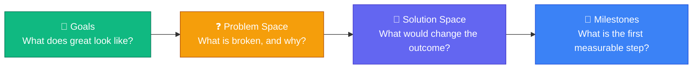

# 7. Questions worth asking

::: tip &#8203;
Understand the scope, the alternatives, and where human judgment stays essential.
:::

ADLC Discovery specializes an engagement method for understanding an SDLC and planning improvement. Its value is the connected evidence, decisions, and collaboration across that engagement.

::: details Why not OpenSpec?
OpenSpec’s default workflow organizes a software change through proposal, specifications, design, and implementation tasks. ADLC Discovery focuses on investigating a client’s SDLC, establishing supported problems and goals, and agreeing an improvement roadmap. OpenSpec could support subsequent implementation; that is a possible handoff, not an integration supplied by this kit. [Source: OpenSpec’s default workflow](https://openspec.dev/docs/schemas/spec-driven).
:::

::: details Why not use the original Connect Framework?
Connect is the broader framework and the inspiration for this tool. Its Goals → Problem Space → Solution Space → Milestones model serves a broad range of engagements. This tool narrows that methodology exclusively to ADLC discovery, adding Current State capture, SDLC domains, source traceability, Strategic Intent versus Solution Goals, and the Target State → Pilot → Scale → Evolve loop. [Source: local Connect adaptation](<../AI SDLC/01 Engagement/06 Reference/01 Connect Framework.md>).
:::

::: details Is this a website, a methodology, or an AI tool?
All three work together: the repository stores evidence and decisions, the methodology structures discovery, the skills assist contributors, and the web app publishes navigable documentation.
:::

::: details Does AI make the decisions or approve gates?
AI helps prepare and check artifacts. People review interpretations and record stakeholder decisions. A generated document or completed checklist does not establish approval.
:::

::: details How do we trust a finding?
Follow its cited sources and confidence status. Independent corroboration supports confirmation; measured impact needs a number. Missing evidence remains an explicit gap. See [Evidence Chain](<../AI SDLC/01 Engagement/03 Process/04 Evidence Chain.md>).
:::

::: details Is the whole lifecycle automated?
Investigation and gate preparation have guided workflows. The current discovery skill’s Solution and Roadmap routes remain manual handoffs; architecture design uses `/design`.
:::

::: details Can we contribute without writing application code?
Yes. Contribution includes workshop input, evidence review, clarification, and document changes. Repository changes still follow the shared branch, commit, and review flow.
:::

::: details What if new evidence contradicts an approved finding?
Preserve the source history, reopen the affected work, and revalidate downstream conclusions and gate readiness. The engagement is designed to evolve as the team learns.
:::

## The framework

## Related references

- [Connect Framework](<../AI SDLC/01 Engagement/06 Reference/01 Connect Framework.md>) — broader methodology, adaptation, and original diagram
- [OpenSpec default workflow](https://openspec.dev/docs/schemas/spec-driven) — proposal, specification, design, and implementation tasks
- [Evidence Chain](<../AI SDLC/01 Engagement/03 Process/04 Evidence Chain.md>) — confidence, citations, and corrections
- [Team Collaboration](<../AI SDLC/01 Engagement/07 Contribution/01 Team Collaboration.md>) — contribution and review

---

[Presentation](index.md) · [Previous](<08 Collinson Case.md>)
