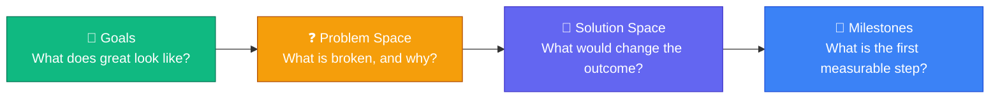

# 7. Questions worth asking

::: tip &#8203;
Understand the scope, the alternatives, and where human judgment stays essential.
:::

ADLC Discovery specializes an engagement method for understanding an SDLC and planning improvement. Its value is the connected evidence, decisions, and collaboration across that engagement.

::: details Why not OpenSpec?
OpenSpec’s default workflow organizes a software change through proposal, specifications, design, and implementation tasks. ADLC Discovery focuses on investigating a client’s SDLC, establishing supported problems and goals, and agreeing an improvement roadmap. OpenSpec could support subsequent implementation; that is a possible handoff, not an integration supplied by this kit. [Source: OpenSpec’s default workflow](https://openspec.dev/docs/schemas/spec-driven).
:::

::: details Why not use the original Connect Framework?
Connect is the broader framework and the inspiration for this tool. Its Goals → Problem Space → Solution Space → Milestones model serves a broad range of engagements. This tool narrows that methodology exclusively to ADLC discovery, adding Current State capture, SDLC domains, source traceability, Strategic Intent versus Solution Goals, and the Target State → Pilot → Scale → Evolve loop. [Source: local Connect adaptation](<../AI SDLC/01 Engagement/06 Reference/01 Connect Framework.md>).
:::

::: details Is this a website, a methodology, or an AI tool?
All three work together: the repository stores evidence and decisions, the methodology structures discovery, the skills assist contributors, and the web app publishes navigable documentation.
:::

::: details Does AI make the decisions or approve gates?
AI helps prepare and check artifacts. People review interpretations and record stakeholder decisions. A generated document or completed checklist does not establish approval.
:::

::: details How do we trust a finding?
Follow its cited sources and confidence status. Independent corroboration supports confirmation; measured impact needs a number. Missing evidence remains an explicit gap. See [Evidence Chain](<../AI SDLC/01 Engagement/03 Process/04 Evidence Chain.md>).
:::

::: details Is the whole lifecycle automated?
Investigation and gate preparation have guided workflows. The current discovery skill’s Solution and Roadmap routes remain manual handoffs; architecture design uses `/design`.
:::

::: details Can we contribute without writing application code?
Yes. Contribution includes workshop input, evidence review, clarification, and document changes. Repository changes still follow the shared branch, commit, and review flow.
:::

::: details What if new evidence contradicts an approved finding?
Preserve the source history, reopen the affected work, and revalidate downstream conclusions and gate readiness. The engagement is designed to evolve as the team learns.
:::

## Questions from the workshop — 8 October 2026

Raised live by the client team during a demo session billed for architects.
Kept here with attribution, the same evidence discipline the tool asks of
every other finding: a claim without its source is just an opinion.

::: details What problem does the tool solve, and why do we need the evidence chain? — Pavel Khrulev, 15:27
Discovery generates a lot of scattered evidence: workshop notes, assumptions, half-confirmed findings. Without a structure, a confident-sounding conclusion two weeks later can't be checked against what was actually said. The evidence chain keeps every recommendation traceable back through Solution Goals → Problems → Capture → Strategic Intent, each link carrying a citation and a confidence status, so a disagreement or a piece of new evidence can reopen exactly the right step instead of reopening the whole conclusion. See [Evidence Chain](<../AI SDLC/01 Engagement/03 Process/04 Evidence Chain.md>).
:::

::: details Is the purpose to organise the discovery team's output? Is this basically a team workspace? — Viktoriya Zinovyeva, 15:36 & 15:43
Partly, and that framing is fair as far as it goes. The repository is a shared workspace: the team's discovery output lives there, reviewed through the same branch, commit, and pull-request flow as code. But the workspace is the mechanism, not the point. What it's organising for is traceability under review, not just a shared place to store things, since the same files that hold the findings are what a stakeholder later reads to agree or challenge them. See [Collaboration](<04 Collaboration.md>).
:::

::: details What depth should architects show, and what here goes beyond tools any end user has? — Lyudmila Dezhkina, 15:41
Open. Nothing in this tool's documentation sets a depth bar for an architect-billed session, and this demo doesn't answer it either, since most of what's on screen (the repo, the skills, the published site) is usable by a nontechnical contributor by design (see [Getting Started Case](<05 Getting Started Case.md>)). That's a deliberate property, not architectural depth. Where architectural judgment actually shows up is in the Solution phase (target state, pilot scope, architecture alignment reviews) which this demo doesn't cover. Worth resolving directly with whoever scoped the session, not something the tool settles on its own.
:::

::: details Could the same portal or knowledge base be built in Confluence, or a repo with the right structure? — Viktoriya Zinovyeva, 15:49; Alina Haloshyna
Yes, honestly: the publishing layer (structured pages, a searchable site) is not the hard part, and Confluence or a well-organised repo can do that. What's harder to replicate there is the coupling: the same files that hold the evidence are what the AI skills read and write against, under the same review flow that publishes them, so methodology, evidence discipline, and tooling stay bound to one source instead of drifting apart. The storage medium was never the differentiator; the "Why not use the original Connect Framework?" entry above makes the same kind of honest comparison against a closer alternative.
:::

::: details Which parts of the tool can be reused in another discovery engagement? — Viktoriya Zinovyeva, 15:54
The harness (skills, agents, conventions), the methodology skeleton (phases, gates, evidence chain), and the bootstrap tooling that detaches a fresh client repository from the starter's history (`/bootstrap-client`). What does not transfer: the findings, evidence, and recommendations themselves, those are specific to the engagement that produced them. See [Launching a New Client Engagement](<07 Launching a New Client Engagement.md>).
:::

::: details What am I missing? — Pavel Khrulev, 16:03, after 40 minutes of not seeing it
Likely this: if evidence traceability and multi-person review aren't a constraint on how you work, a lighter personal setup (Obsidian, a repo, an assistant) may genuinely be enough, and nothing here claims otherwise. The tool is built for a team that has to jointly justify its conclusions to a client and to each other, where "that was already covered" has to be checkable, not remembered. If that's not the working mode, the gap he was describing may be real rather than a misunderstanding.
:::

::: details Who is the intended audience for ADLC, given the session was billed for architects? — Lyudmila Dezhkina, 16:07
Per [the "When to use this tool" table](<01 What Is This Tool.md#when-to-use-this-tool>), the audience is whoever owns discovery for an engagement: starting a client engagement, investigating recurring delivery problems, assessing AI adoption, or scoping a pilot. That's often an architect, but the table doesn't gate on the role. Mariam Chaduneli's read in the session (anyone running discovery, not only architects) matches what's actually written, not just an opinion offered in the moment.
:::

::: details The most balanced read from the session — Viktoriya Zinovyeva, closing summary
The team found a way to structure project information so both people and agents can use it, a step up from Confluence plus Jira or a team channel. A lighter "portal" makes sense for small, short projects. What's less clear is what transfers to other engagements, though some skills likely would. That reusability question is answered above; the rest is a fair standing critique, not refuted here.
:::

## The framework

## Related references

- [Connect Framework](<../AI SDLC/01 Engagement/06 Reference/01 Connect Framework.md>) — broader methodology, adaptation, and original diagram
- [OpenSpec default workflow](https://openspec.dev/docs/schemas/spec-driven) — proposal, specification, design, and implementation tasks
- [Evidence Chain](<../AI SDLC/01 Engagement/03 Process/04 Evidence Chain.md>) — confidence, citations, and corrections
- [Team Collaboration](<../AI SDLC/01 Engagement/07 Contribution/01 Team Collaboration.md>) — contribution and review

---

[Presentation](index.md) · [Previous](<08 Collinson Case.md>)
