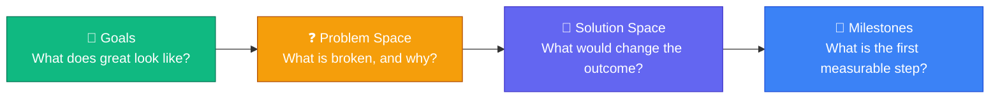

# 7. Questions worth asking

::: tip &#8203;
Understand the scope, the alternatives, and where human judgment stays essential.
:::

ADLC Discovery specializes an engagement method for understanding an SDLC and planning improvement. Its value is the connected evidence, decisions, and collaboration across that engagement.

::: details Why not OpenSpec?
OpenSpec’s default workflow organizes a software change through proposal, specifications, design, and implementation tasks. ADLC Discovery focuses on investigating a client’s SDLC, establishing supported problems and goals, and agreeing an improvement roadmap. OpenSpec could support subsequent implementation; that is a possible handoff, not an integration supplied by this kit. [Source: OpenSpec’s default workflow](https://openspec.dev/docs/schemas/spec-driven).
:::

::: details Why not use the original Connect Framework?
Connect is the broader framework and the inspiration for this tool. Its Goals → Problem Space → Solution Space → Milestones model serves a broad range of engagements. This tool narrows that methodology exclusively to ADLC discovery, adding Current State capture, SDLC domains, source traceability, Strategic Intent versus Solution Goals, and the Target State → Pilot → Scale → Evolve loop. [Source: local Connect adaptation](https://d2dn3olm9x55r4.cloudfront.net/AI%20SDLC/01%20Engagement/06%20Reference/01%20Connect%20Framework.html).
:::

::: details Is this a website, a methodology, or an AI tool?
All three work together: the repository stores evidence and decisions, the methodology structures discovery, the skills assist contributors, and the web app publishes navigable documentation.
:::

::: details Does AI make the decisions or approve gates?
AI helps prepare and check artifacts. People review interpretations and record stakeholder decisions. A generated document or completed checklist does not establish approval.
:::

::: details How do we trust a finding?
Follow its cited sources and confidence status. Independent corroboration supports confirmation; measured impact needs a number. Missing evidence remains an explicit gap. See [Evidence Chain](https://d2dn3olm9x55r4.cloudfront.net/AI%20SDLC/01%20Engagement/03%20Process/04%20Evidence%20Chain.html).
:::

::: details Is the whole lifecycle automated?
Investigation and gate preparation have guided workflows. The current discovery skill’s Solution and Roadmap routes remain manual handoffs; architecture design uses `/design`.
:::

::: details Can we contribute without writing application code?
Yes. Contribution includes workshop input, evidence review, clarification, and document changes. Repository changes still follow the shared branch, commit, and review flow.
:::

::: details What if new evidence contradicts an approved finding?
Preserve the source history, reopen the affected work, and revalidate downstream conclusions and gate readiness. The engagement is designed to evolve as the team learns.
:::

## Questions from the workshop — 8 October 2026

Raised live by the client team during a demo session billed for architects.
Kept here with attribution, the same evidence discipline the tool asks of
every other finding: a claim without its source is just an opinion.

::: details What problem does the tool solve, and why do we need the evidence chain? — Pavel Khrulev, 15:27
Discovery generates a lot of scattered evidence: workshop notes, assumptions, half-confirmed findings. Without a structure, a confident-sounding conclusion two weeks later can't be checked against what was actually said. The evidence chain keeps every recommendation traceable back through Solution Goals → Problems → Capture → Strategic Intent, each link carrying a citation and a confidence status, so a disagreement or a piece of new evidence can reopen exactly the right step instead of reopening the whole conclusion. See [Evidence Chain](https://d2dn3olm9x55r4.cloudfront.net/AI%20SDLC/01%20Engagement/03%20Process/04%20Evidence%20Chain.html).
:::

::: details Is the purpose to organise the discovery team's output? Is this basically a team workspace? — Viktoriya Zinovyeva, 15:36 & 15:43
Partly, and that framing is fair as far as it goes. The repository is a shared workspace: the team's discovery output lives there, reviewed through the same branch, commit, and pull-request flow as code. But the workspace is the mechanism, not the point. What it's organising for is traceability under review, not just a shared place to store things, since the same files that hold the findings are what a stakeholder later reads to agree or challenge them. See [Collaboration](https://d2dn3olm9x55r4.cloudfront.net/Demo/04%20Collaboration.html).
:::

::: details What depth should architects show, and what here goes beyond tools any end user has? — Lyudmila Dezhkina, 15:41
Open. Nothing in this tool's documentation sets a depth bar for an architect-billed session, and this demo doesn't answer it either, since most of what's on screen (the repo, the skills, the published site) is usable by a nontechnical contributor by design (see [Getting Started Case](https://d2dn3olm9x55r4.cloudfront.net/Demo/05%20Getting%20Started%20Case.html)). That's a deliberate property, not architectural depth. Where architectural judgment actually shows up is in the Solution phase (target state, pilot scope, architecture alignment reviews) which this demo doesn't cover. Worth resolving directly with whoever scoped the session, not something the tool settles on its own.
:::

::: details Could the same portal or knowledge base be built in Confluence, or a repo with the right structure? — Viktoriya Zinovyeva, 15:49; Alina Haloshyna
Yes, honestly: the publishing layer (structured pages, a searchable site) is not the hard part, and Confluence or a well-organised repo can do that. What's harder to replicate there is the coupling: the same files that hold the evidence are what the AI skills read and write against, under the same review flow that publishes them, so methodology, evidence discipline, and tooling stay bound to one source instead of drifting apart. The storage medium was never the differentiator; the "Why not use the original Connect Framework?" entry above makes the same kind of honest comparison against a closer alternative.
:::

::: details Which parts of the tool can be reused in another discovery engagement? — Viktoriya Zinovyeva, 15:54
The harness (skills, agents, conventions), the methodology skeleton (phases, gates, evidence chain), and the bootstrap tooling that detaches a fresh client repository from the starter's history (`/bootstrap-client`). What does not transfer: the findings, evidence, and recommendations themselves, those are specific to the engagement that produced them. See [Launching a New Client Engagement](https://d2dn3olm9x55r4.cloudfront.net/Demo/07%20Launching%20a%20New%20Client%20Engagement.html).
:::

::: details What am I missing? — Pavel Khrulev, 16:03, after 40 minutes of not seeing it
Likely this: if evidence traceability and multi-person review aren't a constraint on how you work, a lighter personal setup (Obsidian, a repo, an assistant) may genuinely be enough, and nothing here claims otherwise. The tool is built for a team that has to jointly justify its conclusions to a client and to each other, where "that was already covered" has to be checkable, not remembered. If that's not the working mode, the gap he was describing may be real rather than a misunderstanding.
:::

::: details Who is the intended audience for ADLC, given the session was billed for architects? — Lyudmila Dezhkina, 16:07
Architects, and the billing was accurate: correcting the read given in the session. Per the [Launching a New Client Engagement](https://d2dn3olm9x55r4.cloudfront.net/Demo/07%20Launching%20a%20New%20Client%20Engagement.html) page, someone has to do the technical setup before a team can use any of this (environment, repository, bootstrap, deployment), and that's architect-level work. Architects are also the ones actively driving the Investigate phase day to day. Mariam Chaduneli's read in the session ("anyone running discovery, not only architects") was reasonable from what was on screen, since the [Getting Started Case](https://d2dn3olm9x55r4.cloudfront.net/Demo/05%20Getting%20Started%20Case.html) shows a nontechnical contributor using the tool once it's set up, but using it and setting it up for a team are different jobs. Architects are the ones who can do both.
:::

::: details "What I understood is that a team worked out their way to process and organize project information in a way consumable for both people and agents (for Ludmila — general purpose agents )). That's good and a step forward, before that it would have been Confluence + Jira or just a team channel. In a small team and short term project Confluence + Jira + AI connectors to them might be too heavy, so here we have a 'portal'. What is transferrable to another project was not clear, but I'm sure there might be some useful skills at least. I did not know it was targeted to architects )" — Viktoriya Zinovyeva, closing summary
Three points in one message, each worth answering on its own rather than folding together.

**The read on what this is:** correct, and it's the core of it. The team worked out a structured way to process and organise discovery information so both people and general-purpose agents can use it, not a bespoke format only a specialist can parse. That's a step up from Confluence + Jira or a team channel, where the structure lives in people's heads and conventions, not in files an agent can read and write against under review. And the "too heavy for a small, short-term project" read is fair too: a lighter "portal" is exactly the right call when Confluence + Jira + AI connectors would be overhead the engagement doesn't need. It's the next level of structured team work specifically for the discovery phase, since that's this tool's whole scope: ADLC discovery, not delivery at large.

**What's transferable:** the harness (skills, agents, conventions), the methodology skeleton (phases, gates, evidence chain), and the bootstrap tooling that detaches a fresh client repository from the starter's history (`/bootstrap-client`) — the "Which parts of the tool can be reused in another discovery engagement?" entry above has the detail. What doesn't transfer is the findings, evidence, and recommendations themselves, since those belong to the engagement that produced them. The uncertainty in the room was fair: the demo showed the _output_ of one engagement, not the reusable parts in isolation, so "some useful skills, probably" was a reasonable read from what was actually on screen.

**Not knowing it targeted architects:** it does, by design — see the "Who is the intended audience for ADLC?" entry above. Architects are actively involved in the Investigate phase, and they're the technical people who can set the tool up for the team in the first place. The session billing was accurate; what wasn't stated plainly was _why_ architects specifically, and that's worth saying up front next time rather than leaving it implicit.
:::

## The framework

## Related references

- [Connect Framework](https://d2dn3olm9x55r4.cloudfront.net/AI%20SDLC/01%20Engagement/06%20Reference/01%20Connect%20Framework.html) — broader methodology, adaptation, and original diagram
- [OpenSpec default workflow](https://openspec.dev/docs/schemas/spec-driven) — proposal, specification, design, and implementation tasks
- [Evidence Chain](https://d2dn3olm9x55r4.cloudfront.net/AI%20SDLC/01%20Engagement/03%20Process/04%20Evidence%20Chain.html) — confidence, citations, and corrections
- [Team Collaboration](https://d2dn3olm9x55r4.cloudfront.net/AI%20SDLC/01%20Engagement/07%20Contribution/01%20Team%20Collaboration.html) — contribution and review

---

[Presentation](https://d2dn3olm9x55r4.cloudfront.net/Demo/) · [Previous](https://d2dn3olm9x55r4.cloudfront.net/Demo/08%20Collinson%20Case.html)
