# ADLC Discovery: from evidence to an actionable roadmap

::: tip &#8203;
Understand how delivery works today, agree what needs to change, and design the first step toward an AI-first SDLC.
:::

A shared workspace for ADLC discovery, inspired by the broader Connect Framework. The engagement connects current-state evidence to diagnosed problems, aligned goals, a proposed solution, and a delivery roadmap.

## Explore the tool

| Section | Presentation page                                                              |
| ------- | ------------------------------------------------------------------------------ |
| 1       | [What is this tool?](<01 What Is This Tool.md>)                                |
| 2       | [How the engagement runs](<02 How the Engagement Runs.md>)                     |
| 3       | [Evidence chain](<03 Evidence Chain.md>)                                       |
| 4       | [Collaboration](<04 Collaboration.md>)                                         |
| 4a      | [Getting started case](<05 Getting Started Case.md>)                           |
| 4b      | [Day-to-day collaboration case](<06 Day-to-Day Collaboration Case.md>)         |
| 5       | [Launching a new client engagement](<07 Launching a New Client Engagement.md>) |
| 6       | [Handoff case](<08 Handoff Case.md>)                                           |
| 7       | [Questions and answers](<09 Questions and Answers.md>)                         |

## The flow

```mermaid
flowchart LR
    IN["🗯️ Strategic Intent\nWhy does this engagement exist, raw?"]

    subgraph InvestigateGroup["🔍 Investigate: What's driving this, what's broken, and what's worth solving?"]
        direction TB
        G["🎯 Goals\nWhat's evidenced and worth solving?"]
        C["👁️ Capture\nWhat's actually happening today?"]
        P["❓ Problem\nWhat is broken, and why?"]
        C --> P --> G
    end

    subgraph SolutionGroup["🔧 Solution: What would change the outcome — not just the speed?"]
        direction TB
        TSt["Target State\nWhat does the end state actually look like?"]
        Pi["Pilot\nWhat's the one thing we prove first, and how?"]
        Sc["Scale\nHow does the proven pattern extend beyond the pilot?"]
        Ev["Evolve\nWhat do we change based on what we've learned?"]
        TSt --> Pi --> Sc --> Ev
        Ev -.->|"feed learnings back"| Pi
        Ev -.->|"refines"| TSt
    end

    R["🗺️ Roadmap\nWhat's the phased plan?"]

    IN -.->|"informs"| C
    IN -.->|"grounds + re-scopes"| G
    IN -.->|"anchors"| TSt
    InvestigateGroup --> SolutionGroup --> R

    classDef intent fill:#F59E0B,stroke:#B45309,color:#000
    classDef capture fill:#8B5CF6,stroke:#5B21B6,color:#fff
    classDef problem fill:#EF4444,stroke:#B91C1C,color:#fff
    classDef goals fill:#10B981,stroke:#047857,color:#fff
    classDef target fill:#8B5CF6,stroke:#5B21B6,color:#fff
    classDef pilot fill:#F59E0B,stroke:#B45309,color:#000
    classDef scale fill:#3B82F6,stroke:#1D4ED8,color:#fff
    classDef evolve fill:#10B981,stroke:#047857,color:#fff
    classDef roadmap fill:#3B82F6,stroke:#1D4ED8,color:#fff

    class IN intent
    class C capture
    class P problem
    class G goals
    class TSt target
    class Pi pilot
    class Sc scale
    class Ev evolve
    class R roadmap

    style InvestigateGroup fill:#F5F3FF,stroke:#8B5CF6,color:#6D28D9
    style SolutionGroup fill:#EEF2FF,stroke:#6366F1,color:#4338CA
```

## Related references

- [Process Overview](<../AI SDLC/01 Engagement/03 Process/01 Overview.md>) — engagement model and original diagram
- [Quick Walkthrough](<../AI SDLC/01 Engagement/07 Contribution/06 Quick Walkthrough.md>) — copyable prompts for exploring the workspace
