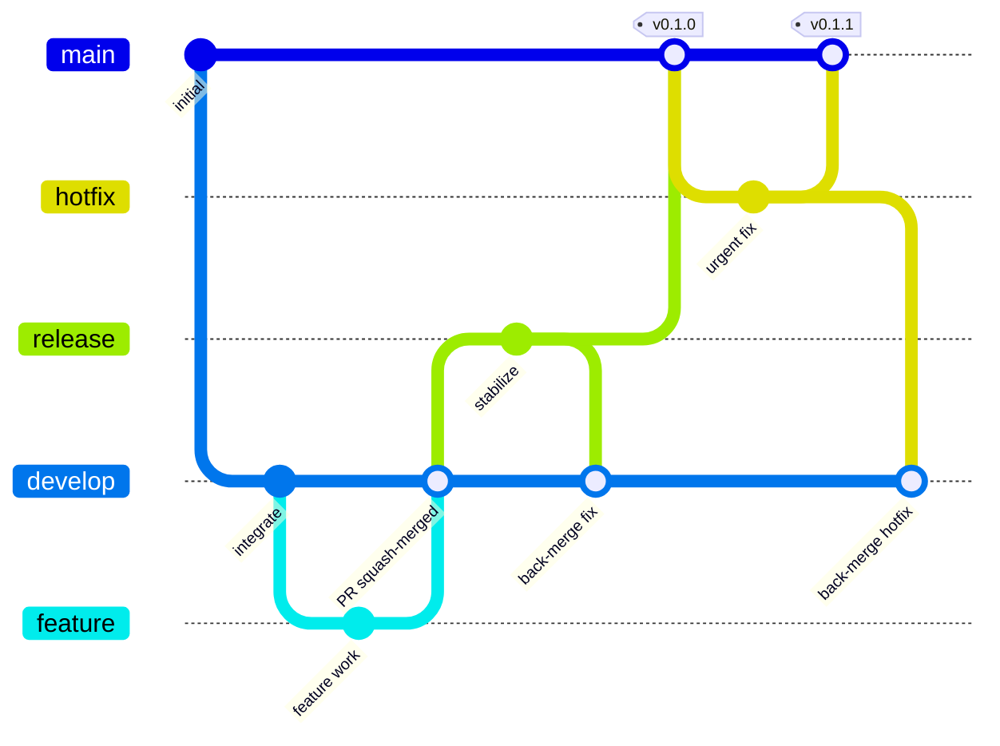

# Branching Strategy

The branching workflow follows Git Flow, aligned with the platform's environments and CI/CD automation
(temporary preview → Dev → Staging → Prod). Each stage enforces isolation, validation, and controlled
promotion of code — nothing reaches Production without passing through Dev and Staging first, except
hotfixes, which still require validation before merge.

## Flow

## Environment Mapping

| Branch Type | Environment Target      | Notes                                                                                 |
| ----------- | ----------------------- | ------------------------------------------------------------------------------------- |
| `main`      | Production, Performance | Tagged, stable builds only — Performance deploys the same tag to keep config mirrored |
| `hotfix/*`  | Staging                 | Urgent patches, validated before Production                                           |
| `release/*` | Staging                 | QA and bug fixes only, no new features                                                |
| `develop`   | Dev                     | Always up-to-date integration branch                                                  |
| `feature/*` | Temporary preview env   | Auto-created per PR, destroyed on merge                                               |

## Naming Conventions

- **Branches:** `feat/<jira>-<short-desc>`, `fix/<jira>-<short-desc>`, `release/<version>`,
  `hotfix/<version-or-jira>`
- **Tags:** `vX.Y.Z`
- **Commits:** [Conventional Commits](https://www.conventionalcommits.org/en/v1.0.0/#summary),
  required for semantic-release (`feat: ...`, `fix: ...`)

## CI/CD by Branch

| Trigger                             | Runs                                                                                      |
| ----------------------------------- | ----------------------------------------------------------------------------------------- |
| `feature/*` PR                      | Validation for affected apps; temporary preview environment created                       |
| `develop` / `release/*` / `main` PR | Full test suite + integration tests; validation, build, and deploy for affected apps      |
| `main` merge (from release/hotfix)  | Build, smoke test, deploy to Production; tag the release; run semantic-release            |
| `hotfix/*`                          | Fast path — build, targeted tests, deploy to Prod after approval; back-merge to `develop` |

## Branch Protection

| Branch      | Restrictions                                                                                                                                  |
| ----------- | --------------------------------------------------------------------------------------------------------------------------------------------- |
| `main`      | Direct pushes disabled; minimum 2 reviewers with at least one Code Owner approval; linear history (rebase & merge or squash)                  |
| `release/*` | Direct pushes disabled except CI/CD bot for tags/automated merges; minimum 1 reviewer with Code Owner approval; rebase & merge, no force-push |
| `develop`   | Direct pushes disabled; minimum 1 reviewer with Code Owner approval for owned paths; squash merge, no force-push                              |

Required status checks before merge: build (affected projects), unit tests, integration/e2e tests
(`develop`/`release/*`/`main`), lint/format, security scan (SCA + SAST), and a changelog-updated check
on `release/*`. Stale approvals are dismissed on new commits; all PR conversations must be resolved.

## Rollback Strategy

Every production deployment is tagged (e.g. `v1.6.0`), so any environment can be restored to a known
stable state without code changes:

1. Check out the target tag.
2. Run the deploy target for all affected apps (or a scoped subset).
3. CI/CD rebuilds and redeploys that exact tag across environments, using previously validated
   artifacts — no code modification required.

Database and content rollback safety comes from separate mechanisms (Liquibase for RDS, CMS
versioning) layered on top of this artifact-based rollback.

## Related

- [Accounts & Environments](Projects/Infrastructure/01%20Accounts%20%26%20Environments.md) — the dev/staging/production environments this branching model targets
- [Deployment](04%20Deployment.md) — how each merge actually builds and deploys, per project type
- [Architecture Overview](00%20Overview.md) — how the whole product fits together

_Source: adapted from Confluence "Branching Strategy" (space TS, page 20414501)._
