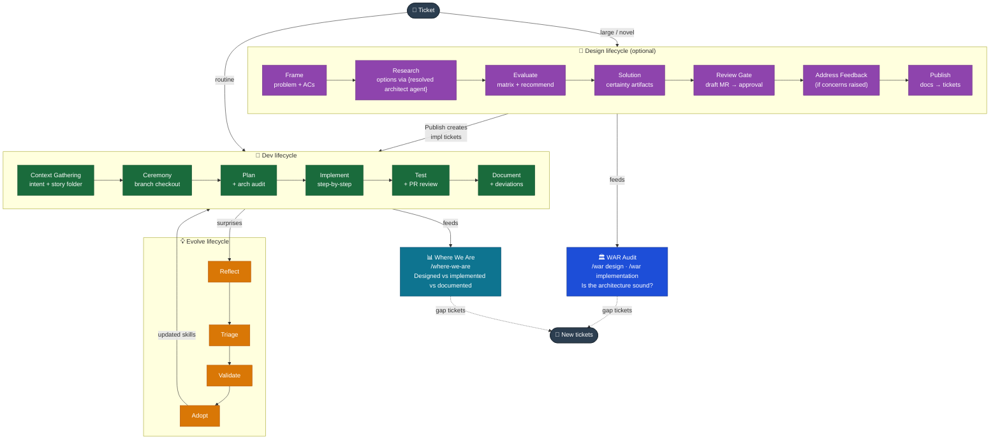

# Harness Bootstrap — Lifecycle Overview

_The four lifecycles, how they interact, and when to use each one._

---

## The four lifecycles

| Lifecycle        | Orchestrator            | Phases                                                                            |
| ---------------- | ----------------------- | --------------------------------------------------------------------------------- |
| **Dev**          | `/dev`                  | Context Gathering → Ceremony → Plan → Implement → Test → Document                 |
| **Design**       | `/design`               | Frame → Research → Evaluate → Solution → Review Gate → Address Feedback → Publish |
| **Evolve**       | `/evolve`               | Reflect → Triage → Validate → Adopt                                               |
| **Architecture** | — (standalone commands) | `/where-we-are` · `/war design` · `/war implementation`                           |

Each orchestrator runs all phases in one session, stopping at every boundary for confirmation. Individual phase commands (`/dev plan`, `/design frame`, etc.) allow resuming mid-flow. Evolve has no orchestrator chaining its stages — each is requested explicitly, based on evidence rather than elapsed time.

---

## When to use which lifecycle

| Situation                                     | Use                                            |
| --------------------------------------------- | ---------------------------------------------- |
| Any ticket — feature, bug fix, chore          | Dev lifecycle always                           |
| Ticket is large, novel, or crosses containers | Design lifecycle first, then Dev               |
| Something surprised you during a ticket       | Evolve lifecycle (Reflect)                     |
| 2–4 pending reflections                       | Evolve lifecycle (Triage)                      |
| End of sprint / before planning               | Architecture lifecycle (`/where-we-are`)       |
| After major HLD changes                       | Architecture lifecycle (`/war design`)         |
| Before a major release                        | Architecture lifecycle (`/war implementation`) |

**Design is optional.** Small, well-understood changes within a single container that introduce no new integrations or architecture decisions — skip Design, go straight to Dev.

---

## Cross-lifecycle invariants

- The AI does not move between phases without explicit developer confirmation.
- No code is written until the plan is approved and the architecture audit passes.
- Documentation is mandatory — tickets are not complete until `/dev document` has run.
- Architecture deviations approved at plan time are tracked through to the Document phase.
- Reflections are not optional ceremony — they are how conventions accumulate.

→ See `Engineering Guide/03 Engineer Role.md` for how engineers and AI divide responsibility within these lifecycles.

---

## Lifecycle interactions

---

→ `01 Dev Lifecycle.md` — Context Gathering → Ceremony → Plan → Implement → Test → Document  
→ `02 Design Lifecycle.md` — Frame → Research → Evaluate → Solution → Review Gate → Address Feedback → Publish  
→ `03 Evolve Lifecycle.md` — Reflect → Triage → Validate → Adopt  
→ `04 Architecture Lifecycle.md` — `/where-we-are` · `/war design` · `/war implementation`  
→ `05 Documents Flow.md` — how docs are born, graduate, and reach their permanent home
