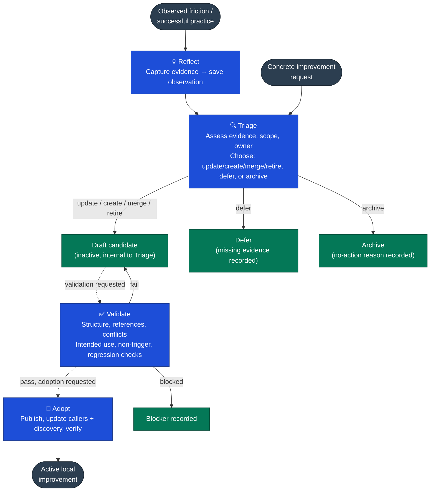

# Evolve Lifecycle — Reflect → Triage → Validate → Adopt

_Grows the shared convention library from observed friction, successful practice, or a concrete improvement request._

---

## Intent

The Evolve lifecycle is the harness's improvement mechanism. Each surprise during a ticket is a potential skill, agent, workflow, or convention change. Reflect captures it as evidence; Triage decides what action it warrants and prepares a draft candidate; Validate establishes evidence that the candidate works as intended; Adopt integrates it into the active harness.

Without this loop, the same conventions get re-discovered every ticket. With it, conventions accumulate — as validated, integrated changes, not elapsed-time guesses.

---

## When to use it

- **Reflect** — after any task where something surprised you: an approach that didn't work, a pattern you had to figure out, a convention you had to invent. Run it immediately; the memory fades quickly.
- **Triage** — after 2–4 pending reflections, or when a concrete improvement request comes in directly. Patterns need surface area to emerge from; triaging a single reflection produces weak drafts.
- **Validate** — once Triage has produced a draft candidate and it needs evidence before being trusted.
- **Adopt** — once a candidate has a passing Validate verdict and the developer accepts it.

## When NOT to use it

Do not reflect on outcomes that are obvious from reading the code. A skill encodes what a future developer would need to re-discover — if it is self-evident, it does not belong. Do not use Evolve for ordinary product changes — that's `/dev`.

---

## Flow



## Phases

**No orchestrator.** Each stage is invoked directly; there is no session-continuation protocol chaining them automatically.

| Phase        | Command                         | What it produces                                                                                             |
| ------------ | ------------------------------- | ------------------------------------------------------------------------------------------------------------ |
| **Reflect**  | `/evolve reflect <observation>` | Persisted observation in `.claude/reflections/{YYYY-MM-DD-HHMM}-{slug}.md`; stops                            |
| **Triage**   | `/evolve triage [request]`      | Inactive draft candidate(s) under `.claude/evolve/{timestamp}-{slug}/`, or a recorded defer/archive decision |
| **Validate** | `/evolve validate <candidate>`  | Evidence and a pass / fail / blocked verdict in the candidate's `Validation.md`                              |
| **Adopt**    | `/evolve adopt <candidate>`     | Integrated local change — active skill/agent/doc, callers and discovery updated                              |

Bare `/evolve` (no arguments) behaves as `/evolve triage` over pending reflections.

---

## Invariants

**Reflect:** A one-sentence brain-dump is enough — the stage structures it. Record what happened, what helped or caused friction, the impact, and supporting task evidence or attribution. Distinguish observations from suggested fixes; do not infer that an isolated experience is a universal rule. Never discard a reflection without saving it. This stage does not change the active harness.

**Triage:** Review saved observations (or a direct improvement request), identify the underlying concern and scope, and inspect the existing owner and affected callers. Choose exactly one action: **Update** (revise the existing owner), **Create** (add a skill, agent, convention, or supporting script where no suitable owner exists), **Merge** (consolidate overlapping guidance), **Retire** (propose removal with caller handling and rollback), **Defer** (preserve the observation with missing evidence and a reconsideration condition), or **Archive** (record why no harness change is warranted). For actionable items, prepare reviewable draft content, destination mappings, and acceptance criteria as an inactive candidate — draft is an internal Triage activity, not a separate command. `.claude/skills/drafts/{name}.md` is the legacy pre-Evolve draft location; a legacy draft found there may be imported into a new `.claude/evolve/` candidate without deleting the original, with the import source recorded in `Report.md`.

**Validate:** Check candidate structure, discovery metadata, references, and instruction conflicts. Exercise intended behavior, inappropriate triggers, and affected existing callers. Record inputs, expected and actual outcomes, methods, and limitations against the exact candidate content in `Validation.md`. Verdict is pass, fail (needs revision, returns to Triage's drafting activity), or blocked (records what evidence is needed to proceed). **Evidence determines readiness — there is no elapsed-time gate** (no "live for a week" waiting rule); a hash-based check on the exact candidate content is what Adopt re-verifies before publishing.

**Adopt:** Verify the candidate is accepted, its validation still applies (content hash unchanged since Validate), and the active destination has not changed since drafting. Publish the recorded changes: activate the skill/agent in its `name/SKILL.md` (or equivalent) layout, update callers, update discovery entries (`CLAUDE.md`'s skill/agent tables), and retire superseded content only where specified. Verify the installed content and its integration. Failed integration is recorded as incomplete, with recovery details — not silently dropped.

---

## Artifacts and ownership

- Observations live in `.claude/reflections/`, moved to `.claude/reflections/triaged/` or `.claude/reflections/archive/` via `git mv` once triaged.
- Candidate work lives under `.claude/evolve/{timestamp}-{slug}/` — `Report.md` (state, provenance, path mappings, content hashes, acceptance, next action), `candidate/` (the proposed content), and `Validation.md` (evidence). These are working artifacts, not discoverable active skills.
- `.claude/skills/drafts/{name}.md` is the legacy pre-Evolve draft import source only.
- Active skills deploy as `.claude/skills/{name}/SKILL.md`; active agents deploy as `.claude/agents/{name}.md`.
- `/patch prepare` and `/patch apply` remain the separate mechanism for syncing a skill or agent back to `.claude/skills/harness-bootstrap/canonical/` — Evolve does not replace that.

---

## What makes a good skill

A repeatable convention that cannot be inferred from the code alone — especially one discovered by getting it wrong first. If a future developer would need to re-discover it, it belongs in a skill. If it is obvious from reading the code, it does not.

---

## Cadence

```
/evolve reflect (×2–4) → /evolve triage → /evolve validate → /evolve adopt
```

Reflection capture and local adoption do not trigger the next lifecycle stage automatically — each stage is requested explicitly, based on evidence rather than elapsed time.
