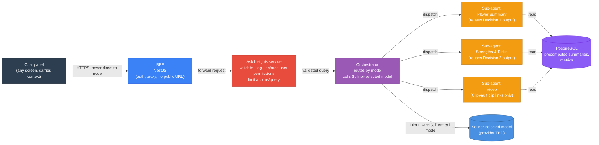
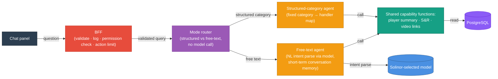
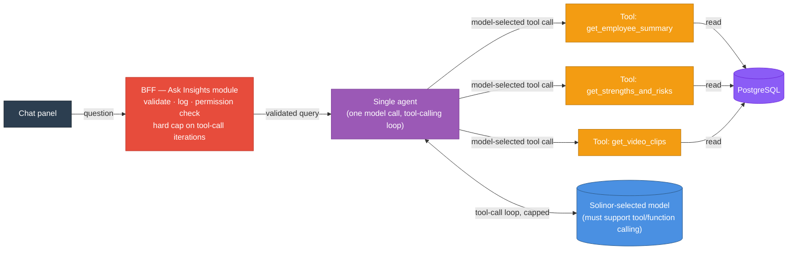
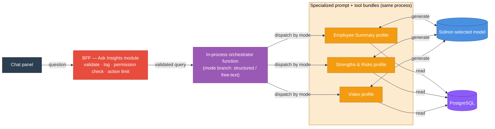
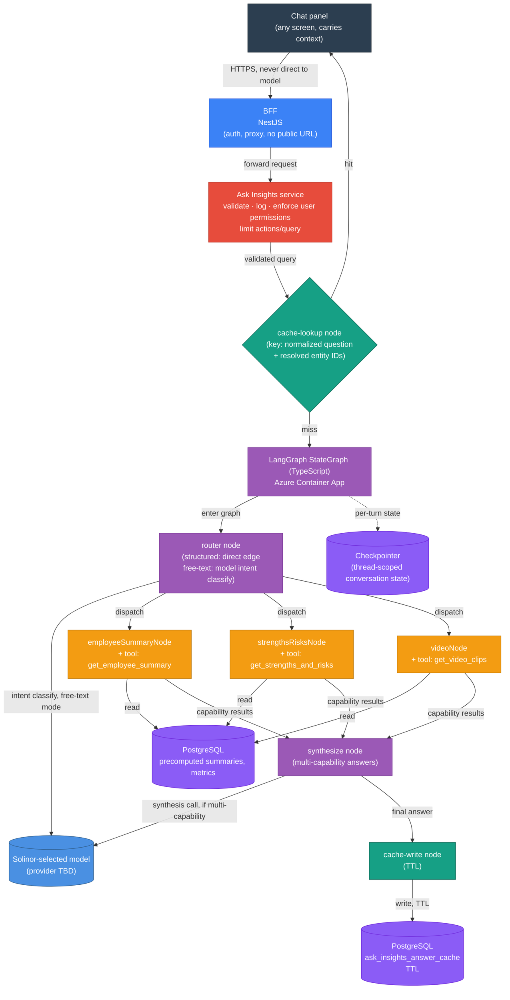

# ADLC-006: Ask Insights — Research

_Produced by the 🔍 Research phase. Owned by @architect. Do not edit after Evaluate phase begins._

## Context

This is Decision 3 of 3 in ADLC-006, scoped to the Full Release (it depends on Access Management landing in the same release). Two competing scoping descriptions exist for Ask Insights: an earlier "two-agent" framing (one agent for structured categories, one for free text) and a separately-drawn diagram (chat panel → Ask Insights backend service → Orchestrator → three sub-agents — Employee Summary, Strengths and Risks, Video — reading Solinor Insights data via BFF APIs). This research reconciles the two framings and lays out the real agent/orchestrator architecture options. Every option is bound by the same guardrails: server-side only, enforced with the asking user's own permissions at the data source, no elevated access for the assistant, a hard limit on actions per query, answers drawn only from Solinor Insights data (the assistant says so when an answer isn't available), clear failure messages, and video answers that only point to existing ClipVault clips — no hosting, proxying, or transcoding, and roughly a third of metrics have no footage at all.

Structural finding from this research: a live, per-request, synchronous (or streamed) conversational flow does not fit the Synthetic Layer's scheduled/event-driven batch runtime as currently documented (`03. Synthetic.md`). Every option therefore needs either a new NestJS module inside the existing BFF, or a new sibling container with an HTTP-triggered entry point reached only via the BFF (mirroring the existing `ComputeTriggerClient` pattern) — never a new scheduled Azure Function.

## Options

### Option A — Orchestrator + 3 sub-agents, as drawn

**Description:** Builds the diagram as sketched: chat panel → Ask Insights backend module (validate/log/permission-check/action-limit) → Orchestrator → three sub-agents (Employee Summary, Strengths & Risks, Video) → Solinor Insights data via BFF-owned data access. Reconciles the two competing framings by subordinating the two-agent-by-mode idea into the orchestrator: "structured category" and "free-text" are not agents, they are two routing strategies the orchestrator chooses between before fan-out to the same three sub-agents. A structured-category request skips model-based intent parsing (orchestrator maps category → sub-agent directly); a free-text request runs one model call to classify intent/extract entities, then the orchestrator dispatches to the same sub-agent(s). Hosting: new sibling container (own deployable) that the BFF calls synchronously, same shape as today's `ComputeTriggerClient` → Compute HTTP trigger but request/response, not fire-and-forget — not a Synthetic Layer scheduled Function.

**Industry precedent:** Multi-agent supervisor/sub-agent pattern — Microsoft Semantic Kernel's Planner-and-Skills model, LangGraph's "supervisor agent" pattern, and OpenAI's Agents SDK "triage + specialist agent handoffs" pattern all use a central router dispatching to narrowly-scoped specialist agents.

**Diagram:**

**Pros:**

- Matches the diagram scoping material already presented to stakeholders — least re-explaining.
- Clean separation of concerns: each sub-agent owns one data domain, so permission scoping per sub-agent (medical/talent-assessment restrictions) is easy to reason about rather than global.
- Reuses Decision 1/2 stored summaries directly — sub-agents are thin wrappers, not new generation logic.
- Natural place to enforce the per-query action-limit guardrail: the orchestrator counts sub-agent calls.

**Cons:**

- Most moving parts of any option — a new container, an orchestrator process, three agent modules — highest build/operate cost for a Full Release feature whose model provider isn't chosen yet.
- Four internal hops (BFF → Ask Insights service → Orchestrator → sub-agent → data) adds latency for what might be a simple structured lookup.
- "Orchestrator weighs agent responses" (per the diagram) implies a second model call to synthesize multiple sub-agent outputs into one answer — an extra cost/latency point not costed anywhere in Frame.

**Unknowns / risks:**

- Whether "weighing agent responses" needs a second model round-trip or can be deterministic (e.g. concatenate + light templating) is unresolved — materially changes cost per query.
- Sub-agent-to-sub-agent concurrency (does the orchestrator always call all three, or route to the one relevant to the category?) is undefined; calling all three per query multiplies model/API cost.

---

### Option B — Two mode-agents as the top-level split, orchestrator demoted to a thin router

**Description:** Takes the opposite reconciliation: the structured-category agent and the free-text agent are the two real top-level services, each independently calling the data layer. The "orchestrator" survives only as a thin, stateless mode classifier (is this a known category, or free text? — no model call needed) that forwards to whichever mode-agent applies. The three capabilities (Employee Summary, Strengths & Risks, Video) are demoted from sub-agents to shared internal library functions called directly by whichever mode-agent needs them — no separate sub-agent runtime boundary, no cross-agent protocol to weigh responses. Hosting: more plausible to host as two NestJS providers inside the BFF module itself rather than a separate deployable, since there's no live weighing/fan-out step.

**Industry precedent:** Mode-based intent routing without a central orchestrator — classic NLU-intent dispatch (Rasa-style intent → action mapping) for the structured path, paired with a separate free-form LLM handler; also resembles GitHub Copilot Chat's distinct "ask" vs. "agent" modes, separately coded pipelines rather than a shared orchestrator.

**Diagram:**

**Pros:**

- Smallest conceptual leap from the earlier "two-agent" scoping material — if that framing had more stakeholder buy-in, this costs less to re-sell.
- Structured-category path can be near-zero-cost (no model call at all) since the router is a deterministic lookup — directly serves the "pre-computed answers for common cases, fast" requirement.
- Fewer runtime hops than Option A for the common case.

**Cons:**

- Capability logic (employee summary, S&R, video) is duplicated or shared awkwardly across two independently-evolving agent codebases unless disciplined about the shared-library boundary — risks drift between what structured mode and free-text mode can answer.
- Loses the clean per-domain permission encapsulation Option A gets almost for free — permission scoping now has to be enforced identically in two call sites rather than once per sub-agent.
- Doesn't naturally extend if a fourth capability is added later — it has to be wired into both agents' logic, not just one new sub-agent.

**Unknowns / risks:**

- The final list of structured question categories (open, unresolved) is this option's single biggest implementation dependency — the structured agent's entire routing table is defined by that list, more than in any other option.

---

### Option C — Single agent, tool-calling (minimal/simplest alternative)

**Description:** Discards both framings as top-level architecture. One Ask Insights backend service does validate/log/permission-check/action-limit, then makes one model call using native tool/function-calling (`get_employee_summary`, `get_strengths_and_risks`, `get_video_clips`, `query_metric_catalog`), and the model itself decides which tool(s) to invoke, up to the action-limit guardrail enforced by the backend as a hard cap on tool-call iterations. "Structured categories" become pre-built prompt templates that short-circuit straight to a specific tool call; free text runs the full tool-selection loop. No orchestrator process, no separate sub-agent services — "sub-agent" becomes "tool definition." Hosting: most naturally a module inside the existing BFF — no new deployable needed.

**Industry precedent:** ReAct-style single-agent tool-calling (Yao et al., 2022) underlies most production non-RAG assistants today — OpenAI/Anthropic native function calling, and read-only, no-general-knowledge assistants like Linear's or Stripe's in-app AI helpers that answer only from the product's own data via a fixed toolset.

**Diagram:**

**Pros:**

- Fewest moving parts of any option — one service, one model call pattern, three tool functions. Lowest build and operate cost, most defensible for a feature whose model provider isn't chosen yet.
- The tool-calling loop is a natural, auditable enforcement point for "limit on actions per query" — the cap is simply "max N tool calls."
- Degrades cleanly to the "say so, don't guess" guardrail: a model with no matching tool for a question simply can't produce an answer outside Solinor Insights data, by construction.
- Scales smoothly if more capabilities are added later — a new tool, not new agent/sub-agent wiring.

**Cons:**

- Fully dependent on the eventual model provider supporting robust tool/function calling — not guaranteed until the Solinor's product owner provider decision lands.
- No clean separation point for per-capability permission scoping — the tool layer has to do all authorization itself, consistently, which concentrates risk in one place rather than three.
- Doesn't visually map to the orchestrator-plus-sub-agent diagram already shown to stakeholders — may read as under-delivering against expectations, even if functionally equivalent.

**Unknowns / risks:**

- Tool-calling reliability/latency varies significantly by model — a model needing multiple back-and-forth turns to pick the right tool could blow past the per-query action-limit or latency target.
- "Say so, don't guess" relies on prompt discipline and needs explicit testing, not just architecture.

---

### Option D — Router + specialized prompt/tool bundles (hybrid, single deployable)

**Description:** Keeps the vocabulary of the diagram (orchestrator, three named capabilities) but implements them as one in-process router inside a single service, not three independently-deployed sub-agent processes. A lightweight orchestration function branches on mode (structured category → direct prompt/tool bundle, free text → full NLU step), and each of the three "sub-agents" is a specialized system-prompt-plus-tool-binding configuration (not a separate runtime), all executed by one shared model-calling layer. Reconciles the two framings by treating both as true at different zoom levels — at the API/doc level, "orchestrator + 3 sub-agents"; at the deployment level, one process with three prompt profiles. Hosting: same minimal-footprint argument as Option C — most naturally a BFF module; a sibling service only if isolation/blast-radius reasons justify it later.

**Industry precedent:** Strategy-pattern-per-skill routing inside one service — comparable to Intercom Fin's and similar production support-bot architectures, which document "skills"/"topics" for stakeholders while implementing them as prompt/tool configurations in a single backend process rather than physically separate agents.

**Diagram:**

**Pros:**

- No new deployable and no inter-process "weighing" step, yet still documentable as "orchestrator + sub-agents" for stakeholders who were shown that diagram — lowest political cost of reconciliation.
- Per-profile permission scoping (medical/talent-assessment restrictions) is still cleanly separable, same as Option A, without the operational overhead of three separate services.
- Easiest option to evolve toward Option A later (promote a profile to its own service) or toward Option C (collapse profiles into one shared tool list) if load or team structure changes post-MVP.

**Cons:**

- "Orchestrator" and "sub-agent" become documentation-only distinctions inside one codebase — risk that engineers blur the boundaries over time without enforced module isolation (ESLint import-boundary rules would need to encode it, similar to the BFF/Compute/canonical layer-boundary checks already run elsewhere in this repo).
- Still needs a definition of "weighing agent responses" if a free-text question spans more than one profile (e.g. "summarize this employee and show me video of his key contributions") — same unresolved question as Option A, just inside one process instead of across three.

**Unknowns / risks:**

- Same "weigh agent responses" ambiguity as Option A.
- Relies on disciplined internal module boundaries to keep the three-profile illustration honest — a lint/review concern, not an architecture-blocking one.

---

### Option E — LangGraph (TypeScript) orchestrator on Azure, tool-based Postgres retrieval, TTL-cached answers

**Description:** Commits the "orchestrator + sub-agents" topology from Option A to a concrete, named implementation: a LangGraph (`@langchain/langgraph`, TypeScript) `StateGraph` running inside a new Azure Container App (or the existing BFF process, if footprint rules it out — same hosting fork as A/D). The graph has one node per role: a `router` node (structured-category → direct edge, free-text → model-based intent classification), three capability nodes (`employeeSummaryNode`, `strengthsRisksNode`, `videoNode`) each bound to a narrow tool-call surface (`get_employee_summary`, `get_strengths_and_risks`, `get_video_clips` — same tool shape as Option C, just invoked from graph nodes instead of a single agent's tool loop), and an optional `synthesize` node for multi-capability answers (makes "weighing" an explicit, named graph node rather than an undefined behavior, resolving the ambiguity shared by Options A/D). A `cache-lookup` node runs before the router and a `cache-write` node runs after synthesis, backed by a new Postgres table (`ask_insights_answer_cache` or similar, TTL column + cache-key = normalized question text + resolved employee/metric IDs — no embeddings/vector search, consistent with RAG being out of scope for M1.5). Tool implementations query PostgreSQL directly — no vector DB, no document retrieval; "tool-based retrieval" means typed function calls against structured tables, same data-access boundary as every other option. LangGraph's built-in checkpointer (`PostgresSaver` or `MemorySaver`) is evaluated as the mechanism for in-conversation short-term memory, persisting per-thread state across turns without hand-rolled session storage.

**Industry precedent:** LangGraph's documented "multi-agent supervisor" and "hierarchical agent teams" patterns are the canonical reference implementation of exactly this topology (router node dispatching to specialist sub-graphs/nodes). Production users of LangGraph JS/TS for this shape include Replit's Agent, Klarna's support assistant, and Uber's internal developer-tooling agents — all graph-based supervisor/specialist architectures with tool-based (not RAG) retrieval over internal structured data sources.

**Diagram:**

**Pros:**

- Gives Option A's diagram a concrete, buildable implementation instead of an unnamed "orchestrator" — removes a build-time unknown that A, B, and D all leave open
- Checkpointing is a first-class LangGraph primitive, not something to hand-build — resolves the existing open question about short-term memory storage with an off-the-shelf mechanism, and gives resumable/replayable runs for debugging production incidents
- Native streaming support matches the "synchronous (or streamed) conversational flow" requirement without custom SSE/chunking plumbing
- Makes the "weighing agent responses" ambiguity (shared with A/D) concrete and named — the `synthesize` node is where that behavior lives and gets tested, rather than an undefined step
- The TTL answer cache is a natural extra node in a graph pipeline — addresses a gap in caching Ask Insights's own output that A–D don't cover (they only reuse Decision 1/2's stored summaries as inputs, not cache their own conversational answers)

**Cons:**

- Introduces a named third-party framework dependency and its idioms (nodes, edges, state reducers, checkpointers) the team has to learn — a different kind of cost than A/B/C/D's "more services" or "more hops" costs
- LangGraph's TypeScript package is less mature and less widely production-proven than its Python counterpart — graph-based multi-agent frameworks carry lock-in risk: migrating off LangGraph later means rewriting orchestration logic, not just swapping a library call
- Checkpointer and answer-cache tables both want a Postgres footprint inside the app-db schema — adds schema-ownership questions not present in any other option
- LangGraph's natural observability companion (LangSmith) is a hosted SaaS product — raises a data-residency question for a club handling medical/talent-assessment data that none of A–D have to answer
- Still inherits Option A's open question about whether all three capability nodes fire per query or route selectively (cost multiplier risk), plus Option C's open question about model tool-calling reliability for the router's free-text classification step

**Unknowns / risks:**

- Whether LangGraph's TS checkpointer Postgres schema can live alongside the app-db's Drizzle-managed schema without migration-tooling conflicts, or needs a separate connection/schema
- Cache-key design for the answer cache (exact-match normalized text vs. some fuzzy/canonicalization step) is undefined, since vector/embedding matching is out of scope, near-duplicate questions won't hit cache, limiting real-world hit rate
- Whether LangSmith (or an equivalent tracing layer) is adopted for observability, and whether that's acceptable given data sensitivity, is unresolved
- TTL value and invalidation trigger (e.g. does updating a employee's underlying metrics in Decision 1/2 invalidate cached Ask Insights answers that reference them?) is undefined

---

## Open Questions

| #   | Question                                                                                                                                                                                                                                                                                                                       | Owner                             |
| --- | ------------------------------------------------------------------------------------------------------------------------------------------------------------------------------------------------------------------------------------------------------------------------------------------------------------------------------ | --------------------------------- |
| 1   | Final list of structured question categories. (Evaluation-input for A/C/D — only affects completeness/effort since they route dynamically or via shared tools; borderline-Viability for B, since its structured agent's entire routing table is this list)                                                                     | Solinor / product                 |
| 2   | Numeric limit on actions per query. (Evaluation-input for all options — every option already has a defined enforcement point; the ceiling is a tuning parameter)                                                                                                                                                               | Solinor                           |
| 3   | Model provider (pending a sync with Solinor's product owner). (Viability-blocking for Option C — its design assumes robust native tool/function calling; Evaluation-input for A/B/D, which can route via simpler prompt-based instruction-following if needed)                                                                 | sync with Solinor's product owner |
| 4   | Does a multi-capability answer need a second model synthesis call ("weighing agent responses")? (Evaluation-input for A and D, which have a literal fan-out step; not applicable for B and C)                                                                                                                                  | @architect                        |
| 5   | Hosting substrate — new sibling container vs. BFF module. (Evaluation-input for all options — primarily a cost/ops/blast-radius trade-off; flagged because none of A–D should default into a new scheduled Synthetic-Layer Function, which doesn't fit a live request)                                                         | @architect                        |
| 6   | Short-term (in-conversation) memory storage location. (Evaluation-input for all options — in-scope per Frame constraints as session-only; storage choice affects cost/scale, not viability)                                                                                                                                    | @architect                        |
| 7   | Cost/rate-limit enforcement granularity (per-user, per-environment, per-query). (Evaluation-input for all options — the proposed Cost guardrail EC is still [proposed], not committed)                                                                                                                                         | Solinor                           |
| 8   | If a framework-committed option (E) is pursued over a hand-rolled orchestrator (A/D), is LangGraph (TS) the team's preferred choice, or should a comparable alternative (Azure AI Agent Service, Mastra, etc.) also be evaluated? (Viability-blocking for Option E specifically — doesn't affect A–D)                          | @architect / Solinor              |
| 9   | TTL and cache-key strategy for Ask Insights's own answer cache (distinct from Decision 1/2's summary caches) — exact-match only, or some normalization step, given vector matching is out of scope. (Evaluation-input — affects cache hit-rate/usefulness, not viability)                                                      | @architect                        |
| 10  | Does the LangGraph checkpointer's Postgres footprint need to live inside the app-db library's schema/migration ownership, or as a separate connection? (Evaluation-input for Option E — ops/ownership question, not a blocker)                                                                                                 | @data / @architect                |
| 11  | Is a hosted tracing/observability tool (e.g. LangSmith) acceptable given the sensitivity of medical/talent-assessment data surfaced through Ask Insights, or must observability stay in-house? (Evaluation-input for Option E — data-residency concern specific to adopting a third-party agent framework's companion tooling) | Solinor / Security                |
